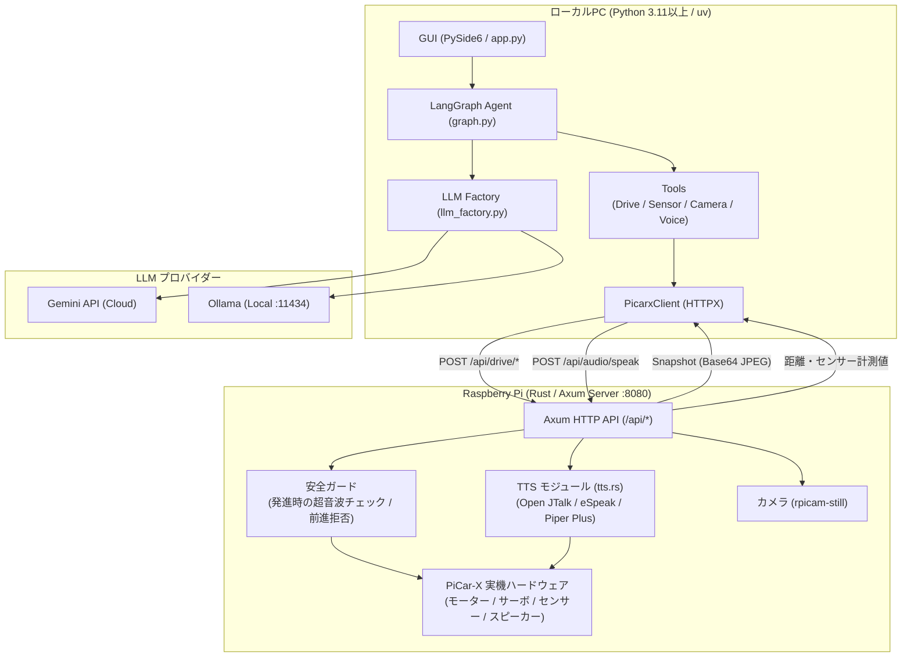

# PiCar-X Agentic AI Controller 仕様書

## 1. 文書概要

本書は、ローカルPC上のPython GUIと、Raspberry Pi上のRust APIサーバーで構成されるPiCar-X制御アプリケーションの現行仕様を定義する。

対象システムは、以下の機能を提供する。

- GeminiまたはOllamaを利用した自然言語チャット
- Raspberry Pi上のPiCar-X車体制御
- 超音波センサーによる距離測定
- カメラ画像の自動取得とGUI表示
- Raspberry Pi側のローカルTTSによる音声再生

音声入力、永続的な会話記憶（Python GUI）、電池などの状態を踏まえた会話は未実装である。目標の仕様は [§14](#14-会話-agent-の目標仕様未実装) に記載する。

> [!NOTE]
> - プロジェクト全体の開発ロードマップ・進捗状況は [ROADMAP.md](ROADMAP.md) を参照してください。
> - End-to-End (E2E) 自律走行および MLOps パイプラインの仕様については、[E2E_SPECIFICATION.md](E2E_SPECIFICATION.md) を参照してください。
> - 未修正の課題は [REVIEW_FINDINGS.md](REVIEW_FINDINGS.md) を参照してください。

## 2. システム構成



### 2.1 PC側

- 実装言語: Python 3.11以上（開発環境の固定は `.python-version` の 3.13）
- GUI: PySide6
- LLM制御: LangChain / LangGraph
- HTTPクライアント: HTTPX
- 設定ファイル: `.env`
- エントリポイント: `python -m src.gui.app`

主な実装ファイル:

- `python/src/gui/app.py`
- `python/src/config.py`
- `python/src/llm_factory.py`
- `python/src/picarx_client/client.py`
- `python/src/agents/graph.py`

### 2.2 Raspberry Pi側

- 実装言語: Rust
- HTTPサーバー: Axum
- ハードウェア制御: rppal / PiCar-X実装
- APIポート: `8080`
- エントリポイント: `rust/src/main.rs`

主な実装ファイル:

- `rust/src/api/mod.rs`
- `rust/src/api/handlers.rs`
- `rust/src/api/hardware.rs`
- `rust/src/tts.rs`

動作モードは次の2つ。

| モード | 起動 | 内容 |
|---|---|---|
| API サーバー（既定） | `./picar-x-rust` | Python GUI と E2E が接続する。Python 側の LLM を使用 |
| 旧 Rust GUI | `./picar-x-rust --gui` | Pi 上の GUI。Rust 内の LLM クライアント、会話メモリ（§13）、押して話す録音を使用 |

ハードウェアの初期化に失敗すると、API サーバーはエラーで終了する。開発用にモックで起動する場合は `PICARX_ALLOW_MOCK=1` を明示する。

## 3. GUI仕様

### 3.1 画面構成

画面は左右2カラムで構成する。

左カラム:

- LLMモデル選択
- カメラ画像表示
- 距離センサー表示
- 安全状態表示
- 手動車体制御
- 緊急停止

右カラム:

- チャット履歴
- ユーザー入力欄
- Sendボタン

### 3.2 モデル選択

現在のモデルプリセットは以下のとおり。

| 表示モデル | 内部モデルID | 用途 |
|---|---|---|
| Gemini Flash | `gemini-3.8-flash` | デフォルト。通常の対話・制御 |
| Gemini Flash-Lite | `gemini-3.5-flash-lite` | 低コスト・低遅延 |
| Gemini Pro | `gemini-3.1-pro-preview` | 高度な推論 |
| Ollama Local | `ollama/qwen2.5:7b` | ローカルLLM |

モデル変更時はLangGraphを再生成する。

既定モデルは Gemini で、チャット内容は Gemini API へ送信される（意図した利用。ROADMAP の D-3）。

Gemini APIが503 `UNAVAILABLE` となった場合は、以下の順で復旧を試みる。

1. LangChainの内部再試行
2. 3秒待機後の再試行
3. `gemini-3.5-flash-lite` へのフォールバック

429 `RESOURCE_EXHAUSTED` はAPIクォータ超過であり、アプリケーション側ではクォータを増加できない。

### 3.3 チャット処理

通常のメッセージは以下の処理を行う。

1. GUIにユーザー入力を表示
2. `HumanMessage` として会話履歴へ追加
3. LangGraphを実行
4. 最新のAIメッセージからテキストを抽出
5. GUIにAssistant返信を表示
6. Assistant返信をPi側TTS APIへ送信

会話履歴はプロセス内のリストのみで、アプリを終了すると消える。

Gemini 3.xの応答がテキストブロック配列の場合は、`type == "text"` の要素だけを抽出して表示する。署名やメタデータは表示しない。

### 3.4 直接発話コマンド

以下の入力はGeminiを経由せず、Pi側TTS APIを直接呼び出す。

| 入力例 | 発話内容 |
|---|---|
| `喋って` | `こんにちは。PiCar-Xです。` |
| `喋って こんにちは` | `こんにちは` |
| `喋って「おはようございます」` | `おはようございます` |
| `しゃべって...` | 指定された内容 |
| `話して...` | 指定された内容 |
| `発話して...` | 指定された内容 |

直接発話ではGemini APIを使用しないため、Geminiのクォータを消費しない。

### 3.5 チャット履歴エラー対策

LLM呼び出し失敗時は、未完了のユーザー発話を会話履歴から削除する。これにより、失敗後の再送信でGeminiのfunction call turn順序が壊れることを防ぐ。

## 4. カメラ仕様

### 4.1 現在の方式

GUI起動後、1秒間隔で `/api/camera/snapshot` を自動呼び出しする。

- 画像サイズ: `320 x 240`
- 形式: JPEG
- JPEG品質: 70
- 通信形式: HTTP JSON + Base64
- GUI表示: Base64復号後のQImage/QPixmap

現在はMJPEGやH.264による連続動画ストリームではなく、1秒ごとの自動スナップショット更新である。

### 4.2 Raspberry Pi側の撮影コマンド

Rust APIサーバーは次の順でカメラコマンドを実行する。

1. `rpicam-still`
2. 起動できない場合は `libcamera-still`

どちらも利用できない場合、APIはHTTP 500を返し、GUIには `Camera Error` を表示する。

### 4.3 カメラ表示状態

| 状態 | GUI表示 |
|---|---|
| 起動直後 | `Camera Connecting...` |
| 取得成功 | JPEG画像 |
| 取得失敗 | `Camera Error: ...` |

カメラ取得成功ログをチャット欄には表示しない。

## 5. センサー仕様

距離センサーは2秒間隔でポーリングする。

| 距離 | 安全状態 |
|---:|---|
| 15cm未満 | `ALERT: Obstacle Close!` |
| 15cm以上 | `SAFE (Limiter Active)` |

APIエラー時は距離表示を `Disconnected` に変更する。

## 6. 手動制御仕様

GUIから以下の操作を実行できる。

| 操作 | API | 初期値 |
|---|---|---|
| 前進 | `POST /api/drive/move` | speed 30, 400ms |
| 後退 | `POST /api/drive/move` | speed 30, 400ms |
| 左操舵 | `POST /api/drive/steer` | -30度 |
| 右操舵 | `POST /api/drive/steer` | 30度 |
| 中央復帰 | `POST /api/drive/steer` | 0度 |
| 緊急停止 | `POST /api/drive/emergency_stop` | 即時停止。解除するまで走行を拒否 |
| 緊急停止の解除 | `POST /api/drive/emergency_stop/reset` | 車両は動かさない |

前進時はRust側の安全ガードが、命令の受信時に超音波距離を確認する。危険距離の場合、前進命令を拒否する。走行中の監視は行わない。

通信は背景スレッドのイベントループで実行するので、LLM の応答待ち中も GUI は操作できる。緊急停止はこのループとも別の専用スレッドから送信する。

## 7. Raspberry Pi API仕様

ベースURLは環境変数 `ROBOT_BASE_URL` で指定する。デフォルト値は `http://raspberrypi.local:8080`。

| Method | Endpoint | 機能 |
|---|---|---|
| POST | `/api/drive/move` | 前進・後退・停止。`speed` は 0〜100、`duration_ms` は 50〜5000（範囲外は 400）。緊急停止中の前進・後退は 409 |
| POST | `/api/drive/steer` | ステアリング角度変更 |
| POST | `/api/drive/stop` | 通常停止。以後の走行は拒否しない |
| POST | `/api/drive/emergency_stop` | 緊急停止。解除するまで走行を拒否する |
| POST | `/api/drive/emergency_stop/reset` | 緊急停止の解除 |
| GET | `/api/sensor/ultrasonic` | 超音波距離取得 |
| GET | `/api/sensor/grayscale` | グレースケール取得 |
| POST | `/api/audio/speak` | TTS生成・スピーカー再生 |
| GET | `/api/audio/listen` | **スタブ**。常に固定文字列を返す |
| GET | `/api/camera/snapshot` | JPEG Base64画像取得（320×240 固定。クライアントの `width` と `quality` は無視される） |

全エンドポイントで `Authorization: Bearer <トークン>` が必須で、不正な場合は 401 を返す。CORS は許可しない。通信は暗号化していないので、信頼できる LAN 内でのみ使用する。電池の値は内部で取得しているが、API では公開していない。

## 8. TTS仕様

### 8.1 エンジン種別

| エンジン | 定数 | 言語 | 品質 |
|---|---|---|---|
| Default (標準) | `TtsEngine::Default` | 日本語 → Open JTalk / 英語 → eSpeak-ng | 標準 |
| PiperPlus (高品質) | `TtsEngine::PiperPlus` | 日本語・英語を含む6言語 | 高品質 (Tsukuyomi-chan モデル) |

エンジンは Rust GUI 側のラジオボタンで切り替えられる。Python GUI 側からは現在選択不可（§12参照）。

### 8.2 処理経路

Python GUI からの経路:

```text
PC GUI
  -> POST /api/audio/speak
  -> Rust detect_language()
  -> Rust generate_tts_file()
  -> open_jtalk または espeak-ng (Default エンジン固定)
  -> PiCar-X の play_file()（再生キューへ追加し、完了を待たずに返る）
  -> スピーカー
```

Rust GUI 内での非同期TTS処理（別スレッド）:

```text
LLM返答受信
  -> std::thread::spawn
    -> detect_language() で ja / en 判定
    -> generate_tts_file() で /tmp/picarx_tts_<nanoseconds>.wav 生成
       [Default]  : open_jtalk (ja) または espeak-ng (en)
       [PiperPlus]: piper-plus --model <tsukuyomi.onnx> --text <本文> (§8.3)
    -> play_file() でブロッキング再生
    -> 一時ファイル削除
```

音声生成・再生・削除は `std::thread::spawn` による別スレッドで非同期実行し、GUI描画をブロックしない。

### 8.3 実装詳細 (`rust/src/tts.rs`)

```rust
#[derive(Debug, Clone, Copy, PartialEq, Eq)]
pub enum TtsEngine {
    Default,    // Open JTalk (ja) / eSpeak-ng (en)
    PiperPlus,  // Piper Plus: Tsukuyomi-chan 6言語高品質モデル
}

pub fn detect_language(text: &str) -> &'static str;
// 日本語文字（ひらがな・カタカナ・漢字）が含まれれば "ja"、それ以外は "en"

pub fn generate_tts_file(text: &str, lang: &str, engine: TtsEngine)
    -> Result<PathBuf, Box<dyn Error + Send + Sync>>;
// PiperPlus の場合: /usr/local/share/piper-plus/ 配下の実行ファイルを探索
//   --model models/tsukuyomi.onnx --config models/config.json
//   --text <本文> --language ja-en-zh-es-fr-pt --speaker 0
//   --noise-scale 0.667 --length-scale 1.5 --output_file <path>
// 一時ファイルパス: /tmp/picarx_tts_<nanoseconds>.wav
```

### 8.4 Raspberry Pi 実機セットアップ

#### デフォルトエンジン

```bash
sudo apt-get install -y \
  espeak-ng \
  open-jtalk \
  open-jtalk-mecab-naist-jdic \
  hts-voice-nitech-jp-atr503-m001
```

#### Piper Plus (Tsukuyomi-chan 高品質モデル)

> [!NOTE]
> `tsukuyomi` は日本語・英語を含む6言語対応の多言語モデルのため、1つのモデルで日英両言語に対応できる。

```bash
# Piper Plus 展開
sudo mkdir -p /usr/local/share/piper-plus
cd /usr/local/share/piper-plus
sudo curl -L -o piper.tar.gz \
  https://github.com/ayutaz/piper-plus/releases/latest/download/piper-linux-arm64.tar.gz
sudo tar xzf piper.tar.gz

# Tsukuyomi-chan モデル取得
sudo mkdir -p /usr/local/share/piper-plus/models
cd /usr/local/share/piper-plus/models
sudo curl -L -o tsukuyomi.onnx \
  https://huggingface.co/ayousanz/piper-plus-tsukuyomi-chan/resolve/main/tsukuyomi-chan-6lang-fp16.onnx
sudo curl -L -o config.json \
  https://huggingface.co/ayousanz/piper-plus-tsukuyomi-chan/resolve/main/config.json
```

現行コードは `--noise-scale 0.667` と `--length-scale 1.5` を固定で渡す。旧版の本書はモデル向けの推奨値を `0.5` としていたが、現行値との整合は未確認である。

### 8.5 TTSエラー

- TTSファイル生成失敗: HTTP 500
- PiCar-X音声再生失敗: HTTP 500
- PC側ではチャット欄に `[TTS Error]` を表示

## 9. 設定

Python側の主な環境変数:

| 変数 | 必須 | デフォルト |
|---|---|---|
| `GEMINI_API_KEY` | Gemini使用時必須 | 空文字 |
| `ROBOT_BASE_URL` | 任意 | `http://raspberrypi.local:8080` |
| `ROBOT_API_TOKEN` | 必須 | 空文字。Pi 側の `PICARX_API_TOKEN` と同じ値 |
| `OLLAMA_BASE_URL` | Ollama使用時 | `http://localhost:11434` |

PC側のHTTPタイムアウトは5秒。

Raspberry Pi側の環境変数（実行時のカレントディレクトリの `.env` からも読み込む）:

| 変数 | 必須 | 内容 |
|---|---|---|
| `PICARX_API_TOKEN` | 必須 | API トークン。未設定ならサーバーは起動しない |
| `PICARX_ALLOW_MOCK` | 任意 | `1` の時のみ、ハード初期化失敗時にモックで起動する |
| `PORT` | 任意 | 待受ポート。既定は `8080` |

トークンは次のように生成し、PC の `python/.env` と Pi の `.env` の両方に設定する。

```powershell
uv run python -c "import secrets; print(secrets.token_urlsafe(32))"
```

`.env` は git に追加しない（`.gitignore` で除外）。

## 10. 起動・デプロイ手順

### 10.1 Raspberry Pi 側プログラムのビルド & デプロイ

> [!IMPORTANT]
> **Raspberry Pi 実機上でのコンパイルはCPU性能・メモリ不足のため非推奨**です。
> 必ず **ローカルPC上のDocker環境でクロスコンパイルし、`scp` でRaspberry Piへバイナリを送信** してください。

#### Step 1: ローカルPCでクロスコンパイル (`rust/build/Makefile`)
```bash
cd rust/build

# お使いのラズパイのモデル (3bplus, zero2w, 4b, 5) を指定してビルド
# 基準機種は Pi 5（ROADMAP の D-1）。CI は現在 3bplus でビルドする（M1 で変更予定）
make build MODEL=5
```
※ 初回のみ `make image` でビルド用Dockerイメージを作成してください。

#### Step 2: Raspberry Pi へバイナリを送信
```bash
make deploy RPI_HOST=pi@<ラズパイのIP> RPI_DIR=/home/pi/
```
または手動で直接 `scp` 送信:
```bash
scp rust/target/aarch64-unknown-linux-gnu/release/picar-x-rust pi@<ラズパイのIP>:~/
```

#### Step 3: Raspberry Pi 上で起動
Raspberry Pi に SSH 接続し、送信されたバイナリを実行します：
```bash
./picar-x-rust
```
APIサーバーとして起動する場合、`--gui` は付けません。起動時に `/opt/picar-x/picar-x.conf` からサーボ校正オフセットが自動適用されます。

### 10.2 PC

```powershell
cd <project_root>\python
uv sync --extra dev
uv run python -m src.gui.app
```

### 10.3 接続確認

```bash
curl -H "Authorization: Bearer $PICARX_API_TOKEN" http://127.0.0.1:8080/api/sensor/ultrasonic
curl -X POST http://127.0.0.1:8080/api/audio/speak \
  -H "Authorization: Bearer $PICARX_API_TOKEN" \
  -H "Content-Type: application/json" \
  -d '{"text":"こんにちは"}'
```

## 11. テスト・品質保証

Python はローカルで以下を実行する。CI は未整備である（ROADMAP の M1 で追加）。

```bash
uv run ruff format --check .
uv run ruff check .
uv run pytest tests/ -v
```

Rust は `.github/workflows/rust-ci.yml` で以下を実行する（Raspberry Pi 3B+ 向けのクロスビルドを含む）。

```bash
cargo fmt --all -- --check
cargo clippy --all-targets --locked -- -D warnings
cargo nextest run --locked --release --profile ci
```

## 12. 既知の制約・今後の拡張

- カメラは現在、1秒間隔のJPEG自動更新であり、真の動画ストリームではない。
- カメラ更新ごとにスナップショットコマンドを起動するため、低遅延映像には向かない。
- Assistantの通常返信は毎回Pi側TTSで再生する。
- Gemini無料枠の429 `RESOURCE_EXHAUSTED` はアプリケーションでは解決できない。
- Rust APIサーバーはPi上のカメラコマンド、TTSエンジン、PiCar-Xハードウェアに依存する。
- TTSエンジン切り替えUIは旧Rust GUIには存在するが、Python GUIからは現在選択できない。
- 将来的にはPi側にカメラの常時配信を追加する（ROADMAP の M1）。
- `/api/audio/listen` はスタブであり、音声入力は API から利用できない。
- 発話を途中で止める API がない。
- `take_snapshot` ツールは画像のメタデータのみを返すため、LLM は画像を見ていない。
- Drive、Vision、Voice のサブエージェントノードはグラフに登録されているが、エッジがなく実行されない。実際には `router` ノードと `tools` ノードのみが動作する。
- Agent は電池、現在地、走行状態、学習状況を参照できない。

## 13. 会話メモリ機能（旧 Rust GUI のみ）

> [!IMPORTANT]
> 本機能が動作するのは **旧 Rust GUI（`--gui`）の Gemini プロバイダーのみ** である。Python GUI と API サーバーからは使用しない。Ollama は単発リクエストのまま。

Brain 側への一本化を計画している（§14.4、ROADMAP の M2）。

### 13.1 概要

| 機能 | 内容 |
|---|---|
| 会話履歴 | 直近メッセージを SQLite に保存し、コンテキストとして Gemini に渡す |
| 会話要約 | 未要約メッセージが12件以上になると Gemini で自動要約・統合 |
| 長期記憶 | ユーザー名・ロボット名・速度設定などをキーバリューで永続保存 |
| DBファイル | `./picarx_memory.db`（実行ファイルと同じディレクトリ） |

### 13.2 SQLite テーブル定義

```sql
CREATE TABLE IF NOT EXISTS conversations (
    id TEXT PRIMARY KEY,
    created_at TEXT NOT NULL DEFAULT (datetime('now'))
);

CREATE TABLE IF NOT EXISTS messages (
    id INTEGER PRIMARY KEY AUTOINCREMENT,
    conversation_id TEXT NOT NULL,
    role TEXT NOT NULL CHECK(role IN ('user', 'assistant')),
    content TEXT NOT NULL,
    created_at TEXT NOT NULL DEFAULT (datetime('now')),
    summarized INTEGER NOT NULL DEFAULT 0,
    FOREIGN KEY (conversation_id) REFERENCES conversations(id)
);

CREATE TABLE IF NOT EXISTS conversation_summaries (
    id INTEGER PRIMARY KEY AUTOINCREMENT,
    conversation_id TEXT NOT NULL UNIQUE,
    summary TEXT NOT NULL,
    updated_at TEXT NOT NULL DEFAULT (datetime('now')),
    FOREIGN KEY (conversation_id) REFERENCES conversations(id)
);

CREATE TABLE IF NOT EXISTS memories (
    id INTEGER PRIMARY KEY AUTOINCREMENT,
    key TEXT NOT NULL UNIQUE,
    value TEXT NOT NULL,
    updated_at TEXT NOT NULL DEFAULT (datetime('now'))
);
```

### 13.3 モジュール構成 (`rust/src/memory/`)

| ファイル | 役割 |
|---|---|
| `mod.rs` | `pub mod model, repository, summarizer` |
| `model.rs` | `Message`, `ConversationSummary`, `Memory` 構造体定義 |
| `repository.rs` | SQLite CRUD 操作（`MemoryRepository`） |
| `summarizer.rs` | 自動要約ロジック（未要約12件以上でトリガー） |

依存クレート: `rusqlite = { version = "0.34", features = ["bundled"] }`
（`bundled` により Pi 上でもシステム SQLite 不要）

### 13.4 Gemini レスポンスへの `memory_updates` 追加

```rust
// CommandListPayload に追加
#[serde(default)]
memory_updates: Option<serde_json::Map<String, Value>>,
```

Gemini `responseSchema` の `memory_updates` は `required` に含めず optional。
キー形式はドット記法（例: `"user.name"`, `"robot.name"`, `"robot.default_speed"`）。

### 13.5 `memory_updates` バリデーション規則

| チェック | 詳細 |
|---|---|
| キーのホワイトリスト | `user.name`, `robot.name`, `robot.default_speed`, `robot.max_speed`, `user_preferences.*`, `behavior.*` のみ許可 |
| 値の型チェック | `speed` 系は数値かつ 0〜100 の範囲内 / `name` 系は文字列かつ50文字以内 |
| `null` 値 | 対応するキーの長期記憶を削除 |
| 不正なキー | ログ出力して無視（処理は続行） |

### 13.6 Gemini へのコンテキスト注入フォーマット

```text
[System Prompt] (既存 SYSTEM_PROMPT + Memory Rules 追記)

--- Long-term Memory ---
{
  "user.name": "太郎",
  "robot.name": "ピカちゃん",
  "robot.default_speed": 30
}

--- Conversation Summary ---
ユーザー（太郎）はロボット（ピカちゃん）に前進・後退の基本操作を指示した。

--- Recent Conversation ---
[User]: 右に曲がって
[Assistant]: はい、右に曲がります！
---

User request: さっきと同じように前に進んで
```

### 13.7 SYSTEM_PROMPT への追記内容

```text
Memory and Personalization Rules:
- If a "Long-term Memory" section is provided in the context, use names and preferences stored there.
- If the user tells you their name, robot's name, or any persistent preference, include a "memory_updates" object.
- memory_updates format: { "key": "value" } where key uses dot notation (e.g. "user.name", "robot.name").
- To delete a memory, set its value to null.
- Only include memory_updates when the user provides new persistent information.
```

追記はプロンプト末尾に行い、既存のコマンド生成指示には一切手を加えない。

### 13.8 会話初期化

- アプリ起動ごとに新しい `conversation_id` を UUID で生成。
- 長期記憶 (`memories` テーブル) は会話をまたいで永続化。

## 14. 会話 Agent の目標仕様（未実装）

> [!NOTE]
> 実施順序と完了条件は [ROADMAP.md](ROADMAP.md)、全体構成は [agentic_ai_architecture_policy.md](agentic_ai_architecture_policy.md) を参照する。

### 14.1 目的

走行判断とは別の会話 Agent が、自分の状況、学習状況、会話の内容と履歴を総合して応答する。

### 14.2 Agent が参照する情報

| 情報 | 取得元 | 現状 | 計画 |
|---|---|---|---|
| 電池 | `/api/status` | Pi 内部で取得、API なし | M1 |
| センサー、走行モード、安全イベント | `/api/status`, `/api/events` | センサーは個別 API のみ | M1 |
| 周囲の様子 | カメラ画像（方式は評価後に確認） | LLM へ渡していない | M2 で評価 |
| いま言われたこと | 音声認識 | 未実装 | M2（PC のマイク）、M6（車載） |
| 過去の会話、人物の事実 | 記憶 DB | Python 側になし | M2 |
| 今いる場所 | 場所グラフ | なし | M4 |
| 使用中のモデル、介入率、上達度 | レジストリ、走行記録 | 実走の指標なし | M3、M5 |

### 14.3 応答の組み立て

1. 発話を受け取り、すぐに短い相づちを返す
2. 状態ストアから現在の状態を短いテキストにする
3. 記憶を検索し、関連する事実と会話を取得する
4. ペルソナ、状態、記憶、直近の会話を予算内で組み立てて LLM へ渡す
5. 応答を文単位で音声合成して再生する
6. 会話、抽出した事実、発生したイベントを記憶へ保存する

現在の状態はツール呼び出しに頼らず毎ターン注入する。不明な値や古い値は「不明」と伝え、推測で答えない。

### 14.4 記憶

- **保存先**: Brain 側の SQLite に一本化する。§13 のスキーマを出発点とする
- **検索**: FTS5（日本語はトリグラムを想定、要検証）と新しさで検索する
- **要約**: 夜間などの空き時間に行う
- **人物の事実**: 出所と日時を持ち、ユーザーが確認と削除をできるようにする

### 14.5 安全境界

- LLM の出力は意図（`go_to`、`explore`、`return`、`look`、`stop`、`say`）に限定する
- 速度や時間を LLM に直接指定させない
- Body は意図を拒否でき、拒否の理由を Agent に返す
- 「止まって」などの停止指示は LLM を介さずに即時処理する

### 14.6 対話の進め方

- 最初は停止して聞く方式か押して話す方式を使う（モーター音と自声への対策）
- ロボットの発話中に話しかけられた場合は発話を止める
- 脳へ接続できない時は、定型の応答で状況を伝える

### 14.7 LLM

- Gemini を既定とし、通信断やクォータ超過の時は PC のローカル LLM で応答する
- PC は GPU なしの Core i7-1255U、メモリ 16GB。ローカルのモデルと量子化レベルは応答時間の実測で選ぶ
- 小さなモデルに対応するため、応答形式は最小限にする
- 応答を文単位で音声合成し、待ち時間を短く感じさせる

### 14.8 プライバシー

- 室内画像、音声、会話、記憶 DB は git に追加しない
- 画像や音声など、新しい種類のデータをクラウドへ送る機能は、追加前に確認する（ROADMAP の D-3）
- 車載マイクの装着前に API の認証を実装する
