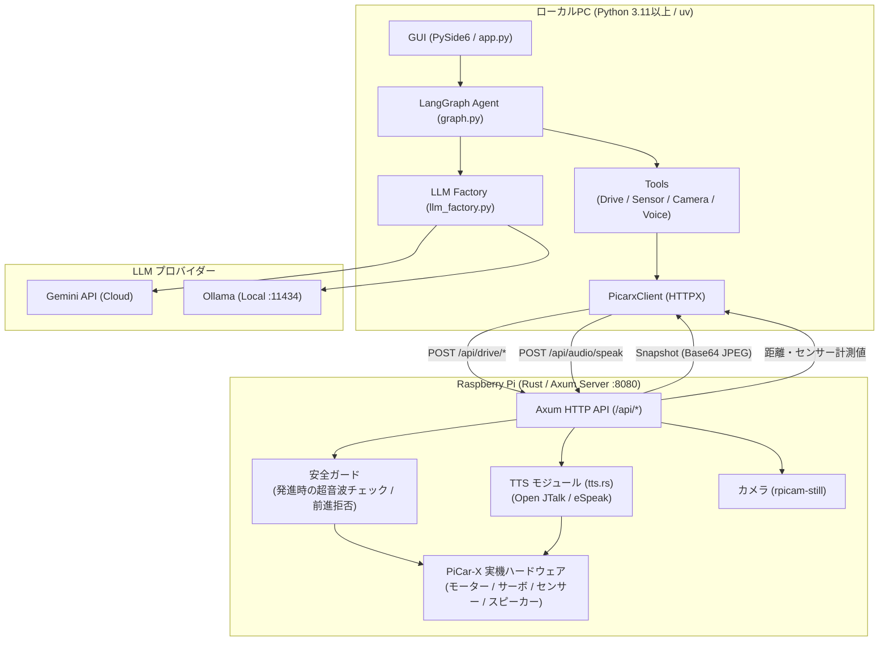

# PiCar-X Agentic AI Controller 仕様書

## 1. 文書概要

本書は、ローカルPC上のPython GUIと、Raspberry Pi上のRust APIサーバーで構成されるPiCar-X制御アプリケーションの現行仕様を定義する。

対象システムは、以下の機能を提供する。

- GeminiまたはOllamaを利用した自然言語チャット
- Raspberry Pi上のPiCar-X車体制御
- 超音波センサーによる距離測定
- カメラ画像の自動取得とGUI表示
- Raspberry Pi側のローカルTTSによる音声再生

Python GUI は電池などの状態を毎ターン Agent へ渡し、会話、人物の事実、車体の出来事を SQLite に保存する。音声入力は PC の内蔵マイクによる「押して話す」方式で、ローカルの Whisper で文字にする（車体にはマイクがない）。目標の仕様は [§13](#13-会話-agent-の目標仕様未実装) に記載する。

> [!NOTE]
> - プロジェクト全体の開発ロードマップ・進捗状況は [ROADMAP.md](ROADMAP.md) を参照してください。
> - End-to-End (E2E) 自律走行および MLOps パイプラインの仕様については、[E2E_SPECIFICATION.md](E2E_SPECIFICATION.md) を参照してください。
> - 未修正の課題は [REVIEW_FINDINGS.md](REVIEW_FINDINGS.md) を参照してください。

## 2. システム構成



### 2.1 PC側

- 実装言語: Python 3.11以上（開発環境の固定は `.python-version` の 3.13）
- GUI: PySide6
- LLM制御: LangChain / LangGraph
- HTTPクライアント: HTTPX
- 設定ファイル: `.env`
- エントリポイント: `python -m src.gui.app`
- 音声入力: `uv sync --extra voice` で `faster-whisper` と `sounddevice` を入れる

主な実装ファイル:

- `python/src/gui/app.py`
- `python/src/config.py`
- `python/src/llm_factory.py`
- `python/src/picarx_client/client.py`
- `python/src/agents/graph.py`（Gemini の Agent）
- `python/src/agents/local_agent.py`（ローカル LLM の Agent）
- `python/src/memory/store.py`、`python/src/memory/events.py`（記憶）
- `python/src/voice/speaker.py`（発話）、`python/src/voice/listener.py`（音声入力）
- `python/src/vision/local_vlm.py`（カメラ画像の認識）

### 2.2 Raspberry Pi側

- 実装言語: Rust
- HTTPサーバー: Axum
- ハードウェア制御: rppal / PiCar-X実装
- APIポート: `8080`
- エントリポイント: `rust/src/main.rs`

主な実装ファイル:

- `rust/src/api/mod.rs`
- `rust/src/api/handlers.rs`
- `rust/src/api/hardware.rs`
- `rust/src/tts.rs`

Pi の実行ファイルは API サーバーだけを起動する（`./picar-x-rust`）。Python GUI と E2E が接続し、LLM は Python 側で動く。旧 Rust GUI（`--gui`）とその LLM、会話メモリ、Pi での録音は 2026-11-07 に削除した。

ハードウェアの初期化に失敗すると、API サーバーはエラーで終了する。開発用にモックで起動する場合は `PICARX_ALLOW_MOCK=1` を明示する。

## 3. GUI仕様

### 3.1 画面構成

画面は左右2カラムで構成する。

左カラム:

- LLMモデル選択
- カメラ画像表示
- 距離センサー表示
- 安全状態表示
- 手動車体制御
- 緊急停止

右カラム:

- チャット履歴
- ユーザー入力欄
- Sendボタン

### 3.2 モデル選択

現在のモデルプリセットは以下のとおり。

| 表示モデル | 内部モデルID | 用途 |
|---|---|---|
| Gemini Flash | `gemini-3.8-flash` | 通常の対話・制御。無料枠は1日20回 |
| Gemini Flash-Lite | `gemini-3.5-flash-lite` | デフォルト。低コスト・低遅延 |
| Gemini Pro | `gemini-3.1-pro-preview` | 高度な推論 |
| Ollama Local | `ollama/qwen3.5:4b-text` | ローカルLLM（PC の CPU で実行）。Gemini が使えない時の代替。`qwen3.5:4b` を取得後、`uv run python -m src.llm_setup` で作成する |

モデル変更時はLangGraphを再生成する。

既定モデルは Gemini で、チャット内容は Gemini API へ送信される（意図した利用。ROADMAP の D-3）。

Gemini APIが503 `UNAVAILABLE` となった場合は、以下の順で復旧を試みる。

1. LangChainの内部再試行
2. 3秒待機後の再試行
3. `gemini-3.5-flash-lite` へのフォールバック

429 `RESOURCE_EXHAUSTED` はAPIクォータ超過であり、アプリケーション側ではクォータを増加できない。

### 3.3 チャット処理

通常のメッセージは以下の処理を行う。

1. GUIにユーザー入力を表示し、読み上げ中の返事を止める（`Speaker.interrupt()`）。音声入力は「🎤 押して話す」を離した時に文字にして、ここから同じ流れに入る
2. 「止まって」などの停止だけの指示は LLM を通さずに停止する
3. `HumanMessage` として会話履歴へ追加
4. Agent を実行する。Gemini は LLM とツールを往復する1つの Agent、ローカル LLM は JSON で行動を決める専用の Agent
5. 最新のAIメッセージからテキストを抽出し、GUIに表示
6. 読み上げ用の文章を `Speaker` が文ごとに Pi の TTS API へ送る
7. 発言と返事を記憶 DB に保存する

発話はすべて `Speaker` を通す。LLM には発話ツールを渡さず、Agent の返事を読み上げる。Pi は1文目を再生しながら2文目を生成するので、話し始めが早くなる。

読み上げは次の時に止まる。止めた後に Pi で生成し終わった文は再生しない。

- 新しいメッセージを送信した時、「🎤 押して話す」を押した時
- 緊急停止ボタンを押した時

会話の記憶は再起動後も残る。Agent のプロセス内の履歴はアプリを終了すると消える。

Gemini 3.xの応答がテキストブロック配列の場合は、`type == "text"` の要素だけを抽出して表示する。署名やメタデータは表示しない。

### 3.4 直接発話コマンド

以下の入力はGeminiを経由せず、`Speaker` から Pi 側TTS APIを呼び出す。

| 入力例 | 発話内容 |
|---|---|
| `喋って` | `こんにちは。PiCar-Xです。` |
| `喋って こんにちは` | `こんにちは` |
| `喋って「おはようございます」` | `おはようございます` |
| `しゃべって...` | 指定された内容 |
| `話して...` | 指定された内容 |
| `発話して...` | 指定された内容 |

直接発話ではGemini APIを使用しないため、Geminiのクォータを消費しない。

### 3.5 チャット履歴エラー対策

LLM呼び出し失敗時は、未完了のユーザー発話を会話履歴から削除する。これにより、失敗後の再送信でGeminiのfunction call turn順序が壊れることを防ぐ。

## 4. カメラ仕様

### 4.1 現在の方式

GUI起動後、1秒間隔で `/api/camera/snapshot` を自動呼び出しする。

- 画像サイズ: `320 x 240`
- 形式: JPEG
- JPEG品質: 70
- 通信形式: HTTP JSON + Base64
- GUI表示: Base64復号後のQImage/QPixmap

現在はMJPEGやH.264による連続動画ストリームではなく、1秒ごとの自動スナップショット更新である。

### 4.2 Raspberry Pi側の撮影コマンド

Rust APIサーバーは次の順でカメラコマンドを実行する。

1. `rpicam-still`
2. 起動できない場合は `libcamera-still`

どちらも利用できない場合、APIはHTTP 500を返し、GUIには `Camera Error` を表示する。

### 4.3 カメラ表示状態

| 状態 | GUI表示 |
|---|---|
| 起動直後 | `Camera Connecting...` |
| 取得成功 | JPEG画像 |
| 取得失敗 | `Camera Error: ...` |

カメラ取得成功ログをチャット欄には表示しない。

## 5. センサー仕様

距離センサーは2秒間隔でポーリングする。

| 距離 | 安全状態 |
|---:|---|
| 15cm未満 | `ALERT: Obstacle Close!` |
| 15cm以上 | `SAFE (Limiter Active)` |

APIエラー時は距離表示を `Disconnected` に変更する。

## 6. 手動制御仕様

GUIから以下の操作を実行できる。

| 操作 | API | 初期値 |
|---|---|---|
| 前進 | `POST /api/drive/move` | speed 30, 400ms |
| 後退 | `POST /api/drive/move` | speed 30, 400ms |
| 左操舵 | `POST /api/drive/steer` | -30度 |
| 右操舵 | `POST /api/drive/steer` | 30度 |
| 中央復帰 | `POST /api/drive/steer` | 0度 |
| 緊急停止 | `POST /api/drive/emergency_stop` | 即時停止。解除するまで走行を拒否 |
| 緊急停止の解除 | `POST /api/drive/emergency_stop/reset` | 車両は動かさない |

前進時はRust側の安全ガードが、命令の受信時に超音波距離を確認する。危険距離の場合、前進命令を拒否する。走行中の監視は行わない。

通信は背景スレッドのイベントループで実行するので、LLM の応答待ち中も GUI は操作できる。緊急停止はこのループとも別の専用スレッドから送信する。

## 7. Raspberry Pi API仕様

ベースURLは環境変数 `ROBOT_BASE_URL` で指定する。デフォルト値は `http://raspberrypi.local:8080`。

| Method | Endpoint | 機能 |
|---|---|---|
| POST | `/api/drive/move` | 前進・後退・停止。`speed` は 0〜100、`ttl_ms` は 50〜1000（範囲外は 400）。`ttl_ms` 以内に次の指令がなければ Pi が停止する。危険、不明なセンサー値、緊急停止の時は 409 と `reason` を返す |
| POST | `/api/drive/steer` | ステアリング角度変更 |
| POST | `/api/drive/stop` | 通常停止。以後の走行は拒否しない |
| POST | `/api/drive/emergency_stop` | 緊急停止。解除するまで走行を拒否する |
| POST | `/api/drive/emergency_stop/reset` | 緊急停止の解除 |
| GET | `/api/sensor/ultrasonic` | 超音波距離取得。不明な時は 503。反射が戻らない時は 343.0 |
| POST | `/api/safety/calibrate` | 今いる床で段差の閾値を校正する。走行中は 409、段差と区別できない値なら 422 |
| GET | `/api/status` | 電池、センサー（古い値は `null`）、走行モード、走れない理由、反射ループ、カメラ、発話中か（`audio.speaking`） |
| GET | `/api/events?after=<id>` | 安全イベント（直近256件）。反射ループの停止には検知から停止までの時間を含む |
| GET | `/api/sensor/grayscale` | グレースケール取得。不明な時は 503 |
| POST | `/api/audio/speak` | TTS生成と再生キューへの追加。再生の完了は待たない |
| POST | `/api/audio/stop` | 再生中とキューの発話を止める。生成中の文も再生しない |
| GET | `/api/audio/listen` | **スタブ**。常に固定文字列を返す |
| GET | `/api/camera/snapshot` | 最新フレームを JPEG Base64 で取得（320×240 固定） |
| GET | `/api/camera/stream` | MJPEG の常時配信（`multipart/x-mixed-replace`、320×240、15fps） |

全エンドポイントで `Authorization: Bearer <トークン>` が必須で、不正な場合は 401 を返す。CORS は許可しない。通信は暗号化していないので、信頼できる LAN 内でのみ使用する。カメラの映像も同様に暗号化されない。

カメラは配信の受信者がいる間と、最後の要求から10秒間だけ動作し、それ以外は止まる。映像は Pi の外へ自動では送らない。

## 8. TTS仕様

### 8.1 エンジン

日本語を含む文は Open JTalk、それ以外は eSpeak NG で音声にする。Open JTalk の声は、`mei` が入っていれば `mei`、なければ `nitech-jp-atr503-m001` を使う。Piper Plus の選択は旧 Rust GUI とともに削除した（2026-11-07）。

### 8.2 処理経路

```text
PC GUI
  -> POST /api/audio/speak
  -> Rust detect_language()
  -> Rust generate_tts_file()
  -> open_jtalk または espeak-ng
  -> 生成中に /api/audio/stop が来ていれば捨てる
  -> PiCar-X の play_file()（再生キューへ追加し、完了を待たずに返る）
  -> スピーカー
```

PC 側の `Speaker` は返事を文に分けて順に送る。短すぎる文は前の文につなげ、句点のない長い文は読点で切る。Open JTalk はひと息が30モーラ前後を超えると音が伸びるので、送る前に助詞の後ろへ読点を足す（`python/src/voice/breath.py`）。

### 8.3 実装詳細 (`rust/src/tts.rs`)

```rust
pub fn detect_language(text: &str) -> &'static str;
// 日本語文字（ひらがな・カタカナ・漢字）が含まれれば "ja"、それ以外は "en"

pub fn generate_tts_file(text: &str, lang: &str)
    -> Result<PathBuf, Box<dyn Error + Send + Sync>>;
// 一時ファイルパス: /tmp/picarx_tts_<nanoseconds>.wav
```

### 8.4 Raspberry Pi 実機セットアップ

```bash
sudo apt-get install -y \
  espeak-ng \
  open-jtalk \
  open-jtalk-mecab-naist-jdic \
  hts-voice-nitech-jp-atr503-m001
```

### 8.5 TTSエラー

- TTSファイル生成失敗: HTTP 500
- PiCar-X音声再生失敗: HTTP 500
- PC側ではチャット欄に `[TTS Error]` を表示

## 9. 設定

Python側の主な環境変数:

| 変数 | 必須 | デフォルト |
|---|---|---|
| `GEMINI_API_KEY` | Gemini使用時必須 | 空文字 |
| `ROBOT_BASE_URL` | 任意 | `http://raspberrypi.local:8080` |
| `ROBOT_API_TOKEN` | 必須 | 空文字。Pi 側の `PICARX_API_TOKEN` と同じ値 |
| `OLLAMA_BASE_URL` | Ollama使用時 | `http://localhost:11434` |

PC側のHTTPタイムアウトは5秒。

Raspberry Pi側の環境変数（実行時のカレントディレクトリの `.env` からも読み込む）:

| 変数 | 必須 | 内容 |
|---|---|---|
| `PICARX_API_TOKEN` | 必須 | API トークン。未設定ならサーバーは起動しない |
| `PICARX_ALLOW_MOCK` | 任意 | `1` の時のみ、ハード初期化失敗時にモックで起動する |
| `PICARX_DISABLE_CLIFF_GUARD` | 任意 | `1` の時のみ段差検知を無効にする。車輪を浮かせた試験など、落下の恐れがない時だけ使う |
| `PORT` | 任意 | 待受ポート。既定は `8080` |

トークンは次のように生成し、PC の `python/.env` と Pi の `.env` の両方に設定する。

```powershell
uv run python -c "import secrets; print(secrets.token_urlsafe(32))"
```

`.env` は git に追加しない（`.gitignore` で除外）。

## 10. 起動・デプロイ手順

### 10.1 Raspberry Pi 側プログラムのビルド & デプロイ

> [!IMPORTANT]
> **Raspberry Pi 実機上でのコンパイルはCPU性能・メモリ不足のため非推奨**です。
> 必ず **ローカルPC上のDocker環境でクロスコンパイルし、`scp` でRaspberry Piへバイナリを送信** してください。

#### Step 1: ローカルPCでクロスコンパイル (`rust/build/Makefile`)
```bash
cd rust/build

# お使いのラズパイのモデル (3bplus, zero2w, 4b, 5) を指定してビルド
# 基準機種は Pi 5（ROADMAP の D-1）。CI も Pi 5 向けにビルドする
make build MODEL=5
```
※ 初回のみ `make image` でビルド用Dockerイメージを作成してください。

#### Step 2: Raspberry Pi へバイナリを送信
```bash
make deploy RPI_HOST=pi@<ラズパイのIP> RPI_DIR=/home/pi/
```
または手動で直接 `scp` 送信:
```bash
scp rust/target/aarch64-unknown-linux-gnu/release/picar-x-rust pi@<ラズパイのIP>:~/
```

#### Step 3: Raspberry Pi 上で起動
Raspberry Pi に SSH 接続し、送信されたバイナリを実行します：
```bash
./picar-x-rust
```
起動時に `/opt/picar-x/picar-x.conf` からサーボ校正オフセットが自動適用されます。

### 10.2 PC

```powershell
cd <project_root>\python
uv sync --extra dev
uv run python -m src.gui.app
```

### 10.3 接続確認

```bash
curl -H "Authorization: Bearer $PICARX_API_TOKEN" http://127.0.0.1:8080/api/sensor/ultrasonic
curl -X POST http://127.0.0.1:8080/api/audio/speak \
  -H "Authorization: Bearer $PICARX_API_TOKEN" \
  -H "Content-Type: application/json" \
  -d '{"text":"こんにちは"}'
```

## 11. テスト・品質保証

Python は `.github/workflows/python-ci.yml` で `ruff check` と `pytest` を実行する。ローカルでは以下を実行する（`ruff format` は CI の対象外）。

```bash
uv run ruff format --check .
uv run ruff check .
uv run pytest tests/ -v
```

Rust は `.github/workflows/rust-ci.yml` で以下を実行する（Raspberry Pi 5 向けのクロスビルドを含む）。

```bash
cargo fmt --all -- --check
cargo clippy --all-targets --locked -- -D warnings
cargo nextest run --locked --release --profile ci
```

## 12. 既知の制約・今後の拡張

- Python GUI のカメラ表示は1秒間隔の更新のままで、常時配信は使っていない。走行ループのみ配信を使う。
- Assistantの通常返信は毎回Pi側TTSで再生する。
- Gemini無料枠の429 `RESOURCE_EXHAUSTED` はアプリケーションでは解決できない。
- Rust APIサーバーはPi上のカメラコマンド、TTSエンジン、PiCar-Xハードウェアに依存する。
- `/api/audio/listen` はスタブであり、Pi では録音しない。音声入力は PC のマイクで行う（車載マイクは ROADMAP の M6）。
- カメラの画像は PC のローカル VLM（`qwen3.5:4b`）で認識し、約7秒かかる。VLM は GUI の起動時に読み込み、30分残す。細い物を見落とすので、走行の安全の判断には使わない。Gemini の Agent には `look` ツールで説明の文章だけを渡す。
- Agent は現在地と学習状況を参照できない（M4、M5）。

## 13. 会話 Agent の目標仕様（未実装）

> [!NOTE]
> 実施順序と完了条件は [ROADMAP.md](ROADMAP.md)、全体構成は [agentic_ai_architecture_policy.md](agentic_ai_architecture_policy.md) を参照する。

### 13.1 目的

走行判断とは別の会話 Agent が、自分の状況、学習状況、会話の内容と履歴を総合して応答する。

### 13.2 Agent が参照する情報

| 情報 | 取得元 | 現状 | 計画 |
|---|---|---|---|
| 電池 | `/api/status` | 実装済み（実機未確認） | M1 |
| センサー、走行モード、安全イベント | `/api/status`, `/api/events` | 実装済み（実機未確認） | M1 |
| 周囲の様子 | カメラ画像を PC のローカル VLM で説明 | 実装済み（実際の室内は未確認） | M2 |
| いま言われたこと | 音声認識 | 未実装 | M2（PC のマイク）、M6（車載） |
| 過去の会話、人物の事実 | 記憶 DB | 実装済み（Python） | M2 |
| 車体の出来事（安全停止、緊急停止、校正） | `/api/events` から記憶 DB へ保存 | 実装済み（実機未確認） | M2 |
| 今いる場所 | 場所グラフ | なし | M4 |
| 使用中のモデル、介入率、上達度 | レジストリ、走行記録 | 実走の指標なし | M3、M5 |

### 13.3 応答の組み立て

1. 発話を受け取り、すぐに短い相づちを返す
2. 状態ストアから現在の状態を短いテキストにする
3. 記憶を検索し、関連する事実と会話を取得する
4. ペルソナ、状態、記憶、直近の会話を予算内で組み立てて LLM へ渡す
5. 応答を文単位で音声合成して再生する
6. 会話、抽出した事実、発生したイベントを記憶へ保存する

現在の状態はツール呼び出しに頼らず毎ターン注入する。不明な値や古い値は「不明」と伝え、推測で答えない。

### 13.4 記憶

- **保存先**: Brain 側の SQLite に一本化する。`python/src/memory/store.py` で実装済み
- **検索**: FTS5（日本語はトリグラムを想定、要検証）と新しさで検索する
- **要約**: 夜間などの空き時間に行う
- **人物の事実**: 出所と日時を持ち、ユーザーが確認と削除をできるようにする

### 13.5 安全境界

- LLM の出力は意図（`go_to`、`explore`、`return`、`look`、`stop`、`say`）に限定する
- 速度や時間を LLM に直接指定させない
- Body は意図を拒否でき、拒否の理由を Agent に返す
- 「止まって」などの停止指示は LLM を介さずに即時処理する

### 13.6 対話の進め方

- 最初は停止して聞く方式か押して話す方式を使う（モーター音と自声への対策）
- ロボットの発話中に話しかけられた場合は発話を止める
- 脳へ接続できない時は、定型の応答で状況を伝える

### 13.7 LLM

- Gemini Flash-Lite を既定とし、使えない時は PC のローカル LLM で応答する。Flash を選んだ時は、混雑、応答なし（20秒）、無料枠の上限で Flash-Lite へ切り替える。無料枠の上限はモデルごとで、`gemini-3.8-flash` は1日20回
- PC は GPU なしの Core i7-1255U、メモリ 16GB。ローカルのモデルと量子化レベルは応答時間の実測で選ぶ
- 小さなモデルに対応するため、応答形式は最小限にする
- 応答を文単位で音声合成し、待ち時間を短く感じさせる

### 13.8 プライバシー

- 室内画像、音声、会話、記憶 DB は git に追加しない
- 画像や音声など、新しい種類のデータをクラウドへ送る機能は、追加前に確認する（ROADMAP の D-3）
- 車載マイクの装着前に API の認証を実装する
