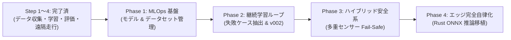

# PiCar-X 軽量E2E自動運転 & MLOps 開発ロードマップ (CPU前提)

本書は、PiCar-XにおけるEnd-to-End（E2E）自動運転システムを、**「GPU不要・計算資源を最小化」**しつつ、**実機ロボティクス・MLOps・車載安全設計・エッジ組込み推論**の重要領域を網羅して発展させるための公式ロードマップである。

> [!NOTE]
> 現在実装されているE2Eシステム全体の詳細仕様は [E2E_SPECIFICATION.md](E2E_SPECIFICATION.md) を参照してください。

---

## 1. 基本方針 & スコープ

### 削るもの（対象外）
- ❌ **巨大モデル（Vision Transformer / LLM制御）**: GPUを要し推論遅延が大きいため採用しない。
- ❌ **重厚な3Dシミュレーター（Unreal Engine / CARLA）**: 独立GPUリソースを消費するため採用しない。
- ❌ **大規模時系列ディープラーニング（LSTM/動画モデル）**: 計算コストとメモリ消費を抑えるため除外。

### 攻めるもの（注力分野）
- ⭕ **MLOps & 実験管理**: データセット・モデルのバージョン管理と定量評価の自動化。
- ⭕ **継続学習（Human-in-the-loop）**: 失敗ケースの切り出しとデータリバランスによる実走性能向上。
- ⭕ **車載安全系（Safety Layer）**: AI推論に依存しない多重センサーFail-Safeの構築。
- ⭕ **エッジ完全自律化（Rust推論）**: Raspberry Pi単体で完結する超低遅延ONNX推論。
- ⭕ **ツール前提**: Python環境操作は常に `uv`（`uv run` / `uv pip`）を使用する。

---

## 2. 全体ロードマップ

---

## 3. 各フェーズの詳細仕様

### Phase 1: 軽量 MLOps & モデルレジストリ（基盤整備）
- **目的**: データとモデルのライフサイクルを可視化・定量比較できるようにする。
- **実装内容**:
  1. **Dataset Registry (`registry/dataset.py`)**:
     - 各走行ログの統計情報（総フレーム数、走行時間、直進/左折/右折比率、平均舵角）を算出してメタデータ化。
  2. **Model Registry (`registry/models.py`)**:
     - `models/v001`, `models/v002` ... の学習設定、エポック数、検証損失、MAE、入力解像度を一元管理。
  3. **Model Comparator CLI (`registry/compare.py`)**:
     - `uv run python -m src.e2e.registry.compare` で登録済みモデルの性能をターミナル上に表形式で比較表示。
- **計算負荷**: ゼロ（メタデータ管理・集計のみ）

---

### Phase 2: データフライホイール & 継続学習（Human-in-the-loop）
- **目的**: 失敗した走行データから効率的にリカバリーを学習させ、実走性能を向上させる。
- **実装内容**:
  1. **Disengagement Logger (危険・介入検知)**:
     - 自動走行中の「手動緊急停止（Ctrl+C）」や「超音波センサー急接近（急ブレーキ作動）」の直前3秒間を自動抽出し、`bad_case` としてタグ付け。
  2. **Dataset Merging & Balancing**:
     - 直進過多になりがちなデータセットから、カーブやリカバリー操舵をバランスよく抽出して再合成。
  3. **Retraining Pipeline (v002)**:
     - 苦手箇所のデータを補強したデータセットで再学習し、`models/v002` を生成して `v001` との走破率を比較。
- **計算負荷**: 非常に軽量（CPUで数分〜5分程度）

---

### Phase 3: ハイブリッド安全系（Safety Layer / Fail-Safe Controller）
- **目的**: AI推論の誤判定が起きても車体が衝突・脱輪しない堅牢な車載安全アーキテクチャの構築。
- **実装内容**:
  1. **多重センサー防護**:
     - 超音波センサー（前方障害物）に加え、床面グレースケールセンサー（白線逸脱・コースアウト検知）を安全層へ統合。
  2. **ダイナミック・スピードリミッター**:
     - ステアリング舵角が大きい（急カーブ）時は、推論要求に関わらず自動的にスロットルを落としてスリップや転倒を防止。
  3. **ウォッチドッグ（通信監視・タイムアウト）**:
     - 推論パケットが100ms以上途切れた場合、直ちにモーター停止・ステアリング中立へ移行。
- **計算負荷**: ゼロ（ルールベースの高速判定）

---

### Phase 4: Raspberry Pi 実機スタンドアロン化（Rust推論移植）
- **目的**: Wi-FiやPCを介さず、Raspberry Pi単体・完全自律で動作する「本物のロボット」へ昇華。
- **実装内容**:
  1. **Rust ONNX Runtime (`ort` crate) 組み込み**:
     - PCで学習した `model.onnx` をRaspberry Piへデプロイ。
     - Raspberry Pi上のRustプログラム内でカメラキャプチャからONNX推論、PWM出力までを直接実行。
  2. **超低遅延化**:
     - Wi-Fi通信オーバーヘッド（30〜50ms）がなくなり、20〜30FPSで遅延のない滑らかな自律走行を実現。
  3. **PC側役割の分離**:
     - PCは「走行ログの受信」「学習」「モデル配信」のみを担当し、リアルタイム制御ループから完全に外す。
- **計算負荷**: Raspberry PiのCPUのみで余裕で動作（軽量CNNのため1推論あたり数ms〜十数ms）

---

## 4. 開発プロセス & 品質ルール

- **Python実行ルール**: 常に `uv` を前提とする（`uv run python -m ...`、`uv pip install ...`）。
- **コード品質**:
  - リンター/フォーマッタ: `uv run ruff check --config pyproject.toml src tests`
  - ユニットテスト: `uv run pytest tests`
  - 新機能追加時も常にCIテスト全件合格を維持する。
