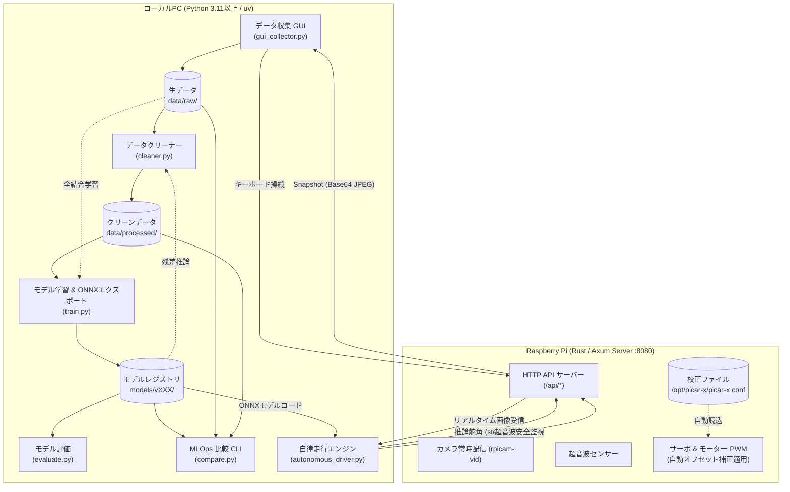

# PiCar-X End-to-End (E2E) 自律走行 & MLOps システム仕様書

本書は、SunFounder PiCar-X において実装された、**「軽量CNNによる画像入力からの直接舵角予測 (End-to-End)」** および **「データ収集・品質管理・モデル管理 (MLOps)」** の現行アーキテクチャと各サブシステムの仕様を定義する。計画は [ROADMAP.md](ROADMAP.md) で管理する。

> [!NOTE]
> - 全体の開発ロードマップ・進捗状況については [ROADMAP.md](ROADMAP.md) を参照してください。
> - ユーザー向けの操作手順については [python/src/e2e/README.md](python/src/e2e/README.md) を参照してください。
> - 未修正の課題は [REVIEW_FINDINGS.md](REVIEW_FINDINGS.md) を参照してください。

---

## 1. 基本方針 & スコープ

### 1.1 基本思想
- **家庭内フリースペース自律走行**: コース・白線・標識のない家庭内（部屋・廊下・家具の間）を縦横無尽に走行し、障害物や行き止まりを自律回避して開けた空間へナビゲートする。
- **GPU不要 (CPU前提)**: PC・Raspberry PiともにCPUのみで動作する軽量設計。
- **現行アーキテクチャ (Plan A Remote Control)**: 推論と安全判断の多くをPC側で行う暫定構成。安全機能は Pi へ移し、実機で確認した（ROADMAP の M1。Wi-Fi 切断時の停止だけ未確認）。推論は M3 で移す計画。
  - PC側: データ収集GUI、データクリーニング、PyTorch学習、ONNX Runtime推論、MLOpsレジストリを担当。
  - Raspberry Pi側: Rust/Axum HTTPサーバー経由でカメラ撮影、超音波センサー計測、モーター・サーボPWM制御を担当。
  - 両者間は標準 HTTP/JSON 通信（Base64 JPEG画像伝送）で疎結合に連携。

### 1.2 対象外 (スコープ外)
- ❌ **フレーム単位の制御への大規模モデル（Vision Transformer / LLM）の使用**: GPUを要し推論遅延が大きいため採用しない。LLMは行き先などの上位の意図のみを扱う（ROADMAP の M5）。
- ❌ **重厚な3Dシミュレーター（Unreal Engine / CARLA）**: 独立GPUリソースを消費するため採用しない。
- ❌ **大規模時系列ディープラーニング（LSTM/動画モデル）**: 計算コストとメモリ消費を抑えるため除外。

### 1.3 注力分野
- ⭕ **MLOps & 実験管理**: データセット・モデルのバージョン管理と定量評価の自動化。
- ⭕ **継続学習（Human-in-the-loop）**: 失敗ケースの切り出しとデータリバランスによる実走性能向上。
- ⭕ **車載安全系（Safety Layer）**: AI推論に依存しない多重センサーFail-Safeの構築。
- ⭕ **エッジ推論（Rust）**: Raspberry Pi単体で完結するONNX推論（未着手、ROADMAP の M3）。
- ⭕ **ツール前提**: Python環境操作は常に `uv`（`uv run` / `uv pip`）を使用する。

---

## 2. 全体構成図



---

## 3. 開発ロードマップについて

計画と進捗は [ROADMAP.md](ROADMAP.md) に集約しています（マイルストーン M0〜M10）。本書の「Step」「Phase」は、コードやコメントで使われている機能 ID です。

---

## 4. 各サブシステム詳細仕様

### 4.1 データ収集サブシステム (`gui_collector.py`)
PC上でカメラ映像をリアルタイム確認しながら手動操縦し、高品質な教師データを記録する。

- **モジュールパス**: `python/src/e2e/gui_collector.py`
- **主要機能**:
  - PySide6 による GUI 操作画面
  - `PicarxClient` (HTTPX 同期通信) を用いたリアルタイム遠隔操作
  - 録画トグル（`R` キー / UIボタン）による必要な走行シーンのみの抽出保存
  - 画像と操舵ラベルの完全同期書き込み
- **操作キーアサイン**:
  - `W`: 前進 (設定速度)
  - `S`: 停止 (車速0)
  - `A`: 左ステアリング (10° 刻み)
  - `D`: 右ステアリング (10° 刻み)
  - `X`: ステアリング中立 (0°)
  - `R`: 録画開始 / 一時停止トグル
- **保存データ形式**: `python/data/raw/<session_timestamp>/`（git 管理外）
  - `images/frame_xxxxxx.jpg`: 解像度 160×120 の JPEG 画像
  - `labels.jsonl`: 各フレームの JSONL レコード
    ```json
    {
      "index": 1,
      "timestamp": 1729000000.123,
      "frame": "frame_000001.jpg",
      "steering": -0.2857,
      "throttle": 0.5,
      "distance_cm": 42.3,
      "command": {"speed": 40, "steering_deg": -10.0, "since_s": 1.2, "camera_moving": false},
      "motion": {"yaw_rate_dps": -6.1, "expansion_rate": 0.08, "edge_flow_px_s": 14.2,
                 "image_moving": true, "approach_cm_s": 9.8, "...": "..."},
      "motion_check": {"flags": []}
    }
    ```
    - `steering` は最大舵角 ±35° を基準に `-1.0` (最大左折) 〜 `+1.0` (最大右折) に正規化。
    - `throttle` は前進の指令が有効な間だけ `0.5`、それ以外は `0.0`。`W` は 600ms の移動指令なので、期限が切れて止まった後は `0.0` になる（2026-11-08 から。それ以前の記録は止まった後も `0.5`）。
    - `distance_cm` は超音波の距離。何も捉えていない時は `null`。
    - `command` はそのフレームの時点で有効な指令（期限を含む）、`motion` はカメラの画像の動きと超音波から推定した実際の動き、`motion_check` は指令との食い違い（§4.7）。食い違いのあるフレームは学習から外す。
    - 電池電圧と床センサーの値はまだ保存しない（M3 の再収集で追加する）。
- **食い違いが続いた時**: 同じ食い違いが1秒続くと、走行を止めて画面に表示し、記憶に「走行を止めた」出来事として残す。
- **収集周期**: `CameraWorker` は約12Hzの設計だが、記録された実測のフレーム間隔は中央値で約1秒（2026-11-03 時点、旧方式）。カメラを常時配信に変えた後（M1）の収集周期は未計測。M3 で 10fps 以上で集め直す。

---

### 4.2 データセット管理 & 自動クリーニング (`dataset.py`, `cleaner.py`)

#### 4.2.1 複数セッション統合データセット (`training/dataset.py`)
- **モジュールパス**: `python/src/e2e/training/dataset.py`
- **クラス**: `DrivingDataset(Dataset)`
- **仕様**:
  - 引数 `data_dir` に「単一セッション」「複数セッションのリスト」「親ディレクトリ (`data/raw`, `data/processed`)」のいずれを指定しても、配下の `labels.jsonl` を自動探索して1つのデータセットに結合。
  - 各画像のパスをセッションごとに正しく解決。クリーナーの出力のように `source_dir` を持つレコードは、参照先の元のセッションから画像を読む。
  - 各サンプルの `session_id` は元のセッション（分割と集計に使う）。画像を複製していた旧形式の出力は `cleaned_meta.original_session` を使う。
  - 前処理パイプライン:
    1. リサイズ: 120×160 ピクセル (H×W)
    2. Tensor 変換: `[0.0, 1.0]`
    3. 正規化: ImageNet 基準 (`mean=[0.485, 0.456, 0.406]`, `std=[0.229, 0.224, 0.225]`)

#### 4.2.2 残差外れ値フィルタ（データクリーナー） (`dataset/cleaner.py`)
- **モジュールパス**: `python/src/e2e/dataset/cleaner.py`
- **クラス / エントリポイント**: `DatasetCleaner`, `clean_dataset()`
- **検出アルゴリズム (Data-Centric AI)**:
  1. 指定された学習済みモデル（`.onnx` または `.pth`）で全フレームのステアリング角 $\hat{y}$ を推論。
  2. 手動入力ラベル $y$ との絶対残差誤差 $e = |\hat{y} - y|$ を算出。
  3. 閾値判定:
     - 絶対誤差閾値 (`--threshold`, デフォルト `0.4` ≒ 約14°以上の乖離) を超えるフレーム
     - またはワーストパーセンタイル (`--top_k_percent`) に該当するフレーム
     これらを「操作遅れ」「衝突後の混乱」「手ブレノイズ」として除外。
- **出力アーティファクト**: `python/data/processed/<output_dir>/`
  - 画像は複製しない（元のデータを唯一の正とする）
  - `labels.jsonl`: クリーニング済みの正常ラベル。各レコードの `source_dir` は元のセッションへの相対パス（相対にできなければ絶対パス）
  - `bad_cases.jsonl`: 除外されたフレーム一覧と除外理由（デバッグ・分析用）
  - `cleaning_report.json`: 除外率、前後MAEの定量的改善レポート
  - `metadata.json`: レジストリ互換の統計メタデータ
- **注意**: モデルと一致しないフレームを除外するため、「前後MAE」は改善して見えやすい。走行性能の改善の根拠には使わない。

---

### 4.3 モデルアーキテクチャ & 学習 (`training/model.py`, `train.py`)

#### 4.3.1 モデル仕様 (`SmallDrivingCNN`)
CPU推論を想定した4層の軽量CNN（推論時間の実測値は未記録）。

- **入力**: `[Batch, 3, 120, 160]` (RGB画像)
- **出力**: `[Batch, 1]` (予測ステアリング角, `-1.0` 〜 `+1.0`)
- **ネットワーク構造**:
  ```text
  Input (3, 120, 160)
    │
    ├── Conv2d(3 -> 16, 3x3, stride=2, padding=1) + BatchNorm2d + ReLU + MaxPool2d(2) -> (16, 30, 40)
    ├── Conv2d(16 -> 32, 3x3, stride=1, padding=1) + BatchNorm2d + ReLU + MaxPool2d(2) -> (32, 15, 20)
    ├── Conv2d(32 -> 64, 3x3, stride=1, padding=1) + BatchNorm2d + ReLU + MaxPool2d(2) -> (64, 7, 10)
    ├── Conv2d(64 -> 64, 3x3, stride=1, padding=1) + BatchNorm2d + ReLU                 -> (64, 7, 10)
    │
    ├── AdaptiveAvgPool2d((2, 2)) -> (64, 2, 2) = 256次元
    ├── Flatten
    │
    ├── Linear(256 -> 64) + ReLU + Dropout(0.2)
    ├── Linear(64 -> 32) + ReLU
    └── Linear(32 -> 1) + Tanh
  ```

#### 4.3.2 学習仕様 (`training/train.py`)
- **損失関数**: Mean Squared Error (MSE Loss)
- **最適化**: Adam (`lr=1e-3`)
- **設定**: `python/configs/train.toml`（エポック数、バッチサイズ、学習率、シード、検証セッション）。コマンドラインの引数で上書きできる
- **再現性**: シードを固定し、CPU で決定的なアルゴリズムだけを使う。同じデータと設定なら同じ指標になる
- **データ分割**: セッション単位。検証セッションの指定がなければ名前順で最後のセッション。セッションが1つしかない、または検証が空なら学習しない
- **交差検証** (`training/cross_validate.py`): セッションを1つずつ抜いて学習し（エポック数は固定、最後の重み）、抜いたセッションで評価する。モデルの比較はこの値で行う
- **データ拡張**: なし
- **エクスポート**:
  - 最良検証ロスの重み: `best_model.pth`
  - ONNX 形式: `model.onnx` (Opset 17, 入出力動的バッチ対応)
  - メタデータ: `metadata.json`。エポック数、バッチサイズ、最良Val Loss、使用セッション一覧に加え、設定、分割、前処理（入力の大きさ、正規化の値）、検証セッションでの指標、PC での推論時間、データのハッシュ（学習サンプルの中身から計算）と各セッションのマニフェストのハッシュ、git のコミットと未コミットの変更の有無、環境（Python、PyTorch などの版、`uv.lock` のハッシュ）、学習の経過
  - ONNX 出力後にスタックトレース情報を除去する（ローカルのパスが残るのを防ぐため）

---

### 4.4 オフライン評価 & MLOps レジストリ (`evaluation/`, `registry/`)

- **オフライン評価 (`evaluate.py`)**:
  - 平均絶対誤差 (MAE) を正規化スケールおよび実角度（±◯度）で算出。左（-0.15 未満）、直進、右（0.15 超）の別の MAE、隣り合うフレームの予測の差の平均（ふらつき）、PC での推論時間も出す（`evaluation/metrics.py`）。
  - 評価結果を `eval_metrics.json` に自動出力。
  - 指定したディレクトリの全フレームで評価する。学習に使ったデータを指定すると、その分も評価に含まれる（`v004` は学習データ全150件で評価）。走行性能の指標としては使わない。
- **データセットレジストリ (`registry/dataset.py`)**:
  - セッションごとのフレーム数、走行時間、FPS、直進/左折/右折比率、平均操舵角を自動分析。
- **モデルレジストリ (`registry/models.py`)**:
  - 保存済みモデルのバージョン、エポック数、検証損失、MAE、ONNX/PTH成果物の有無を走査。
- **MLOps 比較 CLI (`registry/compare.py`)**:
  - `uv run python -m src.e2e.registry.compare` でターミナル上に Rawデータセット、Processedデータセット、モデル性能を表形式で一覧表示。モデルの表には、データのハッシュと git のコミットの先頭も出す。
- **マニフェスト (`dataset/manifest.py`)**:
  - 走行データはセッション単位で追記のみとする。各セッションに `manifest.json`（ファイルごとの SHA256 と大きさ、全体のハッシュ）を作り、`--verify` で変更、欠落、追加を検出する。`metadata.json` は集計から作り直せるので対象外。既存のマニフェストは書き換えない。
- **バックアップ (`scripts/backup.ps1`)**:
  - `python/data`、`python/models`、`data` を robocopy で `D:\PiCarX-backup`（環境変数 `PICARX_BACKUP_DIR` で変更可）へ複製する。複製先のファイルは消さない。記憶 DB があるので GUI を閉じてから実行する。`-RestoreTo <フォルダ>` で戻す。

---

### 4.5 自律操縦 & セーフティレイヤー (`autonomous_driver.py`)

- **実行場所**: PC。Pi とは HTTP で通信する。
- **ループの処理順**:
  1. `/api/camera/stream` の新しいフレームを待つ（処理が遅れても古いフレームは溜まらない）
  2. `/api/status` で Pi の状態を確認
  3. Pi が前進を拒否していれば、理由に応じて脱出または待機（`safety/body_status.py`）
  4. 指令と実際の動きの食い違いの検出（§4.7）。食い違いが1秒続くと止まり、介入（`motion_mismatch`）と記憶の出来事として記録して走行を終える。`--disable_motion_check` を付けた時だけ、旧スタック検知（後退と車体振りで脱出）を使う
  5. 120×160 に変換し、ONNX Runtime でステアリング角を推論
  6. 速度リミッターで速度を決定し、介入バッファを更新
  7. `/api/drive/steer` と `/api/drive/move`（TTL 400ms）を送信。受け付けられた移動だけ軌跡と地図に反映
  8. 地図の描画
- **周期の計測**: 工程ごとの時間を `cycle_profiler.py` で計測し、終了時に表示して `data/cycle_profiles/` へ数値のみ保存する。
- **旧方式の実測周期（2026-11-03 のログ解析）**: フレーム間隔の中央値 **1.14秒**、p10 1.04秒、p90 2.59秒（2,930間隔）。主な原因は撮影ごとの `rpicam-still` 起動と推定する。常時配信に変えた新方式は **15.0Hz**（p50、p95 88.1ms、2026-11-04 実機。ROADMAP の M1）。
- **動作の特徴**: 指令を周期ごとに更新するので、10Hz 以上なら止まらず走り続ける。指令が途絶えると TTL で止まる。
- **開始時**: 今いる床で段差を校正する。校正に失敗すると走行を始めない。

#### 安全機能の実行場所

| 機能 | 実行場所 | タイミング | 備考 |
|---|---|---|---|
| 走行の可否判定 | Pi (Rust) | `move` を受信した時 | 緊急停止、反射ループの停止、下記の危険や不明な値があれば 409 |
| 超音波停止（15cm） | Pi (Rust) | 反射ループ（目標 40Hz）、前進時 | 値が 300ms より古ければ不明として止める。反射が戻らない時は「遠い」として前進を許可し、速度を60までに抑える。音を吸う物にはぶつかる恐れがある。`--safe_dist` は PC の減速のみに使う |
| 段差検知 | Pi (Rust) | 反射ループ、前進時 | 床の値から校正。センサーごとに床の35%（上限300）未満で段差。後退は妨げない |
| 床センサーの異常 | Pi (Rust) | 反射ループ、前後とも | 値が 200ms より古ければ止める |
| TTL による停止 | Pi (Rust) | 反射ループ | `ttl_ms` は 50〜1000。PC が切断されても止まる |
| 通常停止 `/api/drive/stop` | Pi (Rust) | 受信時 | モーターを止める。以後の走行は拒否しない（走行ループの一時停止に使用） |
| 緊急停止 `/api/drive/emergency_stop` | Pi (Rust) | 受信時 | 解除 API が呼ばれるまで前進・後退を拒否する |
| 終了時の停止 | Pi (Rust) | SIGINT、SIGTERM | モーターを止めて終了する。SIGKILL や電源断では実行されない |
| API トークンの検証 | Pi (Rust) | 全要求 | PC の `ROBOT_API_TOKEN` と Pi の `PICARX_API_TOKEN` を一致させる |
| 通信状態の記録 | PC (Python) | 通信失敗時 | 停止は Pi の TTL が行う。PC 側は記録のみ |
| 速度リミッター | PC (Python) | ループごと | |
| 直前軌跡の後退 | PC (Python) | 段差検知時、行き止まり時 | 記録のない範囲へは後退しない。履歴がなければ待機する |
| 指令と実際の動きの食い違い | PC (Python) | ループごと | 約0.3秒前のフレームと比べる。1秒続くと止まって走行を終える。しきい値は実機で未校正 |
| 旧スタック検知 | PC (Python) | ループごと | `--disable_motion_check` の時だけ。8フレーム前との比較を15回 |
| Ctrl+C / `Q` キー | PC (Python) | 受信時 | 舵を0に戻してモーターを停止（通常停止） |

---

### 4.6 ハードウェア校正自動補正レイヤー (`rust/src/picarx/core.rs`)

PiCar-X実機のサーボモーターギア個体差（数度の傾き）を吸収する機構。

- **校正設定ファイルの自動読み込み**:
  - 起動時に `/opt/picar-x/picar-x.conf`、`/etc/picar-x/picar-x.conf`、`~/.config/picar-x/picar-x.conf` を自動探索。
  - `picarx_cam_pan_servo`, `picarx_cam_tilt_servo`, `picarx_dir_servo` をパース。
- **環境変数オーバーライド**:
  - `CAM_PAN_OFFSET`, `CAM_TILT_OFFSET`, `DIR_SERVO_OFFSET` での上書きに対応。
- **駆動時の自動オフセット加算**:
  ```rust
  set_cam_pan_angle(angle + pan_offset);
  set_cam_tilt_angle(angle + tilt_offset);
  set_dir_servo_angle(angle + dir_offset);
  ```
  これにより、Rustサーバー起動直後からカメラが正確に真正面を向き、直進操舵のズレが排除される。

---

### 4.7 指令と実際の動きの食い違いの検出 (`motion/`)

PiCar-X には車輪の回転数を測るセンサーがないので、カメラの画像の動きと超音波の距離から実際の動きを推定し、指令と比べる（ROADMAP の M3）。

- **画像の動き (`motion/estimator.py`)**: 160×120 のグレースケールで特徴点を追跡し（Lucas-Kanade、行きと帰りで戻らない点を除く）、平行移動 + 拡大 + 回転のモデルを RANSAC で当てはめる。人など一部だけの動きは外れ値になる。
  - 約0.3秒前のフレームと比べ、毎秒の値に直す（周期によらず同じしきい値を使うため）
  - 向きの変化（度/秒）: 景色の横のずれ × 水平画角 / 160。右回りが正。水平画角は 53.5°（OV5647 の値。未校正）
  - 拡大の速さ: 前進で正。単眼なので距離（cm）は分からない
  - 超音波の距離の変化: 150cm 以内で、変化が毎秒 100cm 以下の時だけ使う
  - 特徴点が12個未満、または追跡できない時は「不明」
  - PC で1フレーム約1.3ms
- **食い違いの判定 (`motion/checker.py`)**: 指令が変わってから0.5秒は判定しない。カメラを動かしている間も判定しない。
  - `no_motion`: 速度40（`MIN_MOVING_SPEED`。車が確実に進む最低の速度）以上の指令なのに、画像が動かず、超音波の距離も変わらない（超音波が使えなければ画像だけで判断）。画像が不明で超音波も使えなければ不明
  - `turn_mismatch`: 舵角15°以上で逆向きに毎秒8°より速く曲がった。舵角3°以下で毎秒15°より速く曲がった。後退では向きを反転して比べる。速度と軸距を校正した後は、自転車モデルで想定した量と比べ、0.5〜2倍の外なら食い違い
  - `uncommanded_motion`: 停止中に、特徴点の60%以上がそろって動いた（景色全体が動いた）。超音波の距離が変わらなければカメラだけが動いたとみなして不明にする
  - 同じ食い違いが1秒続くと「続いている」とする
  - しきい値はすべて提案値で、床に印を付けたコースとわざと空転させる試験で校正する
- **監視 (`motion/monitor.py`)**: 送った指令を期限（TTL）を含めて追い（`CommandState`）、続いた食い違いを一度だけ知らせる。収集 GUI と自律走行で共通に使う。記憶には種類 `motion_mismatch` の出来事として残す。
- **設定 (`configs/motion.toml`)**: しきい値、水平画角、速度と軸距。収集 GUI と自律走行が起動時に読む。実機の計測（`src.e2e.m3_check`）で校正する。
- **実機の計測 (`m3_check.py`)**: 場面（静止、人が横切る、押される、直進、旋回、車輪を浮かせる）ごとに推定値と判定を記録し、`calibrate` で設定の値を提案する。手順は ROADMAP の M3。
- **記録の解析 (`motion/analyze.py`)**: 記録したセッションを後から解析し、`data/derived/motion/<session_id>.jsonl` に書く（セッションは追記のみなので書き換えない）。旧形式の記録は指令の期限が分からないので、`no_motion` が多く出る。

---

## 5. 機能の詳細

各機能の状態は [ROADMAP.md §6](ROADMAP.md) を正とする。ここでは実装内容と制限を記載する。

### Phase 1: 軽量 MLOps & モデルレジストリ
- **Dataset Registry (`registry/dataset.py`)**: 各走行ログの統計情報（総フレーム数、走行時間、FPS、直進/左折/右折比率、平均舵角）を算出。
- **Model Registry (`registry/models.py`)**: `models/vXXX` の学習設定、エポック数、検証損失、MAE を一覧化。
- **Model Comparator CLI (`registry/compare.py`)**: `uv run python -m src.e2e.registry.compare` で表形式に表示。
- **制限**: 実走の指標（介入回数など）は扱わない。

---

### Phase 2: データ収集と再学習
1. **Disengagement Logger (`dataset/disengagement_manager.py`)**:
   - `cliff_detected`、`obstacle_stop`、`communication_timeout`、`stuck_detected`、`manual_intervention` の発生時に、リングバッファの直前30フレームを保存する。
   - **制限**: 現行周期では30フレームが約30秒以上に相当する。
   - **制限**: `steering` はモデルの出力であり人の修正ではない。`--approve` で学習対象にすると、失敗時の操舵を正解として学習する。人の修正操作を記録する仕組みができるまで、承認して学習に使わない。
2. **Dataset Merging**: 複数セッションの統合学習に対応。
3. **Retraining Pipeline**: `models/v002`〜`v005`、`clean_v1`、`clean_v2` を生成済み（`v001` はメタデータにローカルのパスを含むため git 管理外）。
   - **現状のデータ量**: 3セッション計150フレーム（左101 / 直進37 / 右12）。

---

### Phase 3: 安全機能と空間マッピング
実行場所は [§4.5](#45-自律操縦--セーフティレイヤー-autonomous_driverpy) を参照。停止に関わる機能は Pi の反射ループ（`rust/src/safety/`）へ移した。

1. **Phase 3.1: 段差検知（Pi へ移管）**: 底面グレースケールのいずれかが校正値未満なら段差と判定して止める。閾値は記録データからの推定で、実機の段差試験は未実施。
2. **Phase 3.2: 速度リミッター (`safety/speed_limiter.py`)**: 舵角と前方距離から速度を下げる。
3. **Phase 3.3: ウォッチドッグ (`safety/watchdog.py`)**: 通信失敗の記録に用いる。停止は Pi の TTL が行う。
4. **Phase 3.4: 直前軌跡と安全後退 (`safety/trajectory_tracker.py`)**: 直近の舵角を逆順に再生して後退し、その後に旋回する。記録のない範囲へは後退しない。
5. **Phase 3.5: 占有格子 (`mapping/occupancy_grid.py`, `mapping/visualizer.py`)**: 推測航法と前方超音波から 2D 地図を作り、時間で減衰させる。
   - **既知のバグ**: 右操舵で地図上は左に曲がる（左右反転）。
   - **制限**: エンコーダーと IMU がなく、スリップによるズレが蓄積する。地図の保存と読込はできない（画像保存のみ）。
6. **Phase 3.6: スタック検知 (`safety/stuck_detector.py`)**: 画像の変化が小さい状態が続くと、後退、ウィグル、迂回前進を実行する。既定では指令と実際の動きの食い違いの検出（§4.7）に置き換え、`--disable_motion_check` の時だけ使う。
   - **制限**: 検知までの時間は周期に比例する（10fps で約2秒の計算。実機未確認）。

---

### 計画中の機能
Pi 上の推論（旧 Phase 4）は ROADMAP の M3 に統合した。現時点で性能を実測していないので、達成値は完了条件で管理する。

データとモデルの管理は M3 で進めている（詳細は [ROADMAP.md の M3](ROADMAP.md)）。マニフェスト、バックアップ、画像を複製しないクリーナー、再現できる学習、交差検証は実装した（§4.2〜4.4）。次は未実装。

- 使用中のモデルより悪いモデルは採用しない（同じデータで両方の設定の交差検証を行って比べる）。使用中のモデルの版を記録する
- 介入の記録にセッション、モデルの版、データの版を入れ、モデル別の介入率を集計する
- Pi へ送るモデルには、SHA256、入力の大きさ、正規化の値を書いたマニフェストを付ける。Pi は確認してから読み込み、版ごとのフォルダとリンクの張り替えで切り替え、前の版へ戻せるようにする

MLflow、DVC、モデルの署名は採用しない（[ROADMAP.md §8](ROADMAP.md)）。

---

## 6. ディレクトリ構成

```text
PiCarX/
├── ROADMAP.md                     # 計画と進捗
├── REVIEW_FINDINGS.md             # 未修正の課題
├── E2E_SPECIFICATION.md           # 本仕様書
├── python/
│   ├── pyproject.toml             # uv / Python 依存関係定義 (e2e, dev)
│   ├── configs/                   # train.toml（学習）、motion.toml（動きの判定）
│   ├── data/                      # 走行データ（git 管理外）
│   │   ├── raw/<session_id>/      # images/, labels.jsonl, manifest.json
│   │   ├── processed/clean_vX/    # labels.jsonl（raw を参照）, bad_cases.jsonl, cleaning_report.json
│   │   └── disengagements/<id>/   # images/, labels.jsonl, event.json
│   ├── models/vXXX/               # best_model.pth, model.onnx, metadata.json, eval_metrics.json
│   ├── src/e2e/
│   │   ├── README.md              # 操作マニュアル
│   │   ├── autonomous_driver.py   # 自律走行
│   │   ├── gui_collector.py       # データ収集 GUI
│   │   ├── dataset/               # cleaner.py, disengagement_manager.py, manifest.py
│   │   ├── evaluation/            # evaluate.py, metrics.py
│   │   ├── mapping/               # occupancy_grid.py, visualizer.py
│   │   ├── motion/                # estimator.py, checker.py, monitor.py, analyze.py
│   │   ├── registry/              # compare.py, dataset.py, models.py
│   │   ├── cycle_profiler.py      # 走行ループの周期の内訳
│   │   ├── m1_check.py            # M1 の完了条件を実機で計測
│   │   ├── safety/                # body_status.py, speed_limiter.py, stuck_detector.py,
│   │   │                          # trajectory_tracker.py, watchdog.py
│   │   └── training/              # dataset.py, model.py, train.py, cross_validate.py, provenance.py
│   └── tests/                     # ユニットテスト
└── rust/src/
    ├── api/                       # HTTP API
    ├── safety/                    # 反射ループ（障害物、段差、TTL、緊急停止）
    ├── rpi_camera/                # カメラの常時配信
    ├── sensor_monitor/            # センサーのポーリング
    └── picarx/core.rs             # ハードウェア制御（校正値の自動読込）
```

---

## 7. 実行コマンド集 (uv前提)

| 目的 | コマンド (PowerShell) |
|---|---|
| **データ収集GUI起動** | `uv run python -m src.e2e.gui_collector` |
| **マニフェストの作成と確認** | `uv run python -m src.e2e.dataset.manifest --data_dir data/raw`（確認は `--verify`） |
| **生データ全結合学習** | `uv run python -m src.e2e.training.train --config configs/train.toml --data_dir data/raw --output_dir models/v006` |
| **交差検証（1セッションを抜いて評価）** | `uv run python -m src.e2e.training.cross_validate --config configs/train.toml --data_dir data/raw --output data/cv/<名前>.json` |
| **バックアップ** | `powershell -ExecutionPolicy Bypass -File scriptsackup.ps1`（リポジトリのルートで実行） |
| **データクリーニング (外れ値除外)** | `uv run python -m src.e2e.dataset.cleaner --data_dir data/raw --model models/v004/model.onnx --threshold 0.4 --output_dir data/processed/clean_v2` |
| **クリーンデータでの再学習** | `uv run python -m src.e2e.training.train --data_dir data/processed/clean_v2 --output_dir models/v005 --epochs 25` |
| **モデルオフライン評価** | `uv run python -m src.e2e.evaluation.evaluate --data_dir data/raw --model_path models/v004/best_model.pth` |
| **MLOps レジストリ確認** | `uv run python -m src.e2e.registry.compare` |
| **実機自律走行** | `uv run python -m src.e2e.autonomous_driver --model models/v004/model.onnx --speed 50` |
| **動きの実機計測** | `uv run python -m src.e2e.m3_check run --scenario still`（走る場面は `--i-understand-the-car-will-move`） |
| **記録の動きの解析** | `uv run python -m src.e2e.motion.analyze --data_dir data/raw/<session_id>` |
| **介入イベント一覧確認** | `uv run python -m src.e2e.dataset.disengagement_manager --list` |
| **Rustクロスコンパイル** | `cd rust/build; make build MODEL=5` (ローカルPC Docker上。基準機種は Pi 5) |
| **Rustラズパイ送信** | `cd rust/build; make deploy RPI_HOST=pi@<IP> RPI_DIR=/home/pi/` |
| **静的解析（ローカル）** | `uv run ruff check --config pyproject.toml src tests` |
| **テスト実行（ローカル）** | `uv run pytest tests` |

---

## 8. 開発プロセス & 品質ルール

- **Python実行ルール**: 常に `uv` を前提とする（`uv run python -m ...`、`uv pip install ...`）。
- **Rustビルド & デプロイルール**: 実機でのコンパイルは行わず、常にローカルPC上でDockerクロスコンパイル（`rust/build/Makefile`）を行い、`scp`（`make deploy`）でRaspberry Piへバイナリを送信する。
- **コード品質**:
  - リンター/フォーマッタ: `uv run ruff check --config pyproject.toml src tests`
  - ユニットテスト: `uv run pytest tests`
  - 新機能追加時もテスト全件合格を維持する。Python は `.github/workflows/python-ci.yml` で `ruff check` と `pytest` を実行する。
- **機密情報と個人データ**: `.env`、走行データ（室内画像を含む）、音声、記憶 DB は git に追加しない（`.gitignore` で除外）。
