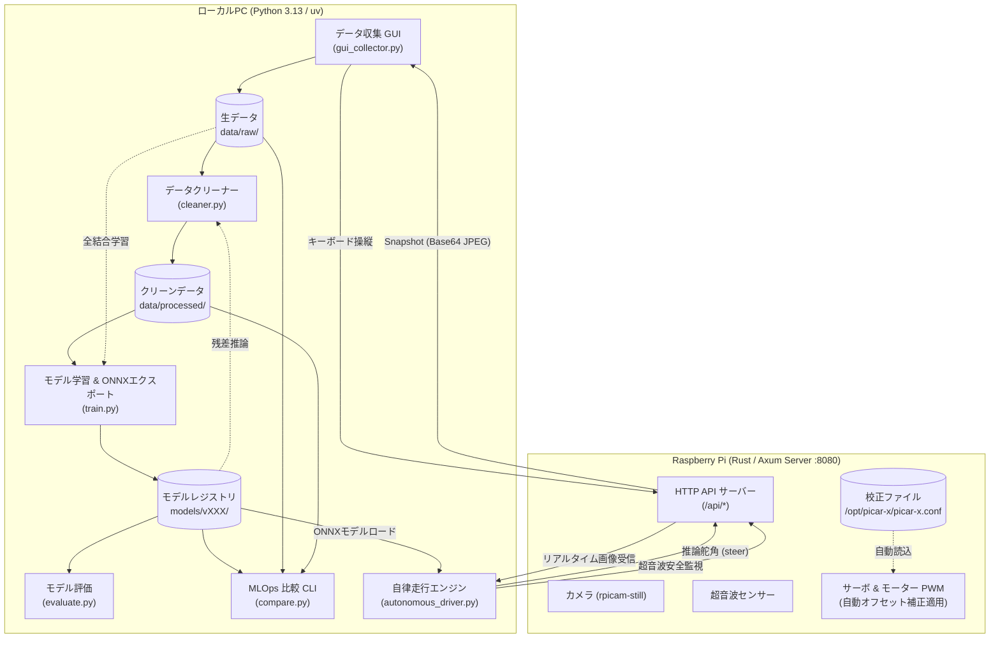

# PiCar-X End-to-End (E2E) 自律走行 & MLOps システム仕様書

本書は、SunFounder PiCar-X において実装された、**「軽量CNNによる画像入力からの直接舵角予測 (End-to-End)」** および **「データ収集・品質管理・モデル管理 (MLOps)」** の全体アーキテクチャと各サブシステムの詳細仕様を定義する。

---

## 1. システム概要 & アーキテクチャ

### 1.1 基本思想
- **GPU完全不要 (CPU前提)**: PC・Raspberry PiともにCPUのみで高速動作する軽量設計。
- **実機車載アーキテクチャ (Plan A Remote Control)**:
  - PC側: データ収集GUI、データクリーニング、PyTorch学習、ONNX Runtime推論、MLOpsレジストリを担当。
  - Raspberry Pi側: Rust/Axum HTTPサーバー経由でカメラ撮影、超音波センサー計測、モーター・サーボPWM制御を担当。
  - 両者間は標準 HTTP/JSON 通信（Base64 JPEG画像伝送）で疎結合に連携。

### 1.2 全体構成図



---

## 2. 各サブシステム詳細仕様

### 2.1 データ収集サブシステム (`gui_collector.py`)
PC上でカメラ映像をリアルタイム確認しながら手動操縦し、高品質な教師データを記録する。

- **モジュールパス**: `python/src/e2e/gui_collector.py`
- **主要機能**:
  - PySide6 による GUI 操作画面
  - `PicarxClient` (HTTPX 同期通信) を用いたリアルタイム遠隔操作
  - 録画トグル（`R` キー / UIボタン）による必要な走行シーンのみの抽出保存
  - 画像と操舵ラベルの完全同期書き込み
- **操作キーアサイン**:
  - `W`: 前進 (設定速度)
  - `S`: 停止 (車速0)
  - `A`: 左ステアリング (10° 刻み)
  - `D`: 右ステアリング (10° 刻み)
  - `X`: ステアリング中立 (0°)
  - `R`: 録画開始 / 一時停止トグル
- **保存データ形式**: `python/data/raw/<session_timestamp>/`
  - `images/frame_xxxxxx.jpg`: 解像度 160×120 の JPEG 画像
  - `labels.jsonl`: 各フレームの JSONL レコード
    ```json
    {
      "timestamp": 1729000000.123,
      "frame": "frame_000001.jpg",
      "steering": -0.2857,
      "throttle": 0.5,
      "speed": 35,
      "ultrasonic": 42.5
    }
    ```
    ※ `steering` は最大舵角 ±35° を基準に `-1.0` (最大左折) 〜 `+1.0` (最大右折) に正規化。

---

### 2.2 データセット管理 & 自動クリーニング (`dataset.py`, `cleaner.py`)

#### 2.2.1 複数セッション統合データセット (`training/dataset.py`)
- **モジュールパス**: `python/src/e2e/training/dataset.py`
- **クラス**: `DrivingDataset(Dataset)`
- **仕様**:
  - 引数 `data_dir` に「単一セッション」「複数セッションのリスト」「親ディレクトリ (`data/raw`, `data/processed`)」のいずれを指定しても、配下の `labels.jsonl` を自動探索して1つのデータセットに結合。
  - 各画像のパスをセッションごとに正しく解決。
  - 前処理パイプライン:
    1. リサイズ: 120×160 ピクセル (H×W)
    2. Tensor 変換: `[0.0, 1.0]`
    3. 正規化: ImageNet 基準 (`mean=[0.485, 0.456, 0.406]`, `std=[0.229, 0.224, 0.225]`)

#### 2.2.2 残差外れ値フィルタ（データクリーナー） (`dataset/cleaner.py`)
- **モジュールパス**: `python/src/e2e/dataset/cleaner.py`
- **クラス / エントリポイント**: `DatasetCleaner`, `clean_dataset()`
- **検出アルゴリズム (Data-Centric AI)**:
  1. 指定された学習済みモデル（`.onnx` または `.pth`）で全フレームのステアリング角 $\hat{y}$ を推論。
  2. 手動入力ラベル $y$ との絶対残差誤差 $e = |\hat{y} - y|$ を算出。
  3. 閾値判定:
     - 絶対誤差閾値 (`--threshold`, デフォルト `0.4` ≒ 約14°以上の乖離) を超えるフレーム
     - またはワーストパーセンタイル (`--top_k_percent`) に該当するフレーム
     これらを「操作遅れ」「衝突後の混乱」「手ブレノイズ」として除外。
- **出力アーティファクト**: `python/data/processed/<output_dir>/`
  - `images/`: セッションID接頭辞を付与したユニークな画像コピー
  - `labels.jsonl`: クリーニング済みの正常ラベル
  - `bad_cases.jsonl`: 除外されたフレーム一覧と除外理由（デバッグ・分析用）
  - `cleaning_report.json`: 除外率、前後MAEの定量的改善レポート
  - `metadata.json`: レジストリ互換の統計メタデータ

---

### 2.3 モデルアーキテクチャ & 学習 (`training/model.py`, `train.py`)

#### 2.3.1 モデル仕様 (`SmallDrivingCNN`)
CPU推論時の超低遅延（数ミリ秒）と高い表現力を両立した4層CNN。

- **入力**: `[Batch, 3, 120, 160]` (RGB画像)
- **出力**: `[Batch, 1]` (予測ステアリング角, `-1.0` 〜 `+1.0`)
- **ネットワーク構造**:
  ```text
  Input (3, 120, 160)
    │
    ├── Conv2d(3 -> 16, 3x3, stride=2, padding=1) + BatchNorm2d + ReLU + MaxPool2d(2) -> (16, 30, 40)
    ├── Conv2d(16 -> 32, 3x3, stride=1, padding=1) + BatchNorm2d + ReLU + MaxPool2d(2) -> (32, 15, 20)
    ├── Conv2d(32 -> 64, 3x3, stride=1, padding=1) + BatchNorm2d + ReLU + MaxPool2d(2) -> (64, 7, 10)
    ├── Conv2d(64 -> 64, 3x3, stride=1, padding=1) + BatchNorm2d + ReLU                 -> (64, 7, 10)
    │
    ├── AdaptiveAvgPool2d((2, 2)) -> (64, 2, 2) = 256次元
    ├── Flatten
    │
    ├── Linear(256 -> 64) + ReLU + Dropout(0.2)
    ├── Linear(64 -> 32) + ReLU
    └── Linear(32 -> 1) + Tanh
  ```

#### 2.3.2 学習仕様 (`training/train.py`)
- **損失関数**: Mean Squared Error (MSE Loss)
- **最適化**: Adam (`lr=1e-3`)
- **データ分割**: Train 80% / Validation 20%
- **エクスポート**:
  - 最良検証ロスの重み: `best_model.pth`
  - ONNX 形式: `model.onnx` (Opset 17, 入出力動的バッチ対応)
  - メタデータ: `metadata.json` (エポック数、バッチサイズ、使用セッション一覧、最良Val Loss)

---

### 2.4 オフライン評価 & MLOps レジストリ (`evaluation/`, `registry/`)

- **オフライン評価 (`evaluate.py`)**:
  - 平均絶対誤差 (MAE) を正規化スケールおよび実角度（±◯度）で算出。
  - 評価結果を `eval_metrics.json` に自動出力。
- **データセットレジストリ (`registry/dataset.py`)**:
  - セッションごとのフレーム数、走行時間、FPS、直進/左折/右折比率、平均操舵角を自動分析。
- **モデルレジストリ (`registry/models.py`)**:
  - 保存済みモデルのバージョン、エポック数、検証損失、MAE、ONNX/PTH成果物の有無を走査。
- **MLOps 比較 CLI (`registry/compare.py`)**:
  - `uv run python -m src.e2e.registry.compare` でターミナル上に Rawデータセット、Processedデータセット、モデル性能を表形式で一覧表示。

---

### 2.5 自律操縦 & セーフティレイヤー (`autonomous_driver.py`)

- **推論ループ (約20Hz)**:
  1. `/api/camera/snapshot` からカメラ画像（Base64 JPEG）を受信
  2. OpenCV / PIL で 120×160 にリサイズ・正規化
  3. ONNX Runtime でステアリング角を推論
  4. 推論値（`-1.0` 〜 `+1.0`）を実機角度（`-35°` 〜 `+35°`）にスケーリング
  5. `/api/drive/steer` へ送信し、一定スロットルで前進
- **多重セーフティガード (Fail-Safe)**:
  - **超音波安全停止**: `/api/sensor/ultrasonic` が指定距離（デフォルト 15.0cm）以下を検知した場合、推論舵角に関わらず**モーターを即時停止**。
  - **緊急停止 (Ctrl+C)**: シグナルハンドラにより、プログラム中断時にステアリング角度0（中立）へ復帰しモーターを停止。

---

### 2.6 ハードウェア校正自動補正レイヤー (`rust/src/picarx/core.rs`)

PiCar-X実機のサーボモーターギア個体差（数度の傾き）を吸収する機構。

- **校正設定ファイルの自動読み込み**:
  - 起動時に `/opt/picar-x/picar-x.conf`、`/etc/picar-x/picar-x.conf`、`~/.config/picar-x/picar-x.conf` を自動探索。
  - `picarx_cam_pan_servo`, `picarx_cam_tilt_servo`, `picarx_dir_servo` をパース。
- **環境変数オーバーライド**:
  - `CAM_PAN_OFFSET`, `CAM_TILT_OFFSET`, `DIR_SERVO_OFFSET` での上書きに対応。
- **駆動時の自動オフセット加算**:
  ```rust
  set_cam_pan_angle(angle + pan_offset);
  set_cam_tilt_angle(angle + tilt_offset);
  set_dir_servo_angle(angle + dir_offset);
  ```
  これにより、Rustサーバー起動直後からカメラが正確に真正面を向き、直進操舵のズレが排除される。

---

## 3. ディレクトリ構成

```text
PiCarX/
├── E2E_ROADMAP.md                 # 開発ロードマップ (Phase 1〜4)
├── E2E_SPECIFICATION.md           # 本仕様書
├── python/
│   ├── pyproject.toml             # uv / Python 依存関係定義 (e2e, dev)
│   ├── data/
│   │   ├── raw/                   # 生データセッション (タイムスタンプ別)
│   │   │   └── <session_id>/
│   │   │       ├── images/
│   │   │       └── labels.jsonl
│   │   └── processed/             # クリーン化済みデータセット
│   │       └── clean_vX/
│   │           ├── images/
│   │           ├── labels.jsonl
│   │           ├── bad_cases.jsonl
│   │           └── cleaning_report.json
│   ├── models/                    # 学習済みモデルレジストリ
│   │   └── vXXX/
│   │       ├── best_model.pth
│   │       ├── model.onnx
│   │       ├── metadata.json
│   │       └── eval_metrics.json
│   ├── src/
│   │   └── e2e/
│   │       ├── README.md          # ユーザー向け操作マニュアル
│   │       ├── autonomous_driver.py # 自律操縦実行スクリプト
│   │       ├── gui_collector.py   # データ収集GUI
│   │       ├── dataset/           # データクリーナー & ユーティリティ
│   │       │   ├── __init__.py
│   │       │   └── cleaner.py
│   │       ├── evaluation/        # 評価スクリプト
│   │       │   └── evaluate.py
│   │       ├── registry/          # MLOps レジストリ & CLI
│   │       │   ├── __init__.py
│   │       │   ├── compare.py
│   │       │   ├── dataset.py
│   │       │   └── models.py
│   │       └── training/          # モデル定義 & 学習
│   │           ├── dataset.py
│   │           ├── model.py
│   │           └── train.py
│   └── tests/                     # ユニットテスト (全15件)
│       ├── test_e2e_cleaner.py
│       └── test_e2e_dataset.py
└── rust/
    └── src/
        └── picarx/
            └── core.rs            # 校正値自動読込付きハードウェア実装
```

---

## 4. 実行コマンド集 (uv前提)

| 目的 | コマンド (PowerShell) |
|---|---|
| **データ収集GUI起動** | `uv run python -m src.e2e.gui_collector` |
| **生データ全結合学習** | `uv run python -m src.e2e.training.train --data_dir data/raw --output_dir models/v004 --epochs 25` |
| **データクリーニング (外れ値除外)** | `uv run python -m src.e2e.dataset.cleaner --data_dir data/raw --model models/v004/model.onnx --threshold 0.4 --output_dir data/processed/clean_v2` |
| **クリーンデータでの再学習** | `uv run python -m src.e2e.training.train --data_dir data/processed/clean_v2 --output_dir models/v005 --epochs 25` |
| **モデルオフライン評価** | `uv run python -m src.e2e.evaluation.evaluate --data_dir data/raw --model_path models/v004/best_model.pth` |
| **MLOps レジストリ確認** | `uv run python -m src.e2e.registry.compare` |
| **実機自律走行** | `uv run python -m src.e2e.autonomous_driver --model models/v004/model.onnx --speed 35` |
| **CI 静的解析** | `uv run ruff check --config pyproject.toml src tests` |
| **CI テスト実行** | `uv run pytest tests` |
