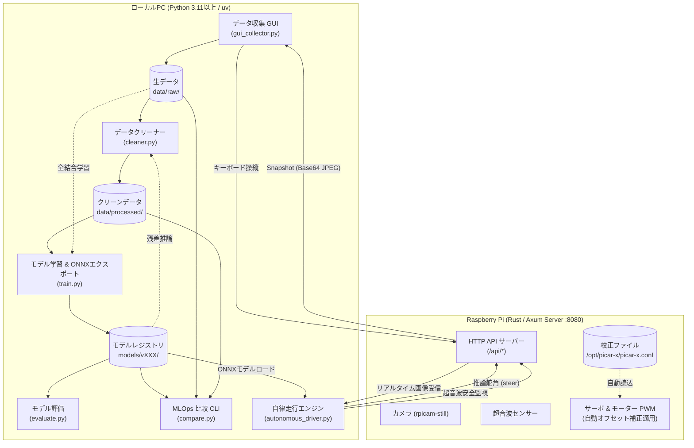

# PiCar-X End-to-End (E2E) 自律走行 & MLOps システム仕様書

本書は、SunFounder PiCar-X において実装された、**「軽量CNNによる画像入力からの直接舵角予測 (End-to-End)」** および **「データ収集・品質管理・モデル管理 (MLOps)」** の現行アーキテクチャと各サブシステムの仕様を定義する。計画は [ROADMAP.md](ROADMAP.md) で管理する。

> [!NOTE]
> - 全体の開発ロードマップ・進捗状況については [ROADMAP.md](ROADMAP.md) を参照してください。
> - ユーザー向けの操作手順については [python/src/e2e/README.md](python/src/e2e/README.md) を参照してください。
> - 未修正の課題は [REVIEW_FINDINGS.md](REVIEW_FINDINGS.md) を参照してください。

---

## 1. 基本方針 & スコープ

### 1.1 基本思想
- **家庭内フリースペース自律走行**: コース・白線・標識のない家庭内（部屋・廊下・家具の間）を縦横無尽に走行し、障害物や行き止まりを自律回避して開けた空間へナビゲートする。
- **GPU不要 (CPU前提)**: PC・Raspberry PiともにCPUのみで動作する軽量設計。
- **現行アーキテクチャ (Plan A Remote Control)**: 推論と安全判断の多くをPC側で行う暫定構成。安全機能と推論はPiへ移す計画（ROADMAP の M1、M3）。
  - PC側: データ収集GUI、データクリーニング、PyTorch学習、ONNX Runtime推論、MLOpsレジストリを担当。
  - Raspberry Pi側: Rust/Axum HTTPサーバー経由でカメラ撮影、超音波センサー計測、モーター・サーボPWM制御を担当。
  - 両者間は標準 HTTP/JSON 通信（Base64 JPEG画像伝送）で疎結合に連携。

### 1.2 対象外 (スコープ外)
- ❌ **フレーム単位の制御への大規模モデル（Vision Transformer / LLM）の使用**: GPUを要し推論遅延が大きいため採用しない。LLMは行き先などの上位の意図のみを扱う（ROADMAP の M5）。
- ❌ **重厚な3Dシミュレーター（Unreal Engine / CARLA）**: 独立GPUリソースを消費するため採用しない。
- ❌ **大規模時系列ディープラーニング（LSTM/動画モデル）**: 計算コストとメモリ消費を抑えるため除外。

### 1.3 注力分野
- ⭕ **MLOps & 実験管理**: データセット・モデルのバージョン管理と定量評価の自動化。
- ⭕ **継続学習（Human-in-the-loop）**: 失敗ケースの切り出しとデータリバランスによる実走性能向上。
- ⭕ **車載安全系（Safety Layer）**: AI推論に依存しない多重センサーFail-Safeの構築。
- ⭕ **エッジ推論（Rust）**: Raspberry Pi単体で完結するONNX推論（未着手、ROADMAP の M3）。
- ⭕ **ツール前提**: Python環境操作は常に `uv`（`uv run` / `uv pip`）を使用する。

---

## 2. 全体構成図



---

## 3. 開発ロードマップについて

計画と進捗は [ROADMAP.md](ROADMAP.md) に集約しています（マイルストーン M0〜M5）。本書の「Step」「Phase」は、コードやコメントで使われている機能 ID です。

---

## 4. 各サブシステム詳細仕様

### 4.1 データ収集サブシステム (`gui_collector.py`)
PC上でカメラ映像をリアルタイム確認しながら手動操縦し、高品質な教師データを記録する。

- **モジュールパス**: `python/src/e2e/gui_collector.py`
- **主要機能**:
  - PySide6 による GUI 操作画面
  - `PicarxClient` (HTTPX 同期通信) を用いたリアルタイム遠隔操作
  - 録画トグル（`R` キー / UIボタン）による必要な走行シーンのみの抽出保存
  - 画像と操舵ラベルの完全同期書き込み
- **操作キーアサイン**:
  - `W`: 前進 (設定速度)
  - `S`: 停止 (車速0)
  - `A`: 左ステアリング (10° 刻み)
  - `D`: 右ステアリング (10° 刻み)
  - `X`: ステアリング中立 (0°)
  - `R`: 録画開始 / 一時停止トグル
- **保存データ形式**: `python/data/raw/<session_timestamp>/`（git 管理外）
  - `images/frame_xxxxxx.jpg`: 解像度 160×120 の JPEG 画像
  - `labels.jsonl`: 各フレームの JSONL レコード
    ```json
    {
      "index": 1,
      "timestamp": 1729000000.123,
      "frame": "frame_000001.jpg",
      "steering": -0.2857,
      "throttle": 0.5
    }
    ```
    - `steering` は最大舵角 ±35° を基準に `-1.0` (最大左折) 〜 `+1.0` (最大右折) に正規化。
    - `throttle` は `W` キーで `0.5`、`S` キーで `0.0` になる。`W` は 600ms の移動指令のため、移動後に停止していても `0.5` のまま記録される。
    - 距離と実速度は保存しない（M3 で追加予定）。
- **収集周期**: `CameraWorker` は約12Hzの設計だが、記録された実測のフレーム間隔は中央値で約1秒（2026-11-03 時点）。

---

### 4.2 データセット管理 & 自動クリーニング (`dataset.py`, `cleaner.py`)

#### 4.2.1 複数セッション統合データセット (`training/dataset.py`)
- **モジュールパス**: `python/src/e2e/training/dataset.py`
- **クラス**: `DrivingDataset(Dataset)`
- **仕様**:
  - 引数 `data_dir` に「単一セッション」「複数セッションのリスト」「親ディレクトリ (`data/raw`, `data/processed`)」のいずれを指定しても、配下の `labels.jsonl` を自動探索して1つのデータセットに結合。
  - 各画像のパスをセッションごとに正しく解決。
  - 前処理パイプライン:
    1. リサイズ: 120×160 ピクセル (H×W)
    2. Tensor 変換: `[0.0, 1.0]`
    3. 正規化: ImageNet 基準 (`mean=[0.485, 0.456, 0.406]`, `std=[0.229, 0.224, 0.225]`)

#### 4.2.2 残差外れ値フィルタ（データクリーナー） (`dataset/cleaner.py`)
- **モジュールパス**: `python/src/e2e/dataset/cleaner.py`
- **クラス / エントリポイント**: `DatasetCleaner`, `clean_dataset()`
- **検出アルゴリズム (Data-Centric AI)**:
  1. 指定された学習済みモデル（`.onnx` または `.pth`）で全フレームのステアリング角 $\hat{y}$ を推論。
  2. 手動入力ラベル $y$ との絶対残差誤差 $e = |\hat{y} - y|$ を算出。
  3. 閾値判定:
     - 絶対誤差閾値 (`--threshold`, デフォルト `0.4` ≒ 約14°以上の乖離) を超えるフレーム
     - またはワーストパーセンタイル (`--top_k_percent`) に該当するフレーム
     これらを「操作遅れ」「衝突後の混乱」「手ブレノイズ」として除外。
- **出力アーティファクト**: `python/data/processed/<output_dir>/`
  - `images/`: セッションID接頭辞を付与したユニークな画像コピー
  - `labels.jsonl`: クリーニング済みの正常ラベル
  - `bad_cases.jsonl`: 除外されたフレーム一覧と除外理由（デバッグ・分析用）
  - `cleaning_report.json`: 除外率、前後MAEの定量的改善レポート
  - `metadata.json`: レジストリ互換の統計メタデータ
- **注意**: モデルと一致しないフレームを除外するため、「前後MAE」は改善して見えやすい。走行性能の改善の根拠には使わない。

---

### 4.3 モデルアーキテクチャ & 学習 (`training/model.py`, `train.py`)

#### 4.3.1 モデル仕様 (`SmallDrivingCNN`)
CPU推論を想定した4層の軽量CNN（推論時間の実測値は未記録）。

- **入力**: `[Batch, 3, 120, 160]` (RGB画像)
- **出力**: `[Batch, 1]` (予測ステアリング角, `-1.0` 〜 `+1.0`)
- **ネットワーク構造**:
  ```text
  Input (3, 120, 160)
    │
    ├── Conv2d(3 -> 16, 3x3, stride=2, padding=1) + BatchNorm2d + ReLU + MaxPool2d(2) -> (16, 30, 40)
    ├── Conv2d(16 -> 32, 3x3, stride=1, padding=1) + BatchNorm2d + ReLU + MaxPool2d(2) -> (32, 15, 20)
    ├── Conv2d(32 -> 64, 3x3, stride=1, padding=1) + BatchNorm2d + ReLU + MaxPool2d(2) -> (64, 7, 10)
    ├── Conv2d(64 -> 64, 3x3, stride=1, padding=1) + BatchNorm2d + ReLU                 -> (64, 7, 10)
    │
    ├── AdaptiveAvgPool2d((2, 2)) -> (64, 2, 2) = 256次元
    ├── Flatten
    │
    ├── Linear(256 -> 64) + ReLU + Dropout(0.2)
    ├── Linear(64 -> 32) + ReLU
    └── Linear(32 -> 1) + Tanh
  ```

#### 4.3.2 学習仕様 (`training/train.py`)
- **損失関数**: Mean Squared Error (MSE Loss)
- **最適化**: Adam (`lr=1e-3`)
- **データ分割**: Train 80% / Validation 20%（フレーム単位のランダム分割、シード未固定）
- **データ拡張**: なし
- **エクスポート**:
  - 最良検証ロスの重み: `best_model.pth`
  - ONNX 形式: `model.onnx` (Opset 17, 入出力動的バッチ対応)
  - メタデータ: `metadata.json` (エポック数、バッチサイズ、使用セッション一覧、最良Val Loss)

---

### 4.4 オフライン評価 & MLOps レジストリ (`evaluation/`, `registry/`)

- **オフライン評価 (`evaluate.py`)**:
  - 平均絶対誤差 (MAE) を正規化スケールおよび実角度（±◯度）で算出。
  - 評価結果を `eval_metrics.json` に自動出力。
  - 指定したディレクトリの全フレームで評価する。学習に使ったデータを指定すると、その分も評価に含まれる（`v004` は学習データ全150件で評価）。走行性能の指標としては使わない。
- **データセットレジストリ (`registry/dataset.py`)**:
  - セッションごとのフレーム数、走行時間、FPS、直進/左折/右折比率、平均操舵角を自動分析。
- **モデルレジストリ (`registry/models.py`)**:
  - 保存済みモデルのバージョン、エポック数、検証損失、MAE、ONNX/PTH成果物の有無を走査。
- **MLOps 比較 CLI (`registry/compare.py`)**:
  - `uv run python -m src.e2e.registry.compare` でターミナル上に Rawデータセット、Processedデータセット、モデル性能を表形式で一覧表示。

---

### 4.5 自律操縦 & セーフティレイヤー (`autonomous_driver.py`)

- **実行場所**: PC。Pi とは HTTP で通信する。
- **ループの処理順**:
  1. ウォッチドッグの確認
  2. `/api/sensor/grayscale` による段差の確認
  3. `/api/sensor/ultrasonic` による障害物の確認
  4. `/api/camera/snapshot` から画像を取得（Base64 JPEG）
  5. スタック検知
  6. 120×160 に変換し、ONNX Runtime でステアリング角を推論
  7. 速度リミッターで速度を決定し、介入バッファ、軌跡、オドメトリを更新
  8. `/api/drive/steer` と `/api/drive/move`（400ms）を送信
  9. 地図の描画と 50ms の待機
- **実測周期（2026-11-03 のログ解析）**: フレーム間隔の中央値 **1.14秒**、p10 1.04秒、p90 2.59秒（2,930間隔）。主な原因は撮影ごとの `rpicam-still` 起動と推定する（内訳は未計測）。
- **動作の特徴**: 1回の移動は 400ms なので、停止と前進を繰り返す。

#### 安全機能の実行場所

| 機能 | 実行場所 | タイミング | 備考 |
|---|---|---|---|
| 前進可否チェック（15cm） | Pi (Rust) | `move` を受信した時のみ | 走行中は監視しない |
| 移動時間による自動停止 | Pi (Rust) | 指定時間の経過後 | `duration_ms=0` は自動停止しない |
| 緊急停止 `/api/drive/stop` | Pi (Rust) | 受信時 | モーターは止まるが、次の `move` で停止状態が解除される |
| 通信タイムアウト | PC (Python) | ループ先頭 | Pi 側の `is_timed_out` は未使用 |
| 段差検知 | PC (Python) | ループごと | 閾値は150固定。`calibrate()` は未使用 |
| 超音波停止 | PC (Python) | ループごと | 距離0と通信失敗（999扱い）は障害物なしとして扱う |
| 速度リミッター | PC (Python) | ループごと | |
| 直前軌跡の後退 | PC (Python) | 段差検知時、行き止まり時 | 記録時間は1ステップ最大200ms |
| スタック検知 | PC (Python) | ループごと | 8フレーム前との比較を15回。実測の周期で約25秒 |
| Ctrl+C / `Q` キー | PC (Python) | 受信時 | 舵を0に戻してモーターを停止 |

---

### 4.6 ハードウェア校正自動補正レイヤー (`rust/src/picarx/core.rs`)

PiCar-X実機のサーボモーターギア個体差（数度の傾き）を吸収する機構。

- **校正設定ファイルの自動読み込み**:
  - 起動時に `/opt/picar-x/picar-x.conf`、`/etc/picar-x/picar-x.conf`、`~/.config/picar-x/picar-x.conf` を自動探索。
  - `picarx_cam_pan_servo`, `picarx_cam_tilt_servo`, `picarx_dir_servo` をパース。
- **環境変数オーバーライド**:
  - `CAM_PAN_OFFSET`, `CAM_TILT_OFFSET`, `DIR_SERVO_OFFSET` での上書きに対応。
- **駆動時の自動オフセット加算**:
  ```rust
  set_cam_pan_angle(angle + pan_offset);
  set_cam_tilt_angle(angle + tilt_offset);
  set_dir_servo_angle(angle + dir_offset);
  ```
  これにより、Rustサーバー起動直後からカメラが正確に真正面を向き、直進操舵のズレが排除される。

---

## 5. 機能の詳細

各機能の状態は [ROADMAP.md §6](ROADMAP.md) を正とする。ここでは実装内容と制限を記載する。

### Phase 1: 軽量 MLOps & モデルレジストリ
- **Dataset Registry (`registry/dataset.py`)**: 各走行ログの統計情報（総フレーム数、走行時間、FPS、直進/左折/右折比率、平均舵角）を算出。
- **Model Registry (`registry/models.py`)**: `models/vXXX` の学習設定、エポック数、検証損失、MAE を一覧化。
- **Model Comparator CLI (`registry/compare.py`)**: `uv run python -m src.e2e.registry.compare` で表形式に表示。
- **制限**: 実走の指標（介入回数など）は扱わない。

---

### Phase 2: データ収集と再学習
1. **Disengagement Logger (`dataset/disengagement_manager.py`)**:
   - `cliff_detected`、`obstacle_stop`、`communication_timeout`、`stuck_detected`、`manual_intervention` の発生時に、リングバッファの直前30フレームを保存する。
   - **制限**: 現行周期では30フレームが約30秒以上に相当する。
   - **制限**: `steering` はモデルの出力であり人の修正ではない。`--approve` で学習対象にすると、失敗時の操舵を正解として学習する。人の修正操作を記録する仕組みができるまで、承認して学習に使わない。
2. **Dataset Merging**: 複数セッションの統合学習に対応。
3. **Retraining Pipeline**: `models/v001`〜`v005`、`clean_v1`、`clean_v2` を生成済み。
   - **現状のデータ量**: 3セッション計150フレーム（左101 / 直進37 / 右12）。

---

### Phase 3: 安全機能と空間マッピング
実行場所は [§4.5](#45-自律操縦--セーフティレイヤー-autonomous_driverpy) を参照。いずれも PC 側で動作し、反応速度は走行ループの周期に制限される。

1. **Phase 3.1: 段差検知 (`safety/cliff_detector.py`)**: 底面グレースケールのいずれかが閾値未満なら段差と判定する。
2. **Phase 3.2: 速度リミッター (`safety/speed_limiter.py`)**: 舵角と前方距離から速度を下げる。
3. **Phase 3.3: ウォッチドッグ (`safety/watchdog.py`)**: ハートビートの途絶または連続エラーで停止する。
   - **制限**: 記録された57件の発火はすべて連続エラー0回で、通信断以外の要因が含まれる（原因は未特定）。
4. **Phase 3.4: 直前軌跡と安全後退 (`safety/trajectory_tracker.py`)**: 直近の舵角を逆順に再生して後退し、その後に旋回する。
   - **制限**: 脱出後は履歴を消去する。履歴がない場合は確認なしで直進後退する。旋回中は段差を確認しない。
5. **Phase 3.5: 占有格子 (`mapping/occupancy_grid.py`, `mapping/visualizer.py`)**: 推測航法と前方超音波から 2D 地図を作り、時間で減衰させる。
   - **既知のバグ**: 右操舵で地図上は左に曲がる（左右反転）。移動距離を半分以下に記録する。ガードに拒否された移動も記録する。通信失敗を空きとして書き込む。
   - **制限**: エンコーダーと IMU がなく、スリップによるズレが蓄積する。地図の保存と読込はできない（画像保存のみ）。
6. **Phase 3.6: スタック検知 (`safety/stuck_detector.py`)**: 画像の変化が小さい状態が続くと、後退、ウィグル、迂回前進を実行する。
   - **制限**: 現行周期では検知に約25秒かかる。

---

### 計画中の機能
Pi 上の推論（旧 Phase 4）は ROADMAP の M3 に統合した。現時点で性能を実測していないので、達成値は完了条件で管理する。

---

## 6. ディレクトリ構成

```text
PiCarX/
├── ROADMAP.md                     # 計画と進捗
├── REVIEW_FINDINGS.md             # 未修正の課題
├── E2E_SPECIFICATION.md           # 本仕様書
├── python/
│   ├── pyproject.toml             # uv / Python 依存関係定義 (e2e, dev)
│   ├── data/                      # 走行データ（git 管理外）
│   │   ├── raw/<session_id>/      # images/, labels.jsonl
│   │   ├── processed/clean_vX/    # images/, labels.jsonl, bad_cases.jsonl, cleaning_report.json
│   │   └── disengagements/<id>/   # images/, labels.jsonl, event.json
│   ├── models/vXXX/               # best_model.pth, model.onnx, metadata.json, eval_metrics.json
│   ├── src/e2e/
│   │   ├── README.md              # 操作マニュアル
│   │   ├── autonomous_driver.py   # 自律走行
│   │   ├── gui_collector.py       # データ収集 GUI
│   │   ├── dataset/               # cleaner.py, disengagement_manager.py
│   │   ├── evaluation/            # evaluate.py
│   │   ├── mapping/               # occupancy_grid.py, visualizer.py
│   │   ├── registry/              # compare.py, dataset.py, models.py
│   │   ├── safety/                # cliff_detector.py, speed_limiter.py, stuck_detector.py,
│   │   │                          # trajectory_tracker.py, watchdog.py
│   │   └── training/              # dataset.py, model.py, train.py
│   └── tests/                     # ユニットテスト
└── rust/src/
    ├── api/                       # HTTP API
    ├── safety/                    # 前進可否チェック
    ├── sensor_monitor/            # センサーのポーリング
    └── picarx/core.rs             # ハードウェア制御（校正値の自動読込）
```

---

## 7. 実行コマンド集 (uv前提)

| 目的 | コマンド (PowerShell) |
|---|---|
| **データ収集GUI起動** | `uv run python -m src.e2e.gui_collector` |
| **生データ全結合学習** | `uv run python -m src.e2e.training.train --data_dir data/raw --output_dir models/v004 --epochs 25` |
| **データクリーニング (外れ値除外)** | `uv run python -m src.e2e.dataset.cleaner --data_dir data/raw --model models/v004/model.onnx --threshold 0.4 --output_dir data/processed/clean_v2` |
| **クリーンデータでの再学習** | `uv run python -m src.e2e.training.train --data_dir data/processed/clean_v2 --output_dir models/v005 --epochs 25` |
| **モデルオフライン評価** | `uv run python -m src.e2e.evaluation.evaluate --data_dir data/raw --model_path models/v004/best_model.pth` |
| **MLOps レジストリ確認** | `uv run python -m src.e2e.registry.compare` |
| **実機自律走行** | `uv run python -m src.e2e.autonomous_driver --model models/v004/model.onnx --speed 35` |
| **介入イベント一覧確認** | `uv run python -m src.e2e.dataset.disengagement_manager --list` |
| **Rustクロスコンパイル** | `cd rust/build; make build MODEL=5` (ローカルPC Docker上。基準機種は Pi 5) |
| **Rustラズパイ送信** | `cd rust/build; make deploy RPI_HOST=pi@<IP> RPI_DIR=/home/pi/` |
| **静的解析（ローカル）** | `uv run ruff check --config pyproject.toml src tests` |
| **テスト実行（ローカル）** | `uv run pytest tests` |

---

## 8. 開発プロセス & 品質ルール

- **Python実行ルール**: 常に `uv` を前提とする（`uv run python -m ...`、`uv pip install ...`）。
- **Rustビルド & デプロイルール**: 実機でのコンパイルは行わず、常にローカルPC上でDockerクロスコンパイル（`rust/build/Makefile`）を行い、`scp`（`make deploy`）でRaspberry Piへバイナリを送信する。
- **コード品質**:
  - リンター/フォーマッタ: `uv run ruff check --config pyproject.toml src tests`
  - ユニットテスト: `uv run pytest tests`
  - 新機能追加時もテスト全件合格を維持する。Python の CI は未整備で、ローカルで実行する（ROADMAP の M1 で追加）。
- **機密情報と個人データ**: `.env`、走行データ（室内画像を含む）、音声、記憶 DB は git に追加しない（`.gitignore` で除外）。
