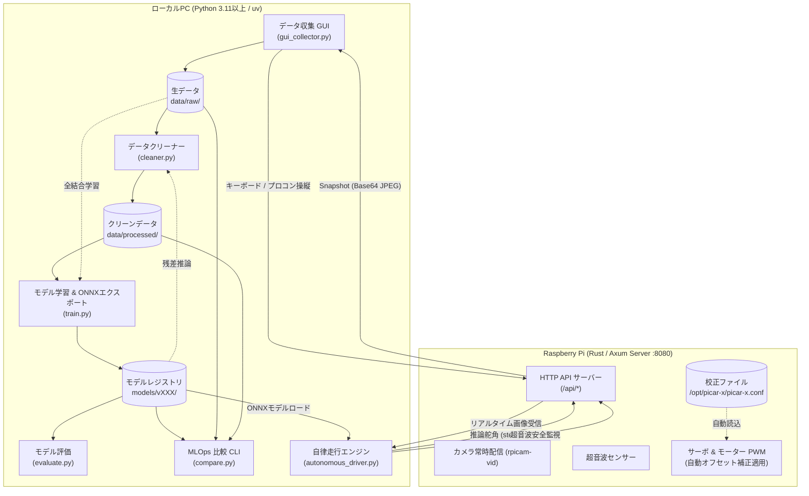

# PiCar-X End-to-End (E2E) 自律走行 & MLOps システム仕様書

本書は、SunFounder PiCar-X において実装された、**「軽量CNNによる画像入力からの直接舵角予測 (End-to-End)」** および **「データ収集・品質管理・モデル管理 (MLOps)」** の現行アーキテクチャと各サブシステムの仕様を定義する。計画は [ROADMAP.md](ROADMAP.md) で管理する。

> [!NOTE]
> - 全体の開発ロードマップ・進捗状況については [ROADMAP.md](ROADMAP.md) を参照してください。
> - ユーザー向けの操作手順については [python/src/e2e/README.md](python/src/e2e/README.md) を参照してください。
> - 未修正の課題は [REVIEW_FINDINGS.md](REVIEW_FINDINGS.md) を参照してください。

---

## 1. 基本方針 & スコープ

### 1.1 基本思想
- **家庭内フリースペース自律走行**: コース・白線・標識のない家庭内（部屋・廊下・家具の間）を縦横無尽に走行し、障害物や行き止まりを自律回避して開けた空間へナビゲートする。
- **GPU不要 (CPU前提)**: PC・Raspberry PiともにCPUのみで動作する軽量設計。
- **現行アーキテクチャ**: 安全系と自律走行のループは Pi で動く（ROADMAP の M1、D-7）。PC は収集、学習、評価、データの管理と、走行の開始、見守り、引き継ぎを担当する。
  - PC側: データ収集 GUI、データビューア、学習と ONNX 出力、交差検証、モデルの配置、Pi の自律走行の操作（`pi_autopilot.py`）。PC で推論して走る `autonomous_driver.py` も残す（比較と地図の表示用）。
  - Raspberry Pi側: Rust/Axum の HTTP サーバー。カメラの常時配信、センサー、反射ループ、自律走行（`tract` で推論、§4.5.1）、走行の記録。
  - 両者の間は HTTP/JSON とカメラの MJPEG 配信。
- **走行データの収集は M6 の後**: 今の装備では、舵0でも左へ曲がる、細い脚と布が超音波に映らない、黒いマットと段差を区別できない。新しい走行データは、装備を見直して直進を確かめてから集める（ROADMAP の D-8、2026-11-17）。

### 1.2 対象外 (スコープ外)
- ❌ **フレーム単位の制御への大規模モデル（Vision Transformer / LLM）の使用**: GPUを要し推論遅延が大きいため採用しない。LLMは行き先などの上位の意図のみを扱う（ROADMAP の M5）。
- ❌ **重厚な3Dシミュレーター（Unreal Engine / CARLA）**: 独立GPUリソースを消費するため採用しない。
- ❌ **大規模時系列ディープラーニング（LSTM/動画モデル）**: 計算コストとメモリ消費を抑えるため除外。

### 1.3 注力分野
- ⭕ **MLOps & 実験管理**: データセット・モデルのバージョン管理と定量評価の自動化。
- ⭕ **継続学習（Human-in-the-loop）**: 失敗ケースの切り出しとデータリバランスによる実走性能向上。
- ⭕ **車載安全系（Safety Layer）**: AI推論に依存しない多重センサーFail-Safeの構築。
- ⭕ **エッジ推論（Rust）**: Raspberry Pi 単体で完結する ONNX 推論（`tract`、2026-11-14 実装、§4.5.1）。
- ⭕ **ツール前提**: Python環境操作は常に `uv`（`uv run` / `uv pip`）を使用する。

---

## 2. 全体構成図



---

## 3. 開発ロードマップについて

計画と進捗は [ROADMAP.md](ROADMAP.md) に集約しています（マイルストーン M0〜M10）。本書の「Step」「Phase」は、コードやコメントで使われている機能 ID です。

---

## 4. 各サブシステム詳細仕様

### 4.1 データ収集サブシステム (`gui_collector.py`)
PC上でカメラ映像をリアルタイム確認しながら手動操縦し、高品質な教師データを記録する。

- **モジュールパス**: `python/src/e2e/gui_collector.py`
- **主要機能**:
  - PySide6 による GUI 操作画面
  - `PicarxClient` (HTTPX 同期通信) を用いたリアルタイム遠隔操作
  - 録画トグル（`R` キー / UIボタン）による必要な走行シーンのみの抽出保存
  - 画像と操舵ラベルの完全同期書き込み
- **操作キーアサイン**:
  - `W`: 押している間だけ前進（設定速度）。0.1秒ごとに指令を送り直し、離すと止まる。キーの自動の連打には頼らない（走りながら `A` や `D` を押すと OS が止めるため）
  - `S`: 停止 (車速0)
  - `A` / `D`: 押している間、舵を毎秒60°で左 / 右へ切る（最大 ±35°）。離すと同じ速さで中央へ戻る
  - `X`: ステアリングを即座に中立 (0°)
  - `Q` / `E`: 押している間、意図を左 / 右にする（両方ならおまかせ）
  - `R`: 録画開始 / 一時停止トグル
  - 食い違いが続いて止まった時、`S` で止めた時、Pi が指令を拒否した時は、走行の操作（キーとプロコン）をすべて離すまで走り出さない。ウィンドウから操作が別の場所へ移った時は、すべてのキーを離したとみなして止まる（2026-11-09 から）
- **プロコン（Nintendo Switch Pro Controller）** (`gamepad.py`、2026-11-11 から): SDL（pygame-ce、`e2e` の追加の依存）の GameController として 20ms ごとに読む。面のボタンは位置で読み（`SDL_GAMECONTROLLER_USE_BUTTON_LABELS=0`）、位置からプロコンの刻印を決める。キーボードと同時に使え、前進が後退より優先
  - `A` / `ZR`: 押している間、前進（設定速度）。`B` / `ZL`: 押している間、後退（`DRIVE_SPEED`。後退で車輪が回る最低の速度は未計測のため）。両方なら止まる
  - 左スティックの左右: 倒した量に応じた舵角（中央の15%は無視）。十字キーの左右: 舵をいっぱいまで切る。どちらもキーボードと同じ毎秒60°で目標へ近づける
  - `X`: 停止（`S` と同じ）。`HOME`: 緊急停止（画面の EMERGENCY STOP と同じ）。`＋`: 録画トグル。`－`: 舵を中央へ。`Y` は `B` の隣で押し間違えやすいので使わない
  - `L` / `R`: 押している間、意図（行きたい向き）を左 / 右にする。押していなければ、または両方ならおまかせ。車の動きは変えない（2026-11-12 から）
  - プロコンが抜けたら、押していた操作を離したとみなして止まる。接続と割り当ての確認は `uv run python -m src.e2e.gamepad`
- **保存データ形式**: `python/data/raw/<session_timestamp>/`（git 管理外）
  - `images/frame_xxxxxx.jpg`: 解像度 160×120 の JPEG 画像
  - `labels.jsonl`: 各フレームの JSONL レコード
    ```json
    {
      "index": 1,
      "timestamp": 1729000000.123,
      "frame": "frame_000001.jpg",
      "steering": -0.2857,
      "throttle": 0.5,
      "intent": "any",
      "stream_seq": 1234,
      "distance_cm": 42.3,
      "distance_far": false,
      "floor": [921, 939, 924],
      "battery_v": 7.88,
      "command": {"speed": 40, "steering_deg": -10.0, "since_s": 1.2, "camera_moving": false},
      "motion": {"yaw_rate_dps": -6.1, "expansion_rate": 0.08, "edge_flow_px_s": 14.2,
                 "image_moving": true, "approach_cm_s": 9.8, "...": "..."},
      "motion_check": {"flags": []}
    }
    ```
    - `steering` は最大舵角 ±35° を基準に `-1.0` (最大左折) 〜 `+1.0` (最大右折) に正規化。
    - `throttle` は前進の指令が有効な間だけ `0.5`、後退の指令が有効な間は `-0.5`（2026-11-11 から）、それ以外は `0.0`。`W` は期限 600ms の指令なので、指令が途絶えて止まった後は `0.0` になる（2026-11-08 から。それ以前の記録は止まった後も `0.5`）。
    - `intent` は行きたい向き（`any` / `left` / `right`）。分かれ道でどちらへ行きたいかを、プロコンの `L` / `R`（キーボードは `Q` / `E`）を押している間だけ記録する。上の層（M5 の見回りと行き先）が走行モデルへ渡す値と同じ。走り方は「基本はまっすぐ、塞がれたら空いている側へ曲がる」で、意図があればその向きを選ぶ。記録のない古いフレームは `any` とみなす（2026-11-12 から）。
    - `distance_cm` は超音波の距離。何も捉えていない時は `null`。反射が戻らず遠いと Pi が判断した時は `distance_far` が `true`。
    - `floor` は床センサーの値（左、中央、右）、`battery_v` は電池電圧。どちらも Pi の `/api/status` から、フレームごとに1回読む。読めなかった時は `null`（2026-11-09 から）。
    - `stream_seq` はカメラの常時配信の通し番号。収集はこの配信（約15fps）を使う。番号が飛んでいれば、その間のフレームを取りこぼしている。
    - `command` はそのフレームの時点で有効な指令（期限を含む）、`motion` はカメラの画像の動きと超音波から推定した実際の動き、`motion_check` は指令との食い違い（§4.7）。食い違いのあるフレームは学習から外す。前進の指令がなかったフレーム（`command.speed` か `throttle` が 0 以下。止まっている時と後退中）も学習から外す。止まっている間や後退中の舵角は、その景色で前へ進みながらどう曲がるかの手本にならないため（2026-11-10 から。外した数は `metadata.json` の `skipped_stopped`）。
- **食い違いが続いた時**: 同じ食い違いが1秒続くと、走行を止めて画面に表示し、記憶に「走行を止めた」出来事として残す。
- **収集周期**: `CameraWorker` はカメラの常時配信を受け、フレームごとに Pi の状態を1回読む。実機で 15.0fps、取りこぼしなし（2026-11-09、2026-11-11 の収集でも 15.0fps）。旧方式（静止画と超音波を毎回取得）は中央値で約1秒だった。

---

### 4.2 データセット管理 & 自動クリーニング (`dataset.py`, `cleaner.py`)

#### 4.2.1 複数セッション統合データセット (`training/dataset.py`)
- **モジュールパス**: `python/src/e2e/training/dataset.py`
- **クラス**: `DrivingDataset(Dataset)`
- **仕様**:
  - 引数 `data_dir` に「単一セッション」「複数セッションのリスト」「親ディレクトリ (`data/raw`, `data/processed`)」のいずれを指定しても、配下の `labels.jsonl` を自動探索して1つのデータセットに結合。
  - 各画像のパスをセッションごとに正しく解決。クリーナーの出力のように `source_dir` を持つレコードは、参照先の元のセッションから画像を読む。
  - 各サンプルの `session_id` は元のセッション（分割と集計に使う）。画像を複製していた旧形式の出力は `cleaned_meta.original_session` を使う。
  - 前処理パイプライン:
    1. リサイズ: 120×160 ピクセル (H×W)
    2. Tensor 変換: `[0.0, 1.0]`
    3. 正規化: ImageNet 基準 (`mean=[0.485, 0.456, 0.406]`, `std=[0.229, 0.224, 0.225]`)

#### 4.2.2 残差外れ値フィルタ（データクリーナー） (`dataset/cleaner.py`)
- **モジュールパス**: `python/src/e2e/dataset/cleaner.py`
- **クラス / エントリポイント**: `DatasetCleaner`, `clean_dataset()`
- **検出アルゴリズム (Data-Centric AI)**:
  1. 指定された学習済みモデル（`.onnx` または `.pth`）で全フレームのステアリング角 $\hat{y}$ を推論。
  2. 手動入力ラベル $y$ との絶対残差誤差 $e = |\hat{y} - y|$ を算出。
  3. 閾値判定:
     - 絶対誤差閾値 (`--threshold`, デフォルト `0.4` ≒ 約14°以上の乖離) を超えるフレーム
     - またはワーストパーセンタイル (`--top_k_percent`) に該当するフレーム
     これらを「操作遅れ」「衝突後の混乱」「手ブレノイズ」として除外。
- **出力アーティファクト**: `python/data/processed/<output_dir>/`
  - 画像は複製しない（元のデータを唯一の正とする）
  - `labels.jsonl`: クリーニング済みの正常ラベル。各レコードの `source_dir` は元のセッションへの相対パス（相対にできなければ絶対パス）
  - `bad_cases.jsonl`: 除外されたフレーム一覧と除外理由（デバッグ・分析用）
  - `cleaning_report.json`: 除外率、前後MAEの定量的改善レポート
  - `metadata.json`: レジストリ互換の統計メタデータ
- **注意**: モデルと一致しないフレームを除外するため、「前後MAE」は改善して見えやすい。走行性能の改善の根拠には使わない。

#### 4.2.3 手作業のラベル (`dataset/annotations.py`)
- 走行データ（`labels.jsonl`）は書き換えず、人が付けたラベルを `python/data/annotations/<セッションID>.json` に置く（2026-11-16 から）。フレームはファイル名で指す
- フレームごとの値: `tags`（自由なタグ。絞り込みと集計用）、`exclude`（学習と評価に使わない）、`intent`（学習の意図の上書き）、`blocked`（前方が塞がっているかの上書き。`null` は不明にする）、`note`
- 学習（`configs/train.toml` の `annotations = true`）: `exclude` のフレームは舵角にも塞がっているかの学習にも使わない。`intent` と `blocked` は、自動のラベル（意図の付け直し、超音波、引っかかり）より優先する。セッションごとの注釈の中身のハッシュと使った数を、`metadata.json` と交差検証の結果の `annotations` に残す
- 保存は一時ファイルに書いてから置き換える。注釈のファイルを消せば元のデータに戻る

---

### 4.3 モデルアーキテクチャ & 学習 (`training/model.py`, `train.py`)

#### 4.3.1 モデル仕様 (`SmallDrivingCNN`)
CPU推論を想定した4層の軽量CNN（推論時間の実測値は未記録）。

- **入力**: `[Batch, 3, 120, 160]` (RGB画像、ONNX の入力名 `input`) と `[Batch, 3]` (行きたい向き。`any`, `left`, `right` の順の 0 / 1、ONNX の入力名 `intent`、2026-11-12 から)
- **出力**: `[Batch, 1]` (予測ステアリング角, `-1.0` 〜 `+1.0`、ONNX の出力名 `steering`) と `[Batch, 1]` (前方が塞がっている確率 `0.0` 〜 `1.0`、ONNX の出力名 `blocked`、2026-11-14 から)。`blocked` は `metadata.json` の `blocked_output.trained` が true の時だけ意味を持つ
- **前方が塞がっているか**: 共通の 128 次元の特徴から、もう1つの頭（Linear(128 -> 32) + ReLU + Linear(32 -> 1)）でロジットを出す。ONNX ではシグモイドを通した確率を出す。意図には関係しない
- **意図の扱い**: 意図ごとに出力の頭（ヘッド）を分ける分岐型（条件付きの模倣学習）。画像の特徴と1つ目の全結合層は共通で、意図に合う頭の値だけを出す。意図を特徴につなげるだけの形より意図に従わせやすい。意図を省くと `any`。記録に意図のない古いフレームも `any` として学習する
- **ネットワーク構造**:
  ```text
  Input (3, 120, 160)
    │
    ├── Conv2d(3 -> 16, 5x5, stride=2) + BatchNorm2d + ReLU   -> (16, 58, 78)
    ├── Conv2d(16 -> 32, 5x5, stride=2) + BatchNorm2d + ReLU  -> (32, 27, 37)
    ├── Conv2d(32 -> 64, 5x5, stride=2) + BatchNorm2d + ReLU  -> (64, 12, 17)
    ├── Conv2d(64 -> 64, 3x3, stride=1) + BatchNorm2d + ReLU  -> (64, 10, 15)
    │
    ├── AdaptiveAvgPool2d((4, 4)) -> (64, 4, 4) = 1024次元
    ├── Flatten
    ├── Linear(1024 -> 128) + ReLU + Dropout(0.3)               (意図で共通)
    │
    ├── 頭 any  : Linear(128 -> 32) + ReLU + Linear(32 -> 1) + Tanh
    ├── 頭 left : 同上
    ├── 頭 right: 同上
    ├── 出力 = 3つの頭の値と意図の 0 / 1 の積の和（意図の頭の値）
    │
    └── 頭 blocked: Linear(128 -> 32) + ReLU + Linear(32 -> 1)（ロジット）
  ```

#### 4.3.2 学習仕様 (`training/train.py`)
- **損失関数**: 舵角は Mean Squared Error (MSE Loss)。`blocked_loss_weight` が 0 より大きい時は、前方が塞がっているかの二値交差エントロピーに重みを掛けて足す。舵角の損失は舵角に使えるフレームだけ、塞がっているかの損失はラベルのあるフレームだけで計算する。重みが 0 なら、学習はこの頭がない時とまったく同じになる（乱数の使い方も含めて確認済み）
- **前方が塞がっているかのラベル**: 超音波の距離から自動で付ける。40cm 未満で「塞がっている」、60cm 以上か反射が戻らない（`distance_far`）時は「空いている」、その間と距離のない記録は使わない（`blocked_near_cm`、`blocked_clear_cm`）。止まった、下がった、曲がれなかった（`exclude`）、食い違いの印があるフレームは舵角には使わないが、塞がっているかの学習には使う。細い家具の脚や音を吸う物は超音波で見えないので、「空いている」のラベルにも誤りが混じる。そこで、前へ進む指令なのに動けなかった（`no_motion`）フレームは、超音波によらず「塞がっている」とし、その前後15フレーム（約1秒）の「空いている」は使わない（`blocked_stuck`、既定は true）。交差検証は、しきい値ごとの再現率と適合率、超音波のラベルだけでの指標、引っかかったフレームを画像から当てた割合（`blocked_detail`）も出す
- **曲がりの意図の付け直し** (`turn_intent`、既定の設定は true): 自動収集の曲がりの区間（`policy_state` の `avoid` と `open_turn`）と、その後に舵が中央へ戻るまでの `cruise` のフレームに、曲がった向きを意図として付ける（`dataset.turn_intents`）。どちらへ、いつまで曲がるかは直前の経過で決まり1枚の画像からは分からないため、向きは上の層（自律走行の `avoidance.py`）が意図で与える。記録のままの意図は `intent_recorded` に残る
- **最適化**: Adam (`lr=1e-3`)
- **設定**: `python/configs/train.toml`（エポック数、バッチサイズ、学習率、シード、検証セッション、`blocked_loss_weight`、`blocked_near_cm`、`blocked_clear_cm`、`blocked_stuck`、`turn_intent`、`flip_augment`）。コマンドラインの引数で上書きできる
- **再現性**: シードを固定し、CPU で決定的なアルゴリズムだけを使う。同じデータと設定なら同じ指標になる
- **データ分割**: セッション単位。検証セッションの指定がなければ名前順で最後のセッション。セッションが1つしかない、または検証が空なら学習しない
- **交差検証** (`training/cross_validate.py`): セッションを1つずつ抜いて学習し（エポック数は固定、最後の重み）、抜いたセッションで評価する。モデルの比較はこの値で行う。画像を見ない基準（`baselines`: 常に0°、学習に使ったセッションの意図ごとの平均）も出す。意図が曲がる向きを表すので、モデルは意図ごとの平均より良い必要がある。塞がっているかを学習した時は、再現率、適合率、常に「空いている」と答えた場合の正解率も出す
- **データ拡張**: 左右反転（`flip_augment`、既定は false）。学習用のフレームに、画像を左右反転し、舵角の符号を反転し、意図の左右を入れ替えた複製を加える。評価は元のフレームだけで行う
- **エクスポート**:
  - 最良検証ロスの重み: `best_model.pth`
  - ONNX 形式: `model.onnx` (Opset 17, 入出力動的バッチ対応)
  - メタデータ: `metadata.json`。エポック数、バッチサイズ、最良Val Loss、使用セッション一覧に加え、設定、分割、前処理（入力の大きさ、正規化の値）、検証セッションでの指標、PC での推論時間、データのハッシュ（学習サンプルの中身から計算）と各セッションのマニフェストのハッシュ、git のコミットと未コミットの変更の有無、環境（Python、PyTorch などの版、`uv.lock` のハッシュ）、学習の経過
  - ONNX 出力後にスタックトレース情報を除去する（ローカルのパスが残るのを防ぐため）

---

### 4.4 オフライン評価 & MLOps レジストリ (`evaluation/`, `registry/`)

- **オフライン評価 (`evaluate.py`)**:
  - 平均絶対誤差 (MAE) を正規化スケールおよび実角度（±◯度）で算出。左（-0.15 未満）、直進、右（0.15 超）の別の MAE、隣り合うフレームの予測の差の平均（ふらつき）、PC での推論時間も出す（`evaluation/metrics.py`）。
  - 評価結果を `eval_metrics.json` に自動出力。
  - 指定したディレクトリの全フレームで評価する。学習に使ったデータを指定すると、その分も評価に含まれる。走行性能の指標としては使わない。
- **データセットレジストリ (`registry/dataset.py`)**:
  - セッションごとのフレーム数、走行時間、FPS、直進/左折/右折比率、平均操舵角を自動分析。
- **モデルレジストリ (`registry/models.py`)**:
  - 保存済みモデルのバージョン、エポック数、検証損失、MAE、ONNX/PTH成果物の有無を走査。
- **MLOps 比較 CLI (`registry/compare.py`)**:
  - `uv run python -m src.e2e.registry.compare` でターミナル上に Rawデータセット、Processedデータセット、モデル性能を表形式で一覧表示。モデルの表には、データのハッシュと git のコミットの先頭も出す。
- **マニフェスト (`dataset/manifest.py`)**:
  - 走行データはセッション単位で追記のみとする。各セッションに `manifest.json`（ファイルごとの SHA256 と大きさ、全体のハッシュ）を作り、`--verify` で変更、欠落、追加を検出する。`metadata.json` は集計から作り直せるので対象外。既存のマニフェストは書き換えない。
- **バックアップ (`scripts/backup.ps1`)**:
  - `python/data`、`python/models`、`data` を robocopy で `D:\PiCarX-backup`（環境変数 `PICARX_BACKUP_DIR` で変更可）へ複製する。複製先のファイルは消さない。記憶 DB があるので GUI を閉じてから実行する。`-RestoreTo <フォルダ>` で戻す。

---

### 4.5 自律操縦 & セーフティレイヤー (`autonomous_driver.py`)

- **実行場所**: PC。Pi とは HTTP で通信する。
- **ループの処理順**:
  1. `/api/camera/stream` の新しいフレームを待つ（処理が遅れても古いフレームは溜まらない）
  2. `/api/status` で Pi の状態を確認。`--gamepad` の時はパッドを読み、操作があれば人が運転を引き継ぐ（入力がなくなって1.5秒で自律に戻る、HOME で走行を終える）。引き継いでいる間はモデルを使わず、画像と人の操作を `data/interventions/<走行ID>/` に保存する（`intervention.py`）
  3. Pi が前進を拒否していれば、理由に応じて脱出または待機（`safety/body_status.py`）
  4. 指令と実際の動きの食い違いの検出（§4.7）。食い違いが1秒続くと止まり、介入（`motion_mismatch`）と記憶の出来事として記録して走行を終える。`--disable_motion_check` を付けた時だけ、旧スタック検知（後退と車体振りで脱出）を使う
  5. 120×160 に変換し、ONNX Runtime でステアリング角を推論。モデルが意図を入力に持つ時は、障害物を避ける判断（`avoidance.py`）がいつ、どちらへ曲がるかを決めて意図で渡す。超音波が 50cm より近いか、塞がっている確率（学習済みの時だけ）が 0.6 以上で2フレーム続いたら曲がり始める。向きは上の層の意図が左右ならその向き、おまかせなら右から。超音波もカメラも空いた状態が4フレーム続き1秒たったら曲がり終え、4秒で空かないか Pi が障害物で止めたら反対側へ切り替える。塞がっている確率が 0.5 以上の間は最低の速度まで落とす。`--no_avoidance`、`--ignore_blocked` で切れる
  6. 速度リミッターで速度を決定し、介入バッファを更新
  7. `/api/drive/steer` と `/api/drive/move`（TTL 400ms）を送信。受け付けられた移動だけ軌跡と地図に反映
  8. 地図の描画
- **周期の計測**: 工程ごとの時間を `cycle_profiler.py` で計測し、終了時に表示して `data/cycle_profiles/` へ数値のみ保存する。
- **旧方式の実測周期（2026-11-03 のログ解析）**: フレーム間隔の中央値 **1.14秒**、p10 1.04秒、p90 2.59秒（2,930間隔）。主な原因は撮影ごとの `rpicam-still` 起動と推定する。常時配信に変えた新方式は **15.0Hz**（p50、p95 88.1ms、2026-11-04 実機。ROADMAP の M1）。
- **動作の特徴**: 指令を周期ごとに更新するので、10Hz 以上なら止まらず走り続ける。指令が途絶えると TTL で止まる。
- **開始時**: 今いる床で段差を校正する。校正に失敗すると走行を始めない。
- **走行の記録**: 走るたびに `data/runs/<走行ID>/run.json`（モデルの版、学習に使ったデータの版、コードの版、自律と人の運転の時間、介入の数）と `interventions.jsonl`（介入ごとに1行。人の介入と安全のための自動停止を分ける）を書く。モデル別の10分あたりの介入回数は `src.e2e.evaluation.interventions` で集計する

#### 安全機能の実行場所

| 機能 | 実行場所 | タイミング | 備考 |
|---|---|---|---|
| 走行の可否判定 | Pi (Rust) | `move` を受信した時 | 緊急停止、反射ループの停止、下記の危険や不明な値があれば 409 |
| 超音波停止（15cm） | Pi (Rust) | 反射ループ（目標 40Hz）、前進時 | 値が 300ms より古ければ不明として止める。反射が戻らない時は「遠い」として前進を許可し、速度を60までに抑える。音を吸う物にはぶつかる恐れがある。`--safe_dist` は PC の減速のみに使う |
| 段差検知 | Pi (Rust) | 反射ループ、前進時 | 床の値から校正。センサーごとに床の35%（上限300）未満で段差。後退は妨げない |
| 床センサーの異常 | Pi (Rust) | 反射ループ、前後とも | 値が 200ms より古ければ止める |
| TTL による停止 | Pi (Rust) | 反射ループ | `ttl_ms` は 50〜1000。PC が切断されても止まる |
| 通常停止 `/api/drive/stop` | Pi (Rust) | 受信時 | モーターを止める。以後の走行は拒否しない（走行ループの一時停止に使用） |
| 緊急停止 `/api/drive/emergency_stop` | Pi (Rust) | 受信時 | 解除 API が呼ばれるまで前進・後退を拒否する |
| 終了時の停止 | Pi (Rust) | SIGINT、SIGTERM | モーターを止めて終了する。SIGKILL や電源断では実行されない |
| API トークンの検証 | Pi (Rust) | 全要求 | PC の `ROBOT_API_TOKEN` と Pi の `PICARX_API_TOKEN` を一致させる |
| 通信状態の記録 | PC (Python) | 通信失敗時 | 停止は Pi の TTL が行う。PC 側は記録のみ |
| 速度リミッター | PC (Python) | ループごと | |
| 直前軌跡の後退 | PC (Python) | 段差検知時、行き止まり時 | 記録のない範囲へは後退しない。履歴がなければ待機する |
| 指令と実際の動きの食い違い | PC (Python) | ループごと | 約0.3秒前のフレームと比べる。1秒続くと止まって走行を終える。しきい値は実機で未校正 |
| 旧スタック検知 | PC (Python) | ループごと | `--disable_motion_check` の時だけ。8フレーム前との比較を15回 |
| Ctrl+C / `Q` キー | PC (Python) | 受信時 | 舵を0に戻してモーターを停止（通常停止） |

---

### 4.5.1 Pi 上の自律走行 (`rust/src/autopilot/`)

走行のループごと Pi で動かす（2026-11-14 に決定）。PC の `autonomous_driver.py` と同じ流れを、Pi の走行サーバーの中の別のスレッドで行う。PC がなくても走れ、Wi-Fi の遅れの影響も受けない。

- **1周の流れ**: カメラの新しいフレームを待つ → 人の指令が来ていれば何もしない → 前へ進めるかを安全の判定で確かめる（障害物なら避ける向きを切り替え、約1秒止められたままなら後退。段差なら後退して段差の反対側へ向きを変える。センサーの値が不明なら待つ。緊急停止なら終える） → 前処理 → 引っかかりの確認 → 推論と避ける判断 → 速度を決めて指令（TTL 400ms）
- **前処理** (`preprocess.rs`): 320x240 の JPEG を復号し、2x2 の平均で 160x120 へ縮め、マニフェストの値で正規化する。PC の OpenCV と同じ計算（ちょうど半分の INTER_LINEAR）
- **推論** (`model.rs`): `tract-onnx` 0.21。読み込む前にマニフェストの各ファイルの SHA256、入力の大きさ、意図の順番、出力の名前を確かめ、合わなければ読み込まない。学習していない `blocked` の出力は使わない
- **避ける判断** (`avoidance.rs`): PC の `avoidance.py` と同じ規則と値
- **速度** (`speed.rs`): PC の `SpeedLimiter` と同じ式。反射が戻らない時は距離なしとして扱う
- **後退** (`trajectory.rs`): 記録した前進の軌跡の範囲だけ、同じ舵角で戻る。周期が速くて1段が 50ms より短い時はまとめる
- **引っかかり** (`stuck.rs`): 40x30 の明るさで 0.5 秒前の画像と比べ、差の平均が 2.5 未満の状態が 0.3 秒続いたら、引っかかったとして記録し、避ける向きを切り替えて後退する。30 秒に3回なら走行を終える
- **人の引き継ぎ**: 走行中に `/api/drive/move` か `/api/drive/steer` が来たら、自律の指令を止める（`human_takeover` を記録）。推論の途中や後退の途中に引き継がれたら、自律の指令は出さない。人の指令が 1.5 秒途絶えたら、曲がりの途中の判断を捨てて自律に戻る。PC の `pi_autopilot --gamepad` は、人がパッドの `＋` を押すか8秒何も触らないまで人の操作を送り続ける。`/api/drive/stop` と緊急停止では走行を終える（`manual_intervention`）
- **避ける間の舵**: 避けている間は、意図の向きへ少なくとも20°切る（`AVOID_MIN_STEER_DEG`。モデルがそれより強く切っていればモデルのまま）。速度も実際に切る舵角で決める
- **抜け出せない時**: 段差では軌跡に沿って1回だけ下がり、下がっても段差のまま、下がる軌跡がない、60秒に2回目の段差、のどれか。引っかかりが30秒に3回。後退して抜ける動作が30秒に4回を超える。これらで走行を終える。`wait_for_help`（`pi_autopilot --gamepad` の時）なら、終えずに止まって人を待つ（状態 `needs_help`、180秒で終える）。PC は音、パッドの振動、表示で「介入してください」と知らせる。人が抜け出させて手を離すと、数えと軌跡をやり直して自律に戻る
- **開始時の床の校正**: 一番明るいセンサーの 40% より暗いセンサーがあれば校正を断る（コードやマットの上で校正すると閾値が低くなりすぎるため）。PC は断られた理由を表示する。黒いマットは段差と区別できないので、段差のない床で走らせる時は走行サーバーを `PICARX_DISABLE_CLIFF_GUARD=1` で起動する（PC が表示で知らせる）
- **走行の記録** (`runlog.rs`): PC の `RunLog` と同じ形式で `~/picarx/runs/<run_id>/` に書く（`PICARX_RUNS_DIR`）。`run.json`（`model_version` と `data_fingerprint` はマニフェストから、終えた理由 `end_reason`、走行サーバーのビルドのコミット `code.server`）、`interventions.jsonl`（段差は床センサーの値と閾値、障害物は距離も残す）、`cycles.jsonl`（1周ごとの距離、モデルの舵角 `model_deg`、実際の舵角、速度、意図、避ける状態、画像の変化、推論時間）。書くたびにディスクへ確定させる（電源を切っても残る）。PC へは `deploy.pi pull-runs` で持ってくる
- **モデルの版** (`store.rs`、`picar-x-rust model ...`): `~/picarx/models/versions/<版>/` に置き、`current` のシンボリックリンクを張り替えて一度に切り替える。使用中と前の2つの版を残す。走行サーバーは `current` を読むだけ（`PICARX_MODELS_DIR`）
- **窓口**: `POST /api/autopilot/start`（`speed`、`min_speed`、`intent`）、`POST /api/autopilot/stop`（`intervention`）、`POST /api/autopilot/intent`、`GET /api/autopilot/status`、`GET /api/autopilot/model`
- **PC 側**: `src/e2e/pi_autopilot.py`（始める、見守る、止める、パッドでの引き継ぎと修正操作の記録）、`src/e2e/deploy/`（バンドルの作成、送信、戻し、走行の記録の取り込み）
- **制限**: 地図（占有格子）と画面の表示は Pi では作らない。引っかかりの確認は画像の変化だけで、PC の動きの確認（特徴点の流れ、曲がり方の食い違い）は移していない

### 4.6 ハードウェア校正自動補正レイヤー (`rust/src/picarx/core.rs`)

PiCar-X実機のサーボモーターギア個体差（数度の傾き）と、左右の後輪の速さの差を吸収する機構。値は今は手で測って設定する。走りながら記録から推定して直す仕組みは ROADMAP の M4「走りながらの自動校正」で計画している。

- **校正設定ファイルの自動読み込み**:
  - 起動時に `/opt/picar-x/picar-x.conf`、`/etc/picar-x/picar-x.conf`、`~/.config/picar-x/picar-x.conf` を自動探索。
  - `picarx_cam_pan_servo`, `picarx_cam_tilt_servo`, `picarx_dir_servo` をパース。
- **環境変数オーバーライド**:
  - `CAM_PAN_OFFSET`, `CAM_TILT_OFFSET`, `DIR_SERVO_OFFSET` での上書きに対応。
- **駆動時の自動オフセット加算**:
  ```rust
  set_cam_pan_angle(angle + pan_offset);
  set_cam_tilt_angle(angle + tilt_offset);
  set_dir_servo_angle(angle + dir_offset);
  ```
  これにより、Rustサーバー起動直後からカメラが正確に真正面を向き、直進操舵のズレが排除される。
- **後輪の速さ** (`try_drive`):
  - 舵を切っている時は内側の車輪を遅くする（`wheel_speeds`。舵角 θ の時、内側は速度 ×(100−|θ|)/100）。
  - その後に `MOTOR_BALANCE`（%、±30まで、既定0）で左右の差を補正する（`balance_wheels`、2026-11-11 から）。正なら右輪を、負なら左輪をその分だけ遅くする。正は右へ寄せる向きで `DIR_SERVO_OFFSET` と同じ。前進と後退の両方に効く。
  - 起動時に `✓ Servo offsets applied: Dir=…` と `✓ Motor balance applied: …%` を表示する。
- **今の実機の値**（Pi の `~/.env` にだけあり、リポジトリには含まれない）: `DIR_SERVO_OFFSET=6`。`MOTOR_BALANCE` は 2026-11-11 に 10 にして直進3秒で −0.8° だったが、2026-11-16 には同じ値で3秒 −23.8°（毎秒約 −14°）まで左へ寄った。前輪は舵0で左を向かず、手で回した回り方も左右同じ。調整は M6（前輪の点検、ジャイロ）まで行わず、0 に戻すと決めた（利用者の判断）。

---

### 4.7 指令と実際の動きの食い違いの検出 (`motion/`)

PiCar-X には車輪の回転数を測るセンサーがないので、カメラの画像の動きと超音波の距離から実際の動きを推定し、指令と比べる（ROADMAP の M3）。

- **画像の動き (`motion/estimator.py`)**: 160×120 のグレースケールで特徴点を追跡し（Lucas-Kanade、行きと帰りで戻らない点を除く）、平行移動 + 拡大 + 回転のモデルを RANSAC で当てはめる。人など一部だけの動きは外れ値になる。
  - 約0.3秒前のフレームと比べ、毎秒の値に直す（周期によらず同じしきい値を使うため）
  - 向きの変化（度/秒）: 景色の横のずれ × 水平画角 / 160。右回りが正。水平画角は 53.5°（OV5647 の値。未校正）
  - 拡大の速さ: 前進で正。単眼なので距離（cm）は分からない
  - 超音波の距離の変化: 150cm 以内で、変化が毎秒 100cm 以下の時だけ使う
  - 特徴点が12個未満、または追跡できない時は「不明」
  - PC で1フレーム約1.3ms
- **食い違いの判定 (`motion/checker.py`)**: 指令が変わってから0.5秒は判定しない。カメラを動かしている間も判定しない。
  - `no_motion`: 速度40（`MIN_MOVING_SPEED`。車が確実に進む最低の速度）以上の指令なのに、画像が動かず、超音波の距離も変わらない（超音波が使えなければ画像だけで判断）。画像が不明で超音波も使えなければ不明
  - `turn_mismatch`: 舵角15°以上で逆向きに毎秒8°より速く曲がった。舵角3°以下で毎秒15°より速く曲がった。後退では向きを反転して比べる。速度と軸距を校正した後は、自転車モデルで想定した量と比べ、0.5〜2倍の外なら食い違い
  - `uncommanded_motion`: 停止中に、特徴点の60%以上がそろって動いた（景色全体が動いた）。超音波の距離が変わらなければカメラだけが動いたとみなして不明にする
  - 同じ食い違いが1秒続くと「続いている」とする
  - しきい値はすべて提案値で、床に印を付けたコースとわざと空転させる試験で校正する
- **監視 (`motion/monitor.py`)**: 送った指令を期限（TTL）を含めて追い（`CommandState`）、続いた食い違いを一度だけ知らせる。収集 GUI と自律走行で共通に使う。記憶には種類 `motion_mismatch` の出来事として残す。
- **設定 (`configs/motion.toml`)**: しきい値、水平画角、速度と軸距。収集 GUI と自律走行が起動時に読む。実機の計測（`src.e2e.m3_check`）で校正する。
- **実機の計測 (`m3_check.py`)**: 場面（静止、人が横切る、押される、直進、旋回、車輪を浮かせる）ごとに推定値と判定を記録し、`calibrate` で設定の値を提案する。手順は ROADMAP の M3。
- **記録の解析 (`motion/analyze.py`)**: 記録したセッションを後から解析し、`data/derived/motion/<session_id>.jsonl` に書く（セッションは追記のみなので書き換えない）。旧形式の記録は指令の期限が分からないので、`no_motion` が多く出る。

---

## 5. 機能の詳細

計画と進み具合は [ROADMAP.md](ROADMAP.md) を正とする。ここでは実装内容と制限を記載する。

### Phase 1: 軽量 MLOps & モデルレジストリ
- **Dataset Registry (`registry/dataset.py`)**: 各走行ログの統計情報（総フレーム数、走行時間、FPS、直進/左折/右折比率、平均舵角）を算出。
- **Model Registry (`registry/models.py`)**: `models/vXXX` の学習設定、エポック数、検証損失、MAE を一覧化。
- **Model Comparator CLI (`registry/compare.py`)**: `uv run python -m src.e2e.registry.compare` で表形式に表示。
- **制限**: 実走の指標（介入回数など）は扱わない。

---

### Phase 2: データ収集と再学習
1. **Disengagement Logger (`dataset/disengagement_manager.py`)**:
   - `cliff_detected`、`obstacle_stop`、`communication_timeout`、`stuck_detected`、`manual_intervention` の発生時に、リングバッファの直前30フレームを保存する。
   - **制限**: 現行周期では30フレームが約30秒以上に相当する。
   - **制限**: `steering` はモデルの出力であり人の修正ではない。`--approve` で学習対象にすると、失敗時の操舵を正解として学習する。承認して学習に使わない。人の修正操作は、自律走行の `--gamepad` での引き継ぎで `data/interventions/` に記録する（2026-11-14）。`event.json` には走行 ID、モデルの版、データの版も入る。
2. **Dataset Merging**: 複数セッションの統合学習に対応。
3. **Retraining Pipeline**: 学習、クリーニング、再学習の流れは実装済み。それまでの走行データ、`clean_v1`/`clean_v2`、モデル `v001`〜`v005` は、走り方の決まりを変えたため 2026-11-12 にバックアップも含めて削除した。
   - **現状のデータ量**: なし（新しい決まりで収集し直す）。

---

### Phase 3: 安全機能と空間マッピング
実行場所は [§4.5](#45-自律操縦--セーフティレイヤー-autonomous_driverpy) を参照。停止に関わる機能は Pi の反射ループ（`rust/src/safety/`）へ移した。

1. **Phase 3.1: 段差検知（Pi へ移管）**: 底面グレースケールのいずれかが校正値未満なら段差と判定して止める。閾値は記録データからの推定で、実機の段差試験は未実施。
2. **Phase 3.2: 速度リミッター (`safety/speed_limiter.py`)**: 舵角と前方距離から速度を下げる。
3. **Phase 3.3: ウォッチドッグ (`safety/watchdog.py`)**: 通信失敗の記録に用いる。停止は Pi の TTL が行う。
4. **Phase 3.4: 直前軌跡と安全後退 (`safety/trajectory_tracker.py`)**: 直近の舵角を逆順に再生して後退し、その後に旋回する。記録のない範囲へは後退しない。
5. **Phase 3.5: 占有格子 (`mapping/occupancy_grid.py`, `mapping/visualizer.py`)**: 推測航法と前方超音波から 2D 地図を作り、時間で減衰させる。
   - **既知のバグ**: 右操舵で地図上は左に曲がる（左右反転）。
   - **制限**: エンコーダーと IMU がなく、スリップによるズレが蓄積する。地図の保存と読込はできない（画像保存のみ）。
6. **Phase 3.6: スタック検知 (`safety/stuck_detector.py`)**: 画像の変化が小さい状態が続くと、後退、ウィグル、迂回前進を実行する。既定では指令と実際の動きの食い違いの検出（§4.7）に置き換え、`--disable_motion_check` の時だけ使う。
   - **制限**: 検知までの時間は周期に比例する（10fps で約2秒の計算。実機未確認）。

---

### 計画中の機能
- **回帰テスト（門番）**: データビューアのタグで選んだ過去の失敗場面とふつうの場面で、新しいモデルを1フレームずつ採点し、合格しないモデルを `deploy.pi push` で送らない（ROADMAP の M3）
- 走行データの収集し直し、「前方が塞がっているか」の見直し、実走での介入回数の比較は、M6 の装備の見直しの後に行う

MLflow、DVC、モデルの署名は採用しない（[ROADMAP.md §7](ROADMAP.md)）。

---

### 4.8 データビューア (`data_viewer.py`)

走行データの確認、手作業のラベル付け、分布と統計の画面（PySide6、2026-11-16 から）。`uv run python -m src.e2e.data_viewer`（既定で `data/raw` と `data/interventions`）。

- **フレームの表** (`dataset/frame_table.py`): 学習と同じ規則で「学習に使うか」と学習で使う意図と塞がっているかのラベルを計算し、手作業のラベルを重ねる。列の見出しで並べ替え、右クリックで表示する列を選ぶ（列ごとの表示は INI 形式の設定に残る）。条件（`=`、`≠`、数値は `>10`、`10..20`、`(なし)`）を重ねて絞り込む
- **注意の印**（`warnings_of`）: 人が確かめる手がかりで、自動では学習から外さない。動きの食い違い、引っかかり、意図と逆の舵、前が空いているのに曲がる（意図が `any`、前方が空き、17°以上）、近いのに直進（20cm 未満）、舵の急変（1フレームで約42°以上）。注意のある行は黄色、手作業で除外した行は赤い取り消し線、学習に使わない行は灰色
- **範囲の選択**: 表の下の帯に今のセッションの全フレームの状態と舵角を描き、ドラッグで範囲を選ぶ。表の Shift+クリック、`I` と `O` でも選べる。絞り込みで隠れた行は選ばない
- **ラベル**: 選んだフレームにまとめて、タグ、除外（`X`）、意図、塞がり、メモを付ける。変えるたびに保存し、`Ctrl+Z` で戻す。`Space` で再生
- **統計**: 絞り込んだフレームの、列ごとの数と割合（横棒）、数値の度数分布、2つの列の組み合わせ（積み上げの横棒）。表の行をダブルクリックすると、その値で絞り込んでフレームへ戻る

---

## 6. ディレクトリ構成

```text
PiCarX/
├── ROADMAP.md                     # 計画と進捗
├── REVIEW_FINDINGS.md             # 未修正の課題
├── E2E_SPECIFICATION.md           # 本仕様書
├── python/
│   ├── pyproject.toml             # uv / Python 依存関係定義 (e2e, dev)
│   ├── configs/                   # train.toml（学習）、motion.toml（動きの判定）
│   ├── data/                      # 走行データ（git 管理外）
│   │   ├── raw/<session_id>/      # images/, labels.jsonl, manifest.json
│   │   ├── interventions/<run_id>/ # 引き継ぎ中の画像と人の操作（images/, labels.jsonl）
│   │   ├── annotations/<id>.json  # 手作業のラベル（データビューア）
│   │   ├── runs/<run_id>/         # run.json, interventions.jsonl, cycles.jsonl
│   │   ├── cv/                    # 交差検証の結果
│   │   ├── processed/clean_vX/    # labels.jsonl（raw を参照）, bad_cases.jsonl, cleaning_report.json
│   │   └── disengagements/<id>/   # images/, labels.jsonl, event.json
│   ├── models/vXXX/               # best_model.pth, model.onnx, metadata.json, eval_metrics.json
│   ├── src/e2e/
│   │   ├── README.md              # 操作マニュアル
│   │   ├── autonomous_driver.py   # PC で推論する自律走行
│   │   ├── pi_autopilot.py        # Pi の自律走行の開始、見守り、引き継ぎ
│   │   ├── data_viewer.py         # データビューア
│   │   ├── avoidance.py           # 障害物を避ける判断（Pi と同じ規則）
│   │   ├── deploy/                # モデルのバンドル、Pi への送信と戻し、走行の記録の取り込み
│   │   ├── gui_collector.py       # データ収集 GUI
│   │   ├── gamepad.py             # プロコンの読み取り（収集 GUI 用）
│   │   ├── dataset/               # cleaner.py, disengagement_manager.py, manifest.py,
│   │   │                          # annotations.py, frame_table.py, session_report.py
│   │   ├── evaluation/            # evaluate.py, metrics.py, compare_cv.py, interventions.py
│   │   ├── mapping/               # occupancy_grid.py, visualizer.py
│   │   ├── motion/                # estimator.py, checker.py, monitor.py, analyze.py
│   │   ├── registry/              # compare.py, dataset.py, models.py
│   │   ├── cycle_profiler.py      # 走行ループの周期の内訳
│   │   ├── m1_check.py            # M1 の完了条件を実機で計測
│   │   ├── safety/                # body_status.py, speed_limiter.py, stuck_detector.py,
│   │   │                          # trajectory_tracker.py, watchdog.py
│   │   └── training/              # dataset.py, model.py, train.py, cross_validate.py, provenance.py
│   └── tests/                     # ユニットテスト
└── rust/src/
    ├── api/                       # HTTP API
    ├── safety/                    # 反射ループ（障害物、段差、TTL、緊急停止）
    ├── autopilot/                 # Pi 上の自律走行（前処理、推論、避ける判断、記録、モデルの版）
    ├── rpi_camera/                # カメラの常時配信
    ├── sensor_monitor/            # センサーのポーリング
    └── picarx/core.rs             # ハードウェア制御（校正値の自動読込）
```

---

## 7. 実行コマンド集 (uv前提)

| 目的 | コマンド (PowerShell) |
|---|---|
| **データ収集GUI起動** | `uv run python -m src.e2e.gui_collector` |
| **データビューア（確認、ラベル、統計）** | `uv run python -m src.e2e.data_viewer`（別のフォルダは `--data_dir`） |
| **決まったルールで走って自動で収集** | `uv run python -m src.e2e.auto_collector --seconds 150 --i-understand-the-car-will-move`（車が動く。床のケーブルと布団などの柔らかい物を片付けてから。ルールは `auto_collector.py` の冒頭） |
| **プロコンの接続と割り当ての確認** | `uv run python -m src.e2e.gamepad`（押したボタンの刻印と操作を表示） |
| **収集したセッションの確認** | `uv run python -m src.e2e.dataset.session_report --data_dir data/raw`（fps、走行中の割合、左右と舵角の偏り、食い違いの印、取りこぼし） |
| **マニフェストの作成と確認** | `uv run python -m src.e2e.dataset.manifest --data_dir data/raw`（確認は `--verify`） |
| **生データ全結合学習** | `uv run python -m src.e2e.training.train --config configs/train.toml --data_dir data/raw --output_dir models/v006` |
| **交差検証（1セッションを抜いて評価）** | `uv run python -m src.e2e.training.cross_validate --config configs/train.toml --data_dir data/raw --output data/cv/<名前>.json` |
| **交差検証の比較（採用の判定）** | `uv run python -m src.e2e.evaluation.compare_cv --current data/cv/<使用中>.json --candidate data/cv/<候補>.json --output data/cv/compare_<名前>.json`（同じセッションを抜いた結果どうしだけ比べる。全体の MAE が悪化するか、意図ごとの平均の基準に負けると `keep_current`） |
| **バックアップ** | `powershell -ExecutionPolicy Bypass -File scripts\backup.ps1`（リポジトリのルートで実行） |
| **データクリーニング (外れ値除外)** | `uv run python -m src.e2e.dataset.cleaner --data_dir data/raw --model models/<version>/model.onnx --threshold 0.4 --output_dir data/processed/clean_v2` |
| **クリーンデータでの再学習** | `uv run python -m src.e2e.training.train --data_dir data/processed/clean_v2 --output_dir models/<version> --epochs 25` |
| **モデルオフライン評価** | `uv run python -m src.e2e.evaluation.evaluate --data_dir data/raw --model_path models/<version>/best_model.pth` |
| **MLOps レジストリ確認** | `uv run python -m src.e2e.registry.compare` |
| **Pi へモデルを送る** | `uv run python -m src.e2e.deploy.pi --host pi@<ホスト> push --model_dir models/<version>`（戻すのは `rollback`、Pi の版の一覧は `list`、走行の記録を持ってくるのは `pull-runs`。`--host` の代わりに `PICARX_SSH_HOST` でもよい） |
| **Pi 上の自律走行** | `uv run python -m src.e2e.pi_autopilot --speed 50`（`--intent left` / `right`、パッドで引き継いで修正操作を記録するなら `--gamepad`。Ctrl+C で止める） |
| **実機自律走行** | `uv run python -m src.e2e.autonomous_driver --model models/<version>/model.onnx --speed 50`（行きたい向きは `--intent left` / `right`、既定は `any`。パッドで引き継いで修正操作を記録するなら `--gamepad`） |
| **モデル別の介入率** | `uv run python -m src.e2e.evaluation.interventions --runs_dir data/runs` |
| **動きの実機計測** | `uv run python -m src.e2e.m3_check run --scenario still`（走る場面は `--i-understand-the-car-will-move`） |
| **記録の動きの解析** | `uv run python -m src.e2e.motion.analyze --data_dir data/raw/<session_id>` |
| **介入イベント一覧確認** | `uv run python -m src.e2e.dataset.disengagement_manager --list` |
| **Rustクロスコンパイル** | `cd rust/build; make build MODEL=5` (ローカルPC Docker上。基準機種は Pi 5) |
| **Rustラズパイ送信** | `cd rust/build; make deploy RPI_HOST=pi@<IP> RPI_DIR=/home/pi/` |
| **静的解析（ローカル）** | `uv run ruff check --config pyproject.toml src tests` |
| **テスト実行（ローカル）** | `uv run pytest tests` |

---

## 8. 開発プロセス & 品質ルール

- **Python実行ルール**: 常に `uv` を前提とする（`uv run python -m ...`、`uv pip install ...`）。
- **Rustビルド & デプロイルール**: 実機でのコンパイルは行わず、常にローカルPC上でDockerクロスコンパイル（`rust/build/Makefile`）を行い、`scp`（`make deploy`）でRaspberry Piへバイナリを送信する。
- **コード品質**:
  - リンター/フォーマッタ: `uv run ruff check --config pyproject.toml src tests`
  - ユニットテスト: `uv run pytest tests`
  - 新機能追加時もテスト全件合格を維持する。Python は `.github/workflows/python-ci.yml` で `ruff check` と `pytest` を実行する。
- **機密情報と個人データ**: `.env`、走行データ（室内画像を含む）、音声、記憶 DB は git に追加しない（`.gitignore` で除外）。

---

## 9. 実機の確認手順と結果

ROADMAP の完了条件を実機で確かめる手順。PC の `python/` で実行する。走る手順は `--i-understand-the-car-will-move` が必要。

### 9.1 M1: 安全系（2026-11-04〜09）

| 順 | 確認 | 手順 | 合格基準 | 結果 |
|---|---|---|---|---|
| 1 | 状態と反射ループ | `m1_check status` | 20Hz 以上、電池とセンサーが実測値 | 39.9Hz、最大間隔 28.1ms |
| 2 | カメラ | `m1_check camera` | 10fps 以上 | 15.0fps（中央値 66.7ms） |
| 3 | 切断時の停止 | 広い床で `m1_check ttl` | `ttl_expired`、TTL + 100ms 以内 | 336ms（TTL 300ms） |
| 4 | Wi-Fi 切断 | `m1_check wifi --simulate --ssh_host <Pi> --ssh_key <鍵>`（Pi 側で TCP 8080 の受信を8秒破棄する疑似切断） | 期限から 100ms 以内に止まる | 期限から 11.4ms |
| 5 | 障害物 | 壁へ向けて走り `m1_check events` | `obstacle`、100ms 以下 | 最大 16.9ms。速度50は 14.3cm で検知、惰性約1.7cm |
| 6 | 段差 | **落下防止措置つき** で段差へ | `cliff` で止まり車輪が手前に残る | 20.0ms、惰性約2.3cm。斜めの進入では前輪が縁に近い |
| 7 | 床の種類 | よく使う床を走らせる | 段差でない所で止まらない | 明るい床は合格。黒いマットは段差と判定する（2026-11-16） |
| 8 | 周期の内訳 | `autonomous_driver` の終了時の表 | 10Hz 以上 | 15.0Hz（p95 88.1ms） |

疑似切断は `scripts/pi/picarx-netcut.sh`（`nft` で受信を1〜30秒破棄し、時間切れ、中断、SSH の切断で元に戻す）を `scripts/pi/install-netcut.sh` で Pi に置いて使う。PC からはパスフレーズなしの専用の鍵で SSH する（`PICARX_SSH_HOST`、`PICARX_SSH_KEY`）。

**車輪が回る最低の速度**（`speed_check`、2026-11-09、電池 8.1V、前進）: Pi は速度をそのまま PWM のデューティ比（%）にし、モーターは約50%未満では回らない。

| 速度 | 止まった状態から | 走行中に落とす |
|---|---|---|
| 30 | 動かない | 動かない |
| 35 | 約3.7cm/s で這う | 約2.7cm/s |
| 40 | 約10cm/s | 約7cm/s |
| 50 | 動く（動き出しに約1秒） | - |

`MIN_MOVING_SPEED = 40`（減速の下限、動きの判定）と `DRIVE_SPEED = 50`（既定）を `python/src/models.py` に置く。後退で動く最低の速度は未計測。

### 9.2 M3: 指令と実際の動きの食い違い（2026-11-09、速度50）

準備: 模様のある床、前方に 1.5m 以上の空き、手順6のために正面に壁。記録は `data/m3_checks/` に残る（画像は含まない）。

| 順 | 確認 | 手順 | 合格基準 | 結果 |
|---|---|---|---|---|
| 1 | 静止 | `m3_check run --scenario still` | 印なし | 合格（p99 0.18px/s） |
| 2 | 人が横切る | `--scenario walk` | 印なし | 合格（隠れたフレームは不明） |
| 3 | 押される | `--scenario push`（2秒ほど押す） | `uncommanded_motion` | 合格（3.3秒で続いた） |
| 4 | 直進 | `--scenario forward --seconds 3` | 印なし | 補正後に合格（下記） |
| 5 | 旋回 | `--scenario left` / `right --seconds 2` | 左は負、右は正 | 左 −15.6°/s、右 +17.5°/s |
| 6 | 壁へ直進 | 壁の約1.2m 手前から `forward --note wall` | 接近速度が記録される | 毎秒 11.3cm |
| 7 | 車輪を浮かせる | 後輪だけを台からはみ出させて `--scenario lifted`（車体ごと持ち上げると段差で拒否される） | `no_motion` で止まる | 1.61秒 |
| 8 | 校正 | `m3_check calibrate --still ... --moving ... --push ... --turn ... --straight ... --wall ...` | 提案値を `configs/motion.toml` へ | `moving_px_s` 5.1、`uncommanded_px_s` 6.7、`speed_cm_s_per_unit` 0.227 |

直進の記録（手順4）: 2026-11-09 は舵0で毎秒約20°左へ曲がり、`DIR_SERVO_OFFSET=6` で3秒 −0.4°。2026-11-11 は左右の後輪の差として `MOTOR_BALANCE=10` を足し3秒 −0.8°。2026-11-16 は同じ設定で3秒 −23.8°（§4.6）。
