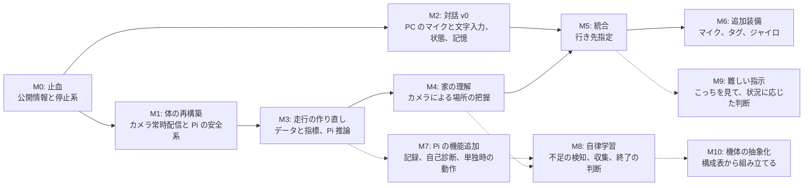

# PiCar-X 開発ロードマップ

本書はプロジェクト全体の計画を一元管理する。

> [!NOTE]
> - 走行と MLOps の現行仕様 → [E2E_SPECIFICATION.md](E2E_SPECIFICATION.md)
> - アプリと会話 Agent の仕様 → [APPLICATION_SPECIFICATION.md](APPLICATION_SPECIFICATION.md)
> - 全体構成の方針 → [agentic_ai_architecture_policy.md](agentic_ai_architecture_policy.md)
> - 未修正の課題一覧 → [REVIEW_FINDINGS.md](REVIEW_FINDINGS.md)

---

## 1. 最終目標

**PiCar-X が人と話しながら家の構造を把握し、家の中を自由に走る。**

そのために、走行判断とは別の会話 Agent が次の情報を総合して会話できるようにする。

- 自分の状況: 今いる場所、電池、すべてのセンサーと走行状態
- 走行の学習状況: 使用中のモデル、介入の頻度、上達の度合い
- 会話: いま言われたこと、過去の会話、人物に関する事実

### 制約

- マシンと計算リソースは大きく増強できない
- 費用は最小限にする。**購入や追加の装備が必要な作業は最後に行う（M6）**
- GPU は前提にしない
- 個人情報（室内画像、音声、会話、記憶 DB、API キー）は git に追加しない

### 設計原則

1. **体（Body）と脳（Brain）を分ける。** Pi は単独で安全を保ち、脳が止まっても安全に停止する
2. **安全機能は Pi が持つ。** Wi-Fi 越しの判断を安全の根拠にしない
3. **LLM は意図だけを出す。** モーターを直接動かさず、実行可否は Body が決める
4. **完了は実機の測定で判断する。** コードの存在を完了としない
5. **クラウドへ送るデータを限定する。** Gemini のテキスト利用は継続する。新しい種類のデータを送る機能は追加前に確認する

---

## 2. 決定事項（2026-11-03）

| ID | 項目 | 決定 | 計画への影響 |
|---|---|---|---|
| D-1 | **Pi の機種** | Raspberry Pi 5 Model B、メモリ 8GB | ビルド基準は `MODEL=5`。走行推論と音声認識を Pi 上で動かせる可能性を実測する |
| D-2 | **PC の稼働** | PicarX を使う時は PC も利用可能 | Brain は PC に置く。PC の常時起動は不要。PC がなければ Body は安全に停止して待機する |
| D-3 | **クラウド** | 現行の Gemini 利用は意図したもので問題なし。LLM は Gemini を既定とし、PC のローカル LLM を代替にする | Gemini API キーは `.env` で管理する。画像や音声など、新しい種類のデータをクラウドへ送る機能は、追加前に確認する |
| D-4 | **追加装備** | PC にマイクあり。車載用マイクは所有、未装着。ジャイロはなし（必要なら購入を検討） | M2 の音声入力は PC のマイクで開発する。車載の装備が必要な作業はすべて M6 へ移動。ジャイロなしで進める |

### PC の性能（確認値）

Intel Core i7-1255U、メモリ 16GB、NVIDIA GPU は検出されず。ローカル LLM は CPU で動作する前提で、モデルは実測で選ぶ（M2）。

### 未決定

- なし。音声認識と画像認識はどちらも PC のローカルで行うと決めた（M2、2026-11-07）。音声認識は Whisper、画像認識は VLM（`qwen3.5:4b`）。Gemini への画像送信は許可済みだが、必要になるまで使わない

---

## 3. 現在地（2026-11-09 時点）

| 指標 | 目標 | 現状 |
|---|---|---|
| 走行ループ周期 | 10Hz以上（M1） | **15.0Hz**（p50、2026-11-04 実機） |
| 危険検知から停止まで | 100ms以下（M1） | **最大 20.0ms**（障害物は速度20と50で最大 16.9ms、段差は速度50で 20.0ms）。PC との通信が途絶えると TTL の期限から 11.4ms で停止 |
| 学習データ | 実走の改善が確認できる量（M3） | 150フレーム、左に偏り。1セッションを抜いた評価で舵角の誤差は ±26.9°（2026-11-08） |
| 介入回数 | 10分あたりの回数を記録（M3） | 未計測 |
| 自己位置 | カメラのみの精度を計測（M4） | 未計測。地図の左右反転などのバグあり |
| 音声対話 | 音声入力から応答まで（M2） | PC のマイクで押して話す。返事の流れ始めは中央値5.5秒（Gemini）。見る質問は8.2秒 |
| Agent の自己認識 | 電池、位置、学習状況に答える（M2、M5） | 電池、センサー、走行状態、最近の安全停止に答える。位置と学習状況は未対応 |

---

## 4. 全体の流れ

M1 と M2 は並行して進められる。M2 は停止中の会話から始めるので、走行の完成を待たない。M0〜M5 は追加の購入や装着なしで進める。

M7〜M10（点線）は、最終目標を達成した後の将来の拡張で、挑戦的な項目を含む。前提のマイルストーンが終わってから、計測の結果を見て着手を決める。購入が必要な部分は、それぞれの中でも最後に行う。

---

## 5. マイルストーン

完了条件の数値は提案値で、実機の測定をもとに調整する。

### M0: 止血 ✅ 完了（2026-11-04）

公開情報と停止系の問題を解消する。

- [x] API キーと室内写真の削除、`.gitignore` の追加
- [x] 仕様書とロードマップの矛盾を修正
- [x] 緊急停止の保持（SAF-1）
- [x] `duration_ms` と速度をサーバー側で検証（SAF-3）
- [x] GUI の緊急停止を常に押せるようにする（SAF-9）
- [x] API のトークン認証と CORS の制限（SAF-10）
- [x] ハード初期化失敗時に黙ってモック起動しない（SAF-11）
- [x] 個人データを追加しにくくする `.gitignore` の強化
- [x] ユーザー名とプライベート IP を履歴から除去、`articles/` を追跡から除外
- [x] 実機で完了条件を確認する（緊急停止、トークン、LLM 応答待ち中の停止）
- [x] `v001` を追跡から除外し、ONNX 出力時にローカルのパスを除去（OPS-9）

**完了条件**: 緊急停止後の `move` が明示的な解除まで拒否される。トークンなしの要求が拒否される。LLM 応答待ち中も緊急停止できる。

### M1: 体の再構築 ✅ 完了（2026-11-09）

全機能の前提となる、速いカメラと Pi 内の安全系を作る。

- [x] カメラの常時配信（`rpicam-vid` の MJPEG 出力）。要求がない時はカメラを止める
- [x] 周期の内訳を計測（撮影、通信、推論、指令）。走行終了時に表示し、`data/cycle_profiles/` へ数値を保存
- [x] Rust の反射ループ（目標 40Hz）: 障害物、段差、期限切れ、不明なセンサー値、緊急停止
- [x] TTL 付き走行コマンドへ変更（`ttl_ms` は 50〜1000）
- [x] 全センサー値に時刻を付け、「不明」を表現する
- [x] `/api/status` と `/api/events`（電池、モード、センサー、安全イベント）
- [x] Python の安全系のうち、反射ループへ移す範囲を移植（段差、障害物停止、通信断）
- [x] Python CI の追加、Rust CI のビルド対象を Pi 5 へ変更
- [x] 実機で完了条件を確認する（下記。手順4の Wi-Fi 切断は Pi 側の疑似切断で確認、2026-11-09）

**完了条件**: カメラ 10fps 以上。危険検知から停止まで 100ms 以下。PC を切断すると TTL 以内に停止。段差試験を **落下防止措置つきで** 実施し、停止を確認。

**範囲（2026-11-04 に確認）**: 障害物の停止は、壁や大きな家具など **超音波で見える物** を対象とする。細い脚、音を吸う物、低い物は検知できないことがあり、M3 のカメラで補う。

#### 実機での確認手順

Pi へ新しいバイナリを配置してから、PC の `python/` で実行する。

| 順 | 確認 | 手順 | 合格基準 |
|---|---|---|---|
| 1 | 状態と反射ループ | `uv run python -m src.e2e.m1_check status` | 20Hz 以上。電池とセンサーが実測値 |
| 2 | カメラ | `uv run python -m src.e2e.m1_check camera` | 10fps 以上 |
| 3 | 切断時の停止 | 広い床で `uv run python -m src.e2e.m1_check ttl --i-understand-the-car-will-move` | 理由 `ttl_expired`、TTL + 100ms 以内 |
| 4 | Wi-Fi 切断 | 広い床で `uv run python -m src.e2e.m1_check wifi --simulate --ssh_host <Pi> --ssh_key <鍵> --i-understand-the-car-will-move`。走り出して約2秒後に Pi 側で走行サーバー（TCP 8080）への受信を8秒間破棄する（疑似切断。下記）。`--simulate` なしなら、走り出した後に PC の Wi-Fi を手で切る | 理由 `ttl_expired`。期限から 100ms 以内（最後の指令から TTL 400ms + 100ms 以内）。車が実際に止まる |
| 5 | 障害物の停止 | 低速で壁へ向けて走行し、`uv run python -m src.e2e.m1_check events` | `obstacle` で停止、100ms 以下 |
| 6 | 段差の停止 | **落下防止措置つき** で段差へ低速で近づけ、同じく `events` を確認 | `cliff` で停止し、車輪が段差の手前に残る |
| 7 | 床の種類 | よく使う部屋の明るい床を低速で走らせる（`--disable_stuck`） | 段差でない場所で止まらない。想定外の床で止まった時は安全に待機し、再校正で再開できる |
| 8 | 周期の内訳 | `autonomous_driver` を走らせ、終了時の表を確認 | 走行ループが 10Hz 以上 |

実機の結果（2026-11-04 時点）:

| 順 | 結果 | 実測 |
|---|---|---|
| 1 | 合格 | 反射ループ 39.9Hz、走行後の最大間隔 28.1ms。電池 8.14V（83%）。床の値は停止中 1146〜1222、走行中 989〜1344 で連番の異常値なし。起動時の校正で記録した連番の値（`0x0A0B` など）は捨てる修正で解消（確認は再起動1回、原因は未特定） |
| 2 | 合格 | 15.0fps。間隔の中央値 66.7ms、最大 170.8ms |
| 3 | 合格 | 336ms 後に `ttl_expired` で停止（TTL 300ms） |
| 4 | 合格（2026-11-09） | 疑似切断で確認。速度50で走り出し、約2秒で自力で停止。`ttl_expired`、期限から 11.4ms（最後の指令から約 411ms）。最初の速度20の試行も 11.4ms で合格したが、車輪が回らず止まる様子は確かめられなかった |
| 5 | 合格 | 壁で確認。速度20は `obstacle` で5回停止、最大 16.9ms、停止時 14.58〜14.97cm。速度50の連続走行は 14.3cm で検知、16.9ms で停止指令、惰性で約1.7cm 進み 12.6cm で停止。細い脚などは範囲外 |
| 6 | 合格 | 閾値300、速度50の連続走行で `cliff` により自力で停止（停止指令まで 20.0ms、惰性は約2.3cm）。前輪は縁に近いが手前に残った（距離は未測定）。速度20で前輪が縁にかかる位置まで進んだ斜めの進入は、利用者の判断で許容。余裕は小さいので、段差の近くでは車のそばで走らせる |
| 7 | 合格 | 走行して問題なしと利用者が判断（速度50、`--disable_stuck`）。手で動かした測定では床 1038〜1465。暗い床は未確認。床への適応は M4 |
| 8 | 合格 | 15.0Hz（p50）、p95 は 88.1ms。内訳の中央値はフレーム待ち 52.0ms、状態取得 9.7ms、推論 1.2ms、指令 19.7ms |

実走で見つかった課題:

- **速度50の連続走行で家具の脚に正面から衝突した（Pi は停止せず、破損なし）。** 脚の15〜20cm 手前に置いても距離は100前後で、超音波では脚が見えない。M1 では防げないので M3 のカメラで補う（利用者の判断）。それまでは車のそばで走らせる
- 舵0でも左へ寄る。**原因は舵の中心のズレだった**（2026-11-09、M3 の確認）。舵0で毎秒約20°左へ曲がっていた。Pi の `~/.env` に `DIR_SERVO_OFFSET=6`（正が右）を設定し、直進は3秒で −0.4° になった。この設定は Pi にだけあり、リポジトリには含まれない。走行サーバーの再起動で読み込まれる
- 前が広く空くと超音波の反射が戻らず、前進を拒否していた。反射が戻らないだけの時は「遠い」として走行を許可し、速度を60までに抑えた（利用者の判断）。広い場所で `far=True`、前進の拒否なしを実機で確認。クッションや布をかざした確認では `343.0` のままで、検知できない恐れがある。カメラによる前方の判断（M3）で補う
- 左前輪の回りが悪く、走行に影響している可能性がある（ハードの課題。未対応）
- モーターの PWM が 50Hz、出力が公式より低い（速度20で公式60%に対し20%）。PWM は公式と同じ約1.76kHz に変更した。実機の感触では速度50前後で進む（定規での測定はなし）。出力の計算は未変更
- 舵を切っても車体が曲がらなかった。左右の後輪が同じ速さだったので、内側を遅くする処理を追加した。速度50、舵 +30 と -30 で左右とも曲がることを実機で確認
- 走行に必要な速度は50前後。手順5と6は速度50の連続走行でも確認した。手順3は速度20で、車輪が回っていなかった可能性がある（停止の処理は TTL で確認済み）。速度の扱いは下記「車輪が回る最低の速度」
- 斜めの進入では、前輪がセンサーより先に縁へ届く。後退でしか戻れないので、走行プログラムは軌跡の記録が尽きると待機する
- 床センサーの左右がコードと逆だった（進行方向に向かって右のセンサーを覆うと1番目の値が下がった）。読み取りの順序を修正し、実機で左右とも確認した
- スタック検知が約5秒ごとに発動した。誤検知の疑いがあり、未解決（閾値が旧周期の前提のまま）。減速の下限が速度20で、カーブや障害物の手前で車輪が止まっていたことも原因の候補（未確認。2026-11-09 に下限を40へ変更）

#### Wi-Fi 切断の疑似再現（2026-11-09）

PC の Wi-Fi を実際に切ると、PC の他の作業に影響する。そこで、Pi 側で走行サーバーへの受信だけを破棄する。Pi から見ると、指令が届かなくなる点で本物の切断と同じ。Pi の Wi-Fi 自体は繋がったままなので、無線の切断そのものは再現しない。

- `scripts/pi/picarx-netcut.sh`: `nft` で TCP 8080 への受信を1〜30秒破棄し、時間切れ、中断、SSH の切断のどれでも元に戻す。`clear` で即座に解く。規則は永続化しない
- `scripts/pi/install-netcut.sh`: 上を `/usr/local/sbin/picarx-netcut` に置き、実行した利用者にだけパスワードなしの `sudo` を許可する。sudoers は `visudo` で検査してから置く
- PC からはパスフレーズなしの専用の鍵で SSH する（`PICARX_SSH_HOST`、`PICARX_SSH_KEY` でも指定できる）。遮断に失敗したら、その場で車を止めて試験を中止する

#### 車輪が回る最低の速度（2026-11-09）

Pi は速度（0〜100）をそのままモーターの PWM のデューティ比（%）にする。モーターは約50%未満では回らないので、速度20では車が動かなかった（手順4の最初の試行）。公式の picarx は 0 以外の速度を `50 + 速度/2`（%）に変換して、この範囲を避けている。

境目を壁への超音波の距離で測った（`src.e2e.speed_check`、2026-11-09、電池 8.1V、前進のみ）。止まった状態からの発進と、速度50で走行中に落とした場合の2通り。

| 速度 | 発進 | 走行中に落とす |
|---|---|---|
| 30 | 動かない | 動かない（0.9cm/s） |
| 35 | 約3.7cm/s で這う | 約2.7cm/s で這う |
| 40 | 約10cm/s（1.5秒で 14.9cm） | 約7cm/s |
| 50 | 動く。ただし動き出しに約1秒かかる（0.8秒で約3cm） | - |

- `python/src/models.py` に2つの定数を置いた。`MIN_MOVING_SPEED = 40`（確実に進む最低の速度）は、減速の下限、動きの判定（`min_check_speed`）、収集 GUI の速度の下限、会話の走行ツールの引き上げに使う。`DRIVE_SPEED = 50`（M1 で停止を確認した速度）は、走行の既定値と確認スクリプトに使う
- 自律走行の既定は `--speed 50 --min_speed 40`。減速は必要という利用者の判断（危ない場面で速度を落とせないため）で、下限を35ではなく、余裕のある40にした
- 後退で動く最低の速度は未計測。後退と脱出の既定は50のまま
- 最初の計測では、左へ寄る癖で斜めに進み、物に接触した（超音波は検知せず、接触で前が浮いて `CLIFF` で前進を拒否したとみられる）。超音波の反射が変わると距離が跳ぶので、速さは2点ずつの傾きの中央値で出し、1回に1つの速度だけ測って毎回置き直す
- Pi の変換を公式に合わせる案は採らなかった。速度50がデューティ比75%になり、手順5と6の停止をやり直す必要があるため

**段差の判定値は記録データからの推定** で、実機では未確認。特に手順 6 と 7 の結果で調整する（`rust/src/safety/mod.rs` の校正定数）。

### M2: 対話 v0 ✅ 完了（2026-11-07）

停止中に、自分の状況と過去の会話を踏まえて答えられるようにする。音声は PC のマイクで開発する。

- [x] Gemini とローカル LLM の切り替え。Gemini が使えない時は Flash-Lite、それも使えなければローカルで応答。実際の上限超過（429）と混雑（503）で確認（2026-11-06）
- [x] ローカル LLM の選定と計測（CPU 実行）。`qwen3.5:4b` を採用し、JSON で行動を決める専用経路を追加（`python/src/agents/local_agent.py`）
- [x] PC のマイクを使う音声入力: 押して話す方式とローカルの Whisper（`small`）。GUI の会話で確認（2026-11-06）
- [x] 状態ストアと、毎ターンの状態注入（Gemini）。ローカルは状態の質問をコードで回答
- [x] 記憶の一本化（SQLite + FTS5）: 会話、人物の事実、車体の出来事（安全停止、緊急停止、床の校正）を PC に保存。Rust 側の記憶は削除した（2026-11-07）
- [x] カメラ画像の認識方式の評価: PC のローカル VLM で「何が見える？」に答える。実際の室内で利用者が確認し、問題なし（2026-11-06）。Gemini への画像送信は許可済みだが、必要になるまで使わない
- [x] 単一 Agent への整理、発話経路の一本化、割り込み停止。実機で確認（2026-11-06）
- [x] 応答時間の計測と目標の決定: 文字入力と音声入力で計測し、目標を決めた（下記、2026-11-07）。見る質問は8.2秒まで短縮
- [x] Rust 側の LLM、記憶、旧 GUI の削除（下記、2026-11-07）

#### 応答時間の計測（2026-11-06）

GUI は会話1回ごとに、入力が終わった時（送信、または押して話すボタンを離した時）からの時間を記録する。

| 記録 | 意味 |
|---|---|
| 文字起こし | 音声入力の時だけ |
| 相づち | 「見てみます。」が流れ始めた時。今は見る質問の時だけ |
| 停止 | 「止まって」で停止指令が Pi に届いた時 |
| 返事の作成 | Agent が返事の文章を作り終えた時 |
| 返事の流れ始め | Pi が返事の最初の文を音声にして再生キューへ入れた時。相づちの再生中は、その後に流れる |

- 各回の値はチャット欄に `[Time]` として出す。会話の内容は保存せず、種類（llm、look、stop、speech_command）、実際に答えたモデル、入力の種類と時間だけを `python/data/turn_timings/timings.jsonl`（git の追跡外）に追記する
- 集計は `uv run python -m src.metrics.turn_report`。種類、モデル、入力ごとに中央値と90パーセンタイルを出す

計測結果（2026-11-07、文字入力のみ）。秒、中央値 / 90パーセンタイル。

| 種類 | モデル | 回数 | 相づち・停止 | 返事の流れ始め |
|---|---|---|---|---|
| 会話 | Gemini Flash-Lite | 6 | - | 4.7 / 5.7 |
| 会話 | ローカル（qwen3.5:4b） | 13 | - | 3.0 / 12.8 |
| 見る質問 | どちらも | 各1 | 相づち 0.2 | 約14 |
| 止まって | - | 1 | 停止 0.03、声 0.2 | 0.2 |

- 相づちと停止は 0.5秒以内に入っている
- 見る質問は、モデルによらず PC のローカル VLM で約14秒かかる。一番の改善点

音声入力（Gemini Flash-Lite、6回、2026-11-07）: 文字起こし 2.1〜2.4秒（中央値 2.3）、返事の流れ始め 3.8〜6.9秒（中央値 5.5）。起動直後の回は文字起こしに 6〜23秒かかった。音声認識のモデルの読み込み中だったと推測している（未確認）ので、目標の計算から外した。

目標（2026-11-07、利用者が決定）。時間は入力が終わった時から数える。

| 種類 | 目標 | 現状 |
|---|---|---|
| 見る質問の「見てみます。」、停止 | 0.5秒以内 | 0.2秒。達成 |
| 文字入力の会話 | 返事の流れ始めの中央値が5秒以内 | 4.7秒。達成 |
| 音声入力の会話 | 中央値6秒以内、遅くても8秒以内 | 5.5秒、最大6.9秒。達成 |
| 見る質問 | 8秒以内 | 約14秒から8.2秒に短縮（下記）。ほぼ達成 |

普通の会話の相づち（2026-11-07、試して取りやめ）: 音声入力ではボタンを離してすぐ「はい。」「うん。」「えーと。」を、文字入力では内容に応じた言葉を出した。同じ言葉を続けず、ときどき出さないようにもした。0.2秒で出すと話し終わりにかぶせたように聞こえ、0.8秒待っても違和感が大きかった。利用者の判断で入れない。相づちは見る質問の「見てみます。」だけにする

- モデル選択欄は一覧の先頭（Flash）を表示していたが、実際は既定の Flash-Lite が答えていた。既定のモデルを表示するよう直した

#### 見る質問の短縮（2026-11-07）

約14秒の内訳を PC で測った（Ollama の計測値）。VLM は使い終わって2分で外れる設定だったので、毎回読み込みから始まっていた。

| 段階 | 時間 |
|---|---|
| VLM の読み込み | 約5.6秒 |
| 画像と質問の読み取り | 3.2〜3.8秒 |
| 画像の変換 | 約2秒 |
| 文の生成（1〜2文） | 2〜3.5秒 |
| Gemini の往復（look を使う判断と、返事の作成） | 各1〜2秒 |

- 対策1: GUI の起動時に VLM を読み込み、30分残す。メモリを約3.2GB 使う。読み込みは見る時と同じ `num_ctx` で行う。違うと見る時に読み込み直しになった
- 対策2: 見る質問を受けた時点で見始め、Gemini の look はその結果を使う。動いてから見る頼みごと（「進んでから」など）では先に見ない。20秒以内に使われなければ捨てる
- 見送り: 答えを1文にすると約2秒縮むが、答えが乏しくなる。画像を小さくしても0.5秒ほどしか縮まない
- 結果: PC での VLM は11.9秒から6.6秒。実機の文字入力で、返事の流れ始めが13.8秒から8.2秒（1回）
- 「前に映ったものを教えて」「写っている物」などの言い方も見る質問として扱う

#### 音声認識の手がかり（2026-11-07）

- 「前に映ったものを教えて」が「前につって教えて」と文字起こしされ、Gemini は前回の会話を答えた
- 合成音声で試すと、手がかりがない時に「止まって」が「どうも、ご視聴ありがとうございました。」になった
- 対策: Whisper に、よく使う言い回しを手がかり（`initial_prompt`）として渡す。聞き取れない時に手がかりの文がそのまま出ることがあるので、動く指示は入れない。雑音だけの音声では、手がかりがあっても何も出なかった。文字起こしは1回あたり約0.3秒長くなる
- 利用者が実機で確認し、おおむね良好（2026-11-07）

#### 発話が途中で遅くなる問題（2026-11-07）

返事の一部（「床を校正したこと」の「こと」、「覚えています」の「います」）だけが、ゆっくり読まれた。

- 原因: Pi の Open JTalk は、読点や句点の間をひと息として読む。ひと息が30モーラ前後を超えると、その先の音が6〜7倍（1音あたり約0.5秒）に伸びる。Docker 上の Open JTalk で音素ごとの長さを出して確かめた。括弧は間にならない
- 文字数では決まらない。「11月」は「ジューイチガツ」と6モーラなので、21文字でも30モーラを超える
- 対策: PC が Pi へ送る前に、ひと息が26モーラを超えそうな所で、助詞の後ろに読点を足す（`python/src/voice/breath.py`）。読みとモーラ数は `pyopenjtalk-plus` で求める。画面に出す文は変えない
- 利用者が実機で、遅くならないことを確認した（2026-11-07）

#### Gemini が応答しない問題（2026-11-06）

原因は2つ。どちらも API キーとコードの誤りではない。

- **無料枠の上限**: `gemini-3.8-flash` は1日20回まで（`GenerateRequestsPerDayPerProjectPerModel-FreeTier`）。ツールを使う会話は1ターンで2〜3回呼ぶので、数ターンで尽きる。上限はモデルごとで、`gemini-3.5-flash-lite` は同じ時に使えた
- **混雑**: `gemini-3.8-flash` は短い質問にも 90秒以上応答しないか、503（高い需要）を返した。ライブラリが内部で5回やり直すので、503 が返るまで 51秒かかり、Flash-Lite で答えるまで最悪約2分だった

対策:

- Gemini への1回の要求は 20秒で打ち切り、ライブラリ内ではやり直さない
- 混雑、応答なし、上限超過の時は、同じモデルでやり直さずに Flash-Lite へ切り替え、それも使えなければローカル LLM で答える
- Flash が上限の時、実際の経路で Flash-Lite が 1.3秒で答えた

既定のモデルは Flash-Lite に変更した（利用者の判断）。Flash は GUI で選べば使える。

GUI の確認（2026-11-06、ローカル LLM）: 利用者が試し、問題なしとの報告。

#### 発話と割り込み（2026-11-06）

- Gemini の Agent は、使われていなかった走行、視覚、発話のサブエージェントを削除し、LLM とツールを往復する1つの Agent にした
- 発話は PC の `Speaker`（`python/src/voice/speaker.py`）に一本化した。LLM には発話ツールを渡さない。返事は文ごとに Pi へ送り、Pi は1文目の再生中に2文目を生成する
- 新しい発言と緊急停止で読み上げを止める。Pi に `POST /api/audio/stop` を追加し、生成中だった文も再生しない。`/api/status` の `audio.speaking` で発話中かが分かる
- 撮影ツールは画像を LLM に渡していなかったので外した。後にローカル VLM の `look` ツールに置き換えた（下記）

実機の結果（2026-11-06、Pi 5）:

- 発話 API: 合格。長い文の音声の生成と送信に 0.6秒。再生中は `audio.speaking` が True、`/api/audio/stop` の後は False になり、声も途中で止まった
- GUI（Flash-Lite）: 次の項目を利用者が確認し、すべて問題なし。新しい発言、押して話す、緊急停止で読み上げが止まる。緊急停止の後に「さっき何があった？」に答え、GUI を開き直しても答える。カメラの前の物を答える。黒い棒を見せると反応した（生成した画像の細い棒は見落としていた）。走行の安全の判断に使わない方針は変えない

#### 音声入力（2026-11-06）

車体にはマイクがないので、PC の内蔵マイクで話す。返事は車体のスピーカーから聞こえる。車載マイクは M6。

- GUI の「🎤 押して話す」を押している間だけ録音し、離すと PC のローカルの Whisper（`faster-whisper`、CPU、int8）で文字にする。文字入力と同じ経路で送るので、「止まって」の即時停止も効く
- 話し始めに読み上げ中の返事を止める。Pi の声を録音しにくくなる
- 音声はメモリ上だけで扱い、保存もクラウドへの送信もしない
- 内蔵マイクの音が小さい（最初の録音でピーク 0.026、最大 -41 dBFS）ので、ピークを揃えてから渡す。増幅は30倍まで
- 短すぎる録音と小さすぎる音は Whisper に渡さない。雑音だけの6秒は `small`、`large-v3-turbo` とも文を作らなかった
- 最初の録音（`small`）: 6秒に 2.4秒で「こんにちは、できますか?こんにちは」
- モデルの比較は `uv run python -m src.voice.mic_check --models small large-v3-turbo`。同じ6秒の録音（最大 -30 dBFS）で次の結果だったので、既定は `small` にした。環境変数 `PICARX_WHISPER_MODEL` で変えられる

| モデル | 文字にする時間 | 結果（話した内容は「こんにちは、聞こえますか、もしもし」） |
|---|---|---|
| `small` | 2.4秒 | こんにちは。聞こえますか?もしもし。 |
| `large-v3-turbo` | 9.4秒 | こんにちは、聞こえますか?もしもーし |

- 最初の録音は声が小さく（最大 -41 dBFS）、`small` が「聞こえますか」を「できますか」と聞き違えた。小さい声では誤りやすい
- 必要なライブラリは `uv sync --extra voice`。入っていない時はボタンが無効になる

#### カメラ画像の認識（2026-11-06）

PC のローカル VLM（`qwen3.5:4b`、画像処理部あり）を、生成した 320×240 の画像で測った。室内の画像は使っていない。

| 項目 | 結果 |
|---|---|
| 1枚あたりの応答 | 8.6〜11.0秒（画像の処理 3.5〜4.9秒、生成 2.9〜3.9秒）。初回はモデルの読み込みで +6秒程度 |
| 内容 | 箱とドアは答えられた。床に置いた細い棒（家具の脚の代わり）は4回とも答えず、「進路はふさがっていない」と答えた |

- 「何が見える？」への会話の返事には使える速さだが、走行の安全判断には使えない。細い脚の検知は M3 のカメラ学習で行う

実装（`python/src/vision/local_vlm.py`）:

- Pi のカメラから1枚だけ取り、PC の VLM に見せる。画像は PC の外へ送らない
- Gemini の Agent には `look` ツールを渡す。Gemini に届くのは VLM の説明の文章だけ
- ローカル LLM の Agent は、「何が見える？」「周りの様子どう？」などを LLM を通さずに VLM へ渡す
- 認識に時間がかかるので、GUI は先に「見てみます。」と返す
- 実際の経路を生成した画像で試すと、初回 15.0〜15.6秒（モデルの読み込みを含む）、2回目 8.5〜8.7秒
- VLM を読み込むと、Ollama が会話用のテキスト専用モデルをメモリから外した（計測時の PC の空きメモリは 1.2GB / 15.7GB）。ローカル LLM で会話している時は、見た直後の返事でテキストモデルを読み込み直す時間がかかる。Gemini で会話している時は影響しない。VLM は2分使わなければ解放する
- Gemini に画像を送る方式は許可済み（2026-11-06）。ローカルを試した後に、聞かれた時の1枚だけを送る形で比べる
- 実際の室内画像での正答は未確認

#### Rust 側の旧機能の削除（2026-11-07 完了）

**理由**: 旧 GUI（`--gui`）とその LLM（`rust/src/llm_agent/`）は、反射ループを通さずに `px.forward()` でモーターを動かしていた。段差や障害物の停止、TTL、緊急停止の保持が効かない。記憶（`rust/src/memory/`）は PC 側と二重になっていた。利用者が今後使わないと判断し、削除した。

削除したもの:

- `llm_agent/`、`memory/`、`sample/`（旧 GUI、RC コントローラ）、`audio_input.rs`、旧 GUI のフォント（`rust/assets/`）、`rust/GeminiAPI_implementation_policy.md`
- 旧 GUI だけが使っていたコード: 安全の確認を通らない `Picarx::forward`、`backward`、`get_distance`、再試行付きの `Ultrasonic::read_distance`、カメラの `RpiCamera`
- TTS の Piper Plus の選択。Open JTalk と eSpeak NG だけにした
- Pi に残っていた旧 GUI の会話の記録 `~/picarx_memory.db`。利用者が削除した（2026-11-07）
- 依存の `eframe`、`ureq`、`rusqlite`、`uuid`、`ndarray`。ビルド用イメージの `libx11-dev` と `libssl-dev`
- 仕様書の §13（旧 GUI の会話メモリ）。§14 は §13 になった

結果: Pi 5 向けの実行ファイルは 23.7MB から 3.8MB。依存を一からコンパイルするリリースビルドは約8分から49秒。

残り:

- カメラのパンとチルトの API は、M4 の見回しで足す。サーボを動かすコード（`set_cam_pan_angle` など）は残っている

**完了条件**: 「電池どう？」に実測値で答える。再起動後も前回の話題を答えられる。Gemini が使えない時もローカル LLM で応答する。応答時間を計測し、見る質問の「見てみます。」と停止の応答を0.5秒以内に出し、本回答の開始までの目標を決める。普通の会話の相づちは試して取りやめた（2026-11-07、利用者の判断）。

#### ローカル LLM の計測（2026-11-05、i7-1255U、偽の走行ツールと固定の状態）

`uv run python -m src.llm_eval` で測定。実機と GUI では未確認。

| 項目 | 従来（ツール定義） | 新方式（JSON） |
|---|---|---|
| 調整に使っていない32問の正答 | 25/32（距離と段差のセンサー呼び出しを正解とすると 27/32） | 30/32 |
| 頼んでいない走行（同じ32問） | 0回 | 0回 |
| 状態の質問 | 16〜23秒 | ほぼ0秒 |
| 連続した会話での走行と舵 | 35〜41秒（LLM 2回） | 1.3〜2.9秒 |
| 会話の最初の応答 | 17〜23秒 | 10〜16秒 |

画像処理部を外したテキスト専用モデル（`uv run python -m src.llm_setup` で作成）で、メモリのピークは 4.28GB から 3.08GB に減った。履歴の上限を増やすと 16 ターン後で 3.38GB。10スレッドで最初の応答は 8.7〜9.3 秒（6スレッドは 9.5〜10.8 秒）。テキスト専用かつ `presence_penalty` 0 で、調整に使っていない32問は 31/32。

応答時間の 93〜98% はプロンプトの処理だった。`qwen3.5` は途中まで巻き戻せないので、固定の指示を先頭に置き、履歴を追記だけにしている。

### M3: 走行の作り直し 🟡 進行中（データとモデルの管理から着手）

データと評価を実走の指標に基づくものへ作り直す。

- [x] 車輪が回る最低の速度を測る（`uv run python -m src.e2e.speed_check --i-understand-the-car-will-move`）。止まった状態からの発進と、速度50で走行中に落とした場合の2通りを、壁への超音波の距離で測った。前進は40で確実に進むので、減速の下限を40にした（2026-11-09、利用者の判断: 減速は必要。M1 の「車輪が回る最低の速度」）
- [x] 指令と実際の動きの食い違いの検出（下記）。再収集の前に作り、集めるデータを最初からきれいにする。実機の確認手順1〜9に合格し、校正した値を `configs/motion.toml` に書いた（2026-11-09）。床に印を付けたコースでの距離と向きの誤差の計測は、M4 の速度とステアリングの校正で行う
- [x] データの保存とバックアップ（下記「データとモデルの管理」）。マニフェストと D ドライブへの複製、復元を確認（2026-11-08）
- [ ] 10fps 以上で再収集し、距離、実際の動きの推定値、床センサーの値、電池電圧を保存。収集 GUI はカメラの常時配信を使うように直し、すべての値を保存するようにした。実機で 15.0fps、取りこぼしなしを確認（2026-11-09）。最初のセッション（1,582フレーム）は、走行中のフレームが16%、舵角が最大か0に偏っていた。`W` がキーの自動の連打で指令を送り直していて、`A` や `D` を押すと止まっていたため。`W` は押している間タイマーで送り直し、舵は押している間なめらかに切って離すと中央へ戻すように直した。止まっているフレームは学習から外し、セッションの中身は `src.e2e.dataset.session_report` で確かめる（2026-11-10）。収集そのものが残り
- [x] セッション単位の分割、シード固定。セッションが少ない間は、1セッションを抜いて評価する方法（交差検証）を使う（2026-11-08）
- [ ] 左右反転によるデータの補強
- [x] 学習の記録: 使ったデータ、コード、環境、設定をモデルごとに残す（下記、2026-11-08）
- [ ] 「前方が塞がっているか」の補助出力（超音波を自動ラベルに使う）。**優先**: 細い家具の脚と音を吸う物は超音波で見えず、衝突を確認済み。超音波が見えない物はラベルが付かないので、手動のラベルも検討する
- [ ] 介入時に人の修正操作を記録（現在の承認機能を置き換える）。記録にセッション、モデルの版、データの版を含める
- [ ] 主指標を「10分あたりの介入回数」に変更し、モデル間で比較
- [ ] モデルの採用の判定: オフラインの自動判定と、実走での確認（下記）
- [ ] 推論を Pi 5 へ移行（`ort` または `tract`）。モデルは検証してから読み込み、1回の操作で前の版へ戻せるようにする（下記）

#### 指令と実際の動きの食い違い（2026-11-08 追加）

PiCar-X には車輪の回転数を測るセンサーがないので、今は「指令した量だけ動いた」とみなしている。床の摩擦（じゅうたん、フローリング）、空転、引っかかり、電池電圧による速度の違い、舵の中心のズレ（M1 で「舵0でも左へ寄る」を確認）で、実際の動きは指令とずれる。ずれたままのデータは、学習（M3）にも地図（M4）にも誤りを持ち込む。

- 実際の動きの推定: カメラの画像の動き（オプティカルフロー）から、進んだ量と曲がった量を推定する。壁や家具に向かっている時は、超音波の距離の変化からも進んだ量を確かめる
- 食い違いの検出: 次の時に、そのフレームへ印を付ける
  - 前進の指令なのに、画像も距離も変わらない（空転、引っかかり）
  - 曲がった量が、舵角から想定した量と大きく違う（滑り、舵のズレ）
  - 指令していないのに動いている（押された、傾いた床）
- データの扱い: 印の付いたフレームは学習から外すか、別に扱う。地図と軌跡（M4）には、指令した量ではなく推定した動きを使う。食い違いが続く時は走行を止め、会話で知らせる
- 補正: 電池電圧と速度の関係を記録して補正する。舵の中心のズレは校正で直す。床の種類ごとの補正は M4 の床の適応と合わせる。向きの精度が足りなければ M6 のジャイロで補う
- 検証: 床に印を付けたコースを走り、推定した距離と向きを実測と比べる。わざと空転させる（車輪を浮かせる、じゅうたんで引っかける）試験で、食い違いを検出できるか確かめる

##### 実装（2026-11-08）

- 画像の動き: 特徴点の追跡と、平行移動 + 拡大 + 回転のモデルの当てはめ（RANSAC）。約0.3秒前のフレームと比べ、向きの変化（度/秒）、拡大の速さ、動きの大きさを出す。特徴点が少ない時は「不明」。PC で1フレーム約1.3ms
- 判定: `no_motion`、`turn_mismatch`、`uncommanded_motion` の3種類。指令の変化直後とカメラを動かしている間は判定しない。超音波が使える時は、画像と超音波の両方で確かめる
- 指令の追跡: 送った指令を期限（TTL）を含めて追う。収集データの `throttle` は、期限が切れて止まった後は `0.0` になった（LRN-6 の一部）
- 収集 GUI: 各フレームに距離、指令、推定した動き、判定を保存する。食い違いが1秒続くと止まり、記憶に残す
- 自律走行: 食い違いが1秒続くと止まり、介入（`motion_mismatch`）と記憶に記録して走行を終える。旧スタック検知の脱出操作は既定で使わない（危険を押して動き続けないため）
- 学習: 食い違いの印が付いたフレームを外す。外した数は `metadata.json` に残る
- 記録の解析: `src.e2e.motion.analyze`。今の150フレーム（約1fps）では、フレームの間隔が長すぎて追跡できないことが多い（3割以上）。10fps での再収集が必要なことを裏付けた

##### 実機での確認手順

PC の `python/` で実行する。記録は `data/m3_checks/` に保存される（画像は含まない）。校正した値は `configs/motion.toml` に書く。Pi のバイナリは M2 から変更なし。

準備: 電池を充電する。模様のある床（ラグ、家具の脚が見える場所）で、前方に 1.5m 以上の空き。手順6のために正面に壁。床にテープでスタート位置と車の向きの線を引く。

| 順 | 確認 | 手順 | 合格基準 |
|---|---|---|---|
| 1 | 静止 | `uv run python -m src.e2e.m3_check run --scenario still`。車にも周りにも触れない | 印なし |
| 2 | 人が横切る | `run --scenario walk`。計測中に人がカメラの前を横切る | 印なし |
| 3 | 押される | `run --scenario push`。計測中に車体を手でゆっくり2秒ほど押し続ける | `uncommanded_motion` が続く |
| 4 | 直進 | `run --scenario forward --seconds 3 --i-understand-the-car-will-move` | 印なし。舵0での曲がり癖を記録 |
| 5 | 旋回 | `run --scenario left --seconds 2 ...`、`right` も。走行後に、テープの線に対して実際に曲がった角度を分度器で測る | 印なし。左は向きの変化が負、右は正 |
| 6 | 壁へ直進 | 壁の約1.2m 手前から `run --scenario forward --seconds 3 --note wall ...`。Pi が 15cm で止める | 超音波の接近速度が記録される（速度の校正に使う） |
| 7 | 車輪を浮かせる | 本などを積んだ台に載せ、**後輪だけ**を台の端からはみ出させて浮かせる（前輪と床センサーは台の上）。`run --scenario lifted ...`。指を車輪から離す。車体ごと持ち上げると、床センサーが床を見失って Pi が `cliff` で前進を拒否する（2026-11-09 に確認） | `no_motion` が2.5秒以内に続き、車が止まる |
| 8 | 校正 | `uv run python -m src.e2e.m3_check calibrate --still <1,2の記録> --moving <4,5の記録> --push <3の記録> --turn <5の記録> --measured_deg <実測> --straight <4の記録> --wall <6の記録>` | 提案された値を `configs/motion.toml` に書く |
| 9 | 再確認 | 校正後に 2、4、7 をもう一度 | すべて合格 |
| 10 | 引っかかり（任意） | じゅうたんの端などで車輪が空転する場所へ `forward` | `no_motion` で止まる |

実機の結果（2026-11-09、速度50、電池 約8.1V）:

| 順 | 結果 | 実測 |
|---|---|---|
| 1 | 合格 | 画像の動きは p99 0.18px/s |
| 2 | 合格 | 印なし。人で隠れた11フレームは `tracking_lost`（不明）になり、誤検知しなかった |
| 3 | 合格 | `uncommanded_motion` が 3.3 秒で続いた（1回目は計測中に押せず、やり直し） |
| 4 | 合格（補正後） | 補正前は舵0で毎秒約20°左へ曲がり、`turn_mismatch` が続いて 2.6 秒で止まった（検出は正しく働いた）。舵の中心を補正（`DIR_SERVO_OFFSET=6`）した後は印なし |
| 5 | 合格 | 左は毎秒 −15.6°、右は +17.5°。曲がった角度の実測は分度器がないため省いた。画角（`hfov_deg`）の校正は M4 で行う |
| 6 | 合格 | 印なし、3秒で −0.4°。壁への接近は毎秒 11.3cm で、Pi が `obstacle` で止めた |
| 7 | 合格 | 前進の指令から 1.61 秒で `no_motion` が続いて止まった。車体ごと持ち上げると Pi が `cliff` で前進を拒否するので、後輪だけを台から浮かせる方法に変えた |
| 8 | 実施 | `moving_px_s` 4.0 → 5.1、`uncommanded_px_s` 8.0 → 6.7、`speed_cm_s_per_unit` 0.227 を設定。`straight_max_rate_dps` は 15.0 のまま |
| 9 | 合格 | 校正後の `walk`、`forward`、`lifted` で印なし、または期待どおり。壁際の模様の少ない場所では、画像で判断できない時間が3割あったが、誤検知はしなかった |

- 速度50の動き出しの遅さ（約1秒）による `no_motion` の誤検知は起きなかった
- `lifted` の判定は、最初は計測の開始から数えていて、カメラの配信を待つ約1秒を含めていた。最初の前進の指令から数えるように直した

#### データとモデルの管理（2026-11-08 追加）

MLOps の基盤について外部の提案を受け、制約に照らして採否を決めた。今の一番のボトルネックは基盤ではなく、データの量（150フレーム、左に偏り、旧方式の約1fps で収集）なので、基盤は再収集を無駄にしないための最小限に絞る。走行ループはすでに 15.0Hz（M1）で、周期は制約ではなくなった。

- **保存とバックアップ**: 走行データはセッション単位で追記のみとし、書き換えない。セッションごとにファイルのハッシュの一覧（マニフェスト）を作る。PC の D ドライブは C ドライブと別の物理ディスク（2TB の HDD、2026-11-08 確認）なので、走行データ、モデル、記憶 DB を Windows 標準の `robocopy` で D ドライブへ複製する。購入は不要。PC ごと失う場合への備え（外付けディスク）は M6 で判断する
- **前処理で画像を複製しない**: クリーナー（`cleaner.py`）は画像をコピーせず、元のデータを参照する `labels.jsonl` だけを出力する。元のデータを唯一の正とし、ディスクの使用量も抑える
- **学習の再現性**: シード、閾値、エポック数などの設定をファイルにまとめる。モデルの `metadata.json` に、git のコミット、データのマニフェストのハッシュ、`uv.lock` のハッシュ、前処理の設定（入力の大きさ、正規化の値）、PyTorch のバージョンを記録し、`registry/compare.py` で一覧できるようにする。MLflow や DVC は使わない（§8）
- **評価の分割**: セッションが少ない間は、1セッションを抜いて評価する交差検証を使う（モデルが小さいので CPU で済む）。固定のテストセットは、セッションが10程度に増えてから作る
- **採用の判定（オフライン）**: 抜いたセッションで、舵角の MAE を全体と左、直進、右の別に出す。舵角の変化量（ふらつき）と推論時間も測る。いま使っているモデルより悪ければ採用しない。比較の結果は毎回同じ形式で残す
- **採用の判定（実走）**: 決めたコースと手順で走らせ、介入回数を記録する。採用するモデルは人が決める。使用中のモデルの版は状態ストアに載せ、会話 Agent が答えられるようにする（M5 の学習状況の報告で使う）
- **介入の集計**: 介入の記録にセッション、モデルの版、データの版を入れ、モデル別の介入率を1つのスクリプトで出せるようにする。専用のデータベースは使わない
- **Pi へのモデルの配置**: モデルと一緒に、SHA256、入力の大きさ、正規化の値、各ソフトウェアの版を書いたマニフェストを送る。Pi はハッシュと入力の大きさを確かめてから読み込み、合わなければ読み込まずに止まる（前処理の食い違いによる誤動作を防ぐ）。版ごとのフォルダに置き、使用中の版はリンクの張り替えで一度に切り替える。前の版を2つ残し、1回の操作で戻せるようにする。走行サーバーにはモデルのフォルダの読み取り権限だけを与える。署名は付けない（§8）
- **量子化**: Pi で推論時間を測り、10Hz に届かない時だけ検討する

#### データとモデルの管理の実装（2026-11-08）

| 項目 | 内容 | 確認 |
|---|---|---|
| マニフェスト | `src.e2e.dataset.manifest`。セッションに `manifest.json` を作り、`--verify` で変更、欠落、追加を検出する。既存のマニフェストは書き換えない | 実データの3セッションで作成し、一致を確認 |
| バックアップ | `scripts/backup.ps1`。`python/data`、`python/models`、`data` を `D:\PiCarX-backup` へ複製する。複製先のファイルは消さない。`-RestoreTo` で戻す | 複製し、別のフォルダへ戻したデータでマニフェストが一致 |
| クリーナー | 画像を複製せず、`source_dir` で元のセッションを参照する | テスト |
| 学習 | `configs/train.toml` の設定、シードの固定、CPU で決定的に学習、セッション単位の分割。検証が空なら学習しない | 別のフォルダへ clone し、戻したデータで学習して、損失、指標、学習の経過、データのハッシュがすべて一致 |
| 交差検証 | `src.e2e.training.cross_validate`。セッションを1つずつ抜いて学習し、抜いたセッションで評価する | 実データで実行（下記） |

1セッションを抜いた評価（今の150フレーム、15エポック）では、舵角の MAE は 0.768（±26.9°）。左 1.11、直進 0.31、右 0.71 で、右は11件しかない。これまでの MAE は学習に使ったデータを含めた値だったので、今のモデルは見ていない場面ではほとんど当てられていない。基盤ではなくデータの量と偏りがボトルネックだと、数値でも確かめられた。

残り: 採用の判定（使用中のモデルとの比較）、使用中のモデルの記録、介入の記録の項目、Pi へのモデルの配置。採用の判定は、同じデータで両方の設定の交差検証を行って比べる。

**完了条件**: 同じ環境で介入回数の改善を複数モデル間で比較できる。Pi 単体で 10Hz 以上で走行する。床に印を付けたコースで、推定した移動距離と向きの誤差を計測し、記録する。空転と引っかかりを検出し、そのフレームを学習データから外せる。別のフォルダへ clone し、同じデータと設定で学習すると同じ指標になる。D ドライブのバックアップから走行データを復元できる。ハッシュが合わないモデルを Pi が読み込まない。1回の操作で前のモデルへ戻せる。

### M4: 家の理解 ⚪ 未着手

家全体の精密な地図は目指さず、**場所とそのつながり** を把握する。この段階では装備を追加せず、カメラのみで行う。

- [ ] 地図のバグ修正（MAP-1〜4）※先行して実施可
- [ ] 速度とステアリングの校正（床に印を付けて計測）
- [ ] 画像の変化量による向きの補正（視覚オドメトリ）。M3 の動きの推定と食い違いの検出を、地図と軌跡にも使う
- [ ] カメラ画像の特徴による場所の認識
- [ ] カメラのパンを使った見回し
- [ ] 場所グラフとその保存
- [ ] 文字または声で場所の名前を教える（「ここはキッチンだよ」）
- [ ] 占有格子は近傍の回避と可視化に限定
- [ ] 床の種類への適応: 記録した床の値をもとに、走行中の基準値の更新と、場所ごとの基準値の保存を設計する。絶対的な下限は緩めない
- [ ] 起動時の場所の確認（下記）。電源を切って運ばれることがあるので、起動時は毎回「場所が分からない」状態から始める
- [ ] 持ち上げの検知: 動作中に床センサーが床を見失ったら、運ばれたとみなして止まり、置かれた後に起動時と同じ手順で場所を当て直す
- [ ] 階の区別: 見た目で区別し、足りなければ教えてもらう（「ここは2階だよ」）。場所ごとに家の Wi-Fi の電波の強さも記録し、大まかな手がかりにする（購入なし）。それでも足りなければ M6 の気圧センサーで補う

#### 起動時の場所の確認（2026-11-08 追加）

人に聞く回数を減らすため、自分で確かめてから聞く。PiCar-X は前輪で向きを変える車なので、その場では回れない。距離と床のセンサーは前にしかないので、後ろへは下がらない。

| 順 | 動作 | 内容 |
|---|---|---|
| 1 | 動かずに安全を確認 | 電池、センサー、床の校正を確かめる。車輪は動かさない |
| 2 | 聞かずに使える手がかりで候補を絞る | 電源を切る前にいた場所と、家の Wi-Fi の電波の強さ。運ばれたかもしれないので、見た目で確かめられた時だけ採用する |
| 3 | その場で見回す | 車輪は動かさず、カメラを左右に振って前方の約240度（首振り ±90度と視野）を見る。超音波で前の距離も測る |
| 4 | 前向きに小さく旋回 | 3 で決まらない時だけ。前が空いていて床も続いている時に、低速で前へ進みながら曲がり、見えなかった後ろ側を見る。数回に分け、毎回止まって見回す。危険なら Pi の反射ループが止める。前が狭い時は飛ばす |
| 5 | 決まったら伝える | 確からしさが高ければ「リビングにいるようです」と伝えて自律行動を始める |
| 6 | それでも決まらない時だけ聞く | 候補があれば「リビングで合っていますか？」のように、はい・いいえで答えられる形にする。候補がなければ「ここはどこですか？」と聞き、初めての場所なら名前を教えてもらって新しい場所として覚える。教わった景色は覚え、同じ場所で何度も聞かない |
| 7 | 分かるまで自律行動をしない | 行き先を指定する指示には「今いる場所が分からないので、先に教えてください」と答える。人が直接操作する走行と会話はできる |
| 8 | 答えがない時は待つ | 場所が分からないまま走り回らない。PC が起動していない時は、Pi は安全に止まって待つ（D-2） |

確からしさの閾値と旋回の回数は、実際の家で正答率と聞いた回数を測ってから決める。

**完了条件**: 3分走行後の向き誤差を計測し記録する。教えた部屋の正答率を計測する（目標 90%。未達なら M6 のタグで補う）。再起動後も場所を覚えている。電源を切って別の部屋へ運んだ後の起動で、場所を正しく把握してから自律行動を始める。人に聞いた割合も記録する。場所が分からない時は自律行動をしない。

### M5: 統合 ⚪ 未着手

会話と走行をつなげ、最終目標の中核を実現する。

- [ ] 意図 API: `go_to`、`explore`、`return`、`look`、`stop`
- [ ] 行動管理（会話、走行、安全イベントの調停）
- [ ] 学習状況の報告
- [ ] 電池低下時の行動（充電を頼む、停止する）
- [ ] 行き先までの途中で、段差や障害物で進めない時は止まり、理由を利用者に伝える。危険を押して進まない
- [ ] 夜間の記憶要約と再学習（PC が起動している時に実行）

**完了条件**: 「キッチンに行って」で移動を試み、到着または失敗を正しく報告する。「最近走行は上達した？」に実データで答えられる。

### M6: 追加装備 ⚪ 未着手

**最後に行う。** M0〜M5 の計測結果を見て、必要なものだけを実施する。

| 装備 | 費用 | 内容 | 判断基準 |
|---|---|---|---|
| USB マイク | なし（所有） | 車載の音声入力、走行中の会話（モーター音と自声への対策） | 音声で話しかける機能を車体で使う時に実施 |
| 印刷した AprilTag | 紙と印刷のみ | 部屋ごとの絶対位置の補正 | 場所の正答率が目標に届かない時 |
| I2C ジャイロ | 要購入 | 向きの補正、衝突とスタックの検知 | 向きの誤差が移動に支障をきたす時 |
| 後方センサー | 要購入 | 後退時の障害物検知 | 実走で後退が問題になった時 |
| 気圧センサー（I2C） | 要購入（数百円） | 運ばれた時の階の変化（1階分は約3m の高さの差） | 見た目、教えてもらう方法、Wi-Fi の電波の強さで階を区別できない時 |
| 外付けディスク | 要購入 | PC の外へのバックアップ（M3 では PC 内の D ドライブへ複製する） | 走行データが増え、PC の故障や盗難で失うと集め直しが大変になった時 |

**完了条件**: 車体のマイクに話しかけて応答する。走行中に話しかけても安全に応答する。実施した装備について、導入前後の改善を計測する。

---

### 保守（随時）

マイルストーンとは別に、小さい作業として随時行う（2026-11-08 追加）。購入は不要で、走行データは扱わない。

- [ ] CI で依存関係の脆弱性を調べる: Python は `pip-audit`、Rust は `cargo-audit`。GitHub の Dependabot を有効にする（Python、Cargo、GitHub Actions）
- [ ] Pi の SSH を鍵認証だけにし、パスワードでのログインを止める
- [ ] Pi のファイアウォール（`ufw`）で、SSH と走行 API への接続を家の LAN からだけに限る。API のトークン認証（M0）と重ねて守る
- [ ] ルーターで Pi の IP アドレスを固定する（DHCP の予約。ルーターの設定なので利用者が行う）

**完了条件**: CI が脆弱性のある依存関係を検出して知らせる。Pi にパスワードでログインできない。家の LAN の外から Pi の API に接続できない。

---

### 将来の拡張（M7〜M10）

最終目標の後に取り組む項目（2026-11-07 追加）。挑戦的なものを含むので、各マイルストーンの最初に実現できるかを小さく試してから、進め方を決める。

### M7: Pi の機能追加 ⚪ 未着手

Pi 5（メモリ 8GB）の余力を使い、**PC が止まっていても Pi だけで役立つ機能** を足す。PC 側の資源を使うものは含めない（PC には余裕がないため）。

- [ ] 余力の計測: M3 の走行推論を Pi で動かした状態で、CPU、メモリ、温度、SD カードの空きを測る。追加する機能はこの余力の範囲に収める
- [ ] 走行の記録装置（ドライブレコーダー）: 直前の数十秒のカメラ画像とセンサー値を Pi のメモリに持ち続け、安全停止、介入、衝突らしき出来事の前後だけを SD カードへ保存する。PC がない時の走行も学習データにでき、M8 の不足の検知にも使う。保存量には上限を設け、古いものから消す。室内画像を含むので git には入れない
- [ ] 自己診断: CPU 温度、性能の制限（スロットリング）、電源電圧、Wi-Fi の強さ、SD カードの空きを監視する。会話の Agent が状態として参照できるようにし、過熱や低電圧の時は Pi が走行を止める
- [ ] PC がない時の動作: 電池の残りを監視し、少なくなったら止まってスピーカーで知らせる。PC とつながっていない時は「PC とつながっていません」と話して待機する（Pi の TTS を使う）
- [ ] 車載マイクの装着後（M6）: 話しかけの始まりの検出（VAD）を Pi で行い、声がある区間だけを PC へ送る。常時の録音や保存はしない

**完了条件**: 追加した機能を動かしたまま、走行ループが 10Hz 以上を保つ。記録装置が、安全停止の前後の画像とセンサー値を残せる。PC を切った状態で、電池の低下と接続切れを音声で知らせる。

### M8: 自律学習 ⚪ 未着手

**学習が足りない場所や状況を自分で見つけ、データ集めから始め、十分に覚えたと判断したら学習を終える。** 人が毎回データ集めと学習を指示しなくてよくする。

- [ ] 不足の検知: 走行モデルの自信の低さ、介入や安全停止の多さ、場所の認識の失敗が集中する場所と状況（床の種類、明るさ、家具の配置）を記録から見つける。M4 の場所グラフと M7 の記録装置を使う
- [ ] データ集め: 不足している場所へ行き、ゆっくり走ってデータを集める。安全は Pi の反射ループが守る。人の操作が必要な時は会話で頼む（「ここの走り方を教えてください」）
- [ ] 学習と評価: PC が起動している時に再学習し、前のモデルと同じ評価で比べる。悪くなったら採用しない
- [ ] 終了の判断: 決めた指標（例: その場所の介入回数、場所の正答率、モデルの自信）が目標に届き、新しいデータを足しても改善しなくなったら、その場所の学習を終える。終えたことを会話で報告する
- [ ] 学習状況の見える化: どの場所をどこまで覚えたかを、会話で答えられるようにする（M5 の学習状況の報告を広げる）

**完了条件**: 学習が足りない場所を1つ以上自動で見つけ、データ集めから学習、終了の判断までを人の指示なしで行う。その場所の介入回数が、始める前より減ったことを計測で示す。

### M9: 難しい指示 ⚪ 未着手

あいまいな指示や、周りの状況の判断が必要な指示に、正しく判断して動けるようにする。「キッチンまで来て」は M5 で扱う。

- [ ] 「こっちを見て」: 話している人の方を向く。まずカメラのパンと人の検出（PC の VLM か、Pi で動く軽い検出器）で、見える範囲の人を探して向く。声の方向で向くには複数のマイクが必要なので、購入を伴う部分は最後に検討する
- [ ] 「ついてきて」「そこで待ってて」など、人の位置や時間の条件を含む指示
- [ ] 指示があいまいな時は聞き返す（「どちらのキッチンですか？」「右ですか、左ですか？」）
- [ ] 実行の前に危険を判断する: 段差、狭い場所、電池の残りから実行できるかを判断し、できない時は理由を伝えて止まる。判断の根拠に VLM の答えだけを使わない（細い物を見落とすため）
- [ ] 指示の評価セット: 難しい指示の例と正しい行動を集め、成功率を計測する

**完了条件**: 「こっちを見て」で、カメラに映る範囲の利用者の方を向く。評価セットの成功率を計測し、記録する。危険な指示では、止まって理由を伝える。

### M10: 機体の抽象化 ⚪ 未着手

**機体（ハードウェア）が変わっても、その構成に合ったソフトウェアと AI を組み立てられるようにする。** 組み立てた後の学習は M8 の方針で進める。

考え方: 機体ごとに「構成表」を作り、ソフトウェアはこの表を見て使える機能を組み立てる。ソフトとハードの間に対応表を挟み、部品が変わっても上の層（会話、計画、学習）を書き換えずに済むようにする。

- [ ] 構成表の設計: センサー（種類、個数、取り付け位置と向き）、カメラ（位置、画角、パンとチルトの有無）、マイクとスピーカー（位置）、移動の方式（車輪、足）、モーターの出力の範囲と安全な上限、電源を書く
- [ ] 部品の自動検出: I2C の機器、カメラ、USB の音声機器を調べ、構成表の下書きを作る。最後は人が確かめる
- [ ] 機能の層を分ける: 「前に進む」「止まる」「周りの距離を知る」「見る」など、機体によらない機能の窓口を決める。今の PiCar-X 用の処理は、その窓口の1つの実装にする
- [ ] 安全の層を構成表から作る: 距離センサーの位置と個数、止まるまでの距離、出力の上限を構成表から計算し、Pi の反射ループに渡す。構成表にない機体では動かさない
- [ ] 校正の手順: 機体ごとにモーターの出力、舵角、センサーの基準値を測る手順を用意する（今の床センサーとサーボの校正を一般化する）
- [ ] 学習の引き継ぎ: センサーやカメラの位置が変わった時、前の機体の学習をどこまで使えるかを評価し、足りない分は M8 で集める
- [ ] 車輪から足への変更は、移動の制御そのものが別の問題になるので、この中でも最後に扱う

**完了条件**: PiCar-X の構成表から、今と同じ機能が組み立てられる。構成表の一部（例: カメラの位置、超音波センサーの有無）を変えた時に、使える機能と安全の設定が正しく変わることを試験で示す。

---

## 6. 既存機能の状態

凡例: 🟢 完了条件を実機で確認済み / 🟡 動作するが課題あり / ⚪ 未実装

実機の完了条件を定めていなかったため、現時点で 🟢 はない。「Phase」はコードやコメントで使われている機能 ID で、計画の番号としては使わない。

| 機能 ID | 内容 | 状態 | 課題 |
|---|---|---|---|
| Step 1 | データ収集 GUI | 🟡 | 旧方式で約1fps。M1 の常時配信後の周期は未計測。距離と速度を保存しない |
| Step 2 | 学習と ONNX 出力 | 🟡 | 動作する。データ量と再現性に課題 |
| Step 3 | オフライン評価 | 🟡 | 走行性能の指標にならない |
| Step 4 | 遠隔自律走行 | 🟡 | 15.0Hz（p50、2026-11-04 実機）。推論は PC。細い脚に衝突する |
| Phase 1 | MLOps レジストリ | 🟡 | 実走の指標がない |
| Phase 2.1 | Disengagement Logger | 🟡 | 直前30フレーム（15Hz で約2秒）を記録。ラベルはモデル出力 |
| Phase 2.2 | データセット統合 | 🟡 | 動作する |
| Phase 2.3 | 残差クリーナー | 🟡 | 改善の判断には使えない |
| Phase 2.4 | 再学習パイプライン | 🟡 | 実行はできるが、データは150フレーム |
| Phase 3.1 | 段差検知 | 🟡 | Pi へ移管し校正つきに変更。実機の段差試験は未実施 |
| Phase 3.2 | 速度リミッター | 🟡 | PC 側に残す。停止は Pi の反射ループが行う |
| Phase 3.3 | ウォッチドッグ | 🟡 | 停止は Pi の TTL へ移管。PC 側は通信状態の記録のみ |
| Phase 3.4 | 直前軌跡と安全後退 | 🟡 | 記録のない範囲へは後退しない。実機未確認 |
| Phase 3.5 | 占有格子 | 🟡 | 左右反転などのバグ。保存不可 |
| Phase 3.6 | スタック検知 | 🟡 | 10fps なら検知まで約2秒の計算。実機未確認 |
| — | サーボ校正の自動読込 | 🟡 | 実装あり。今回のレビューでは実機未確認 |
| — | チャット（Gemini / Ollama） | 🟡 | 文字と音声。見る質問は PC のローカル VLM の説明を使う。LLM は意図ではなく速度と時間を指定して走らせる（M5 で意図 API へ） |
| — | TTS | 🟡 | Open JTalk と eSpeak NG。Piper Plus は削除。ひと息が長い文は PC が読点を足す |
| — | 会話メモリと長期記憶 | 🟡 | Python GUI で会話、事実、車体の出来事を保存。旧 Rust GUI の記憶は削除 |
| — | 音声入力 | 🟡 | PC のマイクで押して話す（Whisper）。Pi の録音は削除し、API はスタブ |

---

## 7. 旧計画との対応

| 旧項目 | 移行先 | 変更点 |
|---|---|---|
| Phase 4.1〜4.3（Pi 推論、低遅延、PC の役割分離） | M3 | PC 離れそのものではなく、応答速度と安全のために実施 |
| Phase 5.1（Pi のローカル LLM） | 後回し（§8） | PC を利用できるので不要。Gemini と PC のローカル LLM を使う |
| Phase 5.2（LLM の性能向上） | M2 | 状態注入と FTS5 による記憶検索を優先 |
| Phase 5.3（GUI と Agent × E2E 統合） | M5 | 統合 GUI は後回し。意図 API を優先 |
| Phase 6.1（動画ストリーミング） | M1 | **最後から最優先へ** |
| Phase 6.2（STT） | M2（PC のマイク）、M6（車載） | **PC で前倒し** |
| Phase 6.3（Python GUI の音声設定） | 後回し（§8） | |
| Phase 6.4（データ拡張、速度予測） | M3（拡張のみ） | 速度予測は後回し |
| Phase 6.5（後方センサー） | M6 | 実走で後退が問題になってから |

---

## 8. 後回しにするもの、やらないもの

### 後回し

- Pi 上のローカル LLM
- ベクトル DB（まず FTS5 で検索品質を確かめる）
- 統合 GUI の作り込み、Python GUI の音声設定
- 速度も予測する E2E モデル
- MLflow による実験の記録: 当面はモデルの `metadata.json` と `registry/compare.py` で追える。M8 の自動再学習で実験の数が増え、表で追えなくなったら再検討する（SQLite で動き、常駐はしない）
- DVC によるデータの版管理: データは少なく、追記のみで運用するので、セッションごとのマニフェストで足りる。M8 で学習の手順を自動で繰り返す時に再検討する
- 固定のテストセット: セッションが10程度に増えるまで、1セッションを抜いて評価する方法を使う
- 走行モデルの A/B 比較とドリフトの検知: 実走のデータが増えてから（M8）
- モデルの署名: Pi に SSH で入れる人は走行サーバーのバイナリも置き換えられるので、署名の効果が小さく、鍵の管理の手間に見合わない。M3 ではハッシュの確認だけを行う。PC 以外からモデルを配る形になったら再検討する

### やらないもの

- 前方超音波1本と推測航法のみによる家全体の精密地図
- GPU を必要とするモデルや 3D シミュレーター
- 到達できないノードを含むマルチエージェント構成の維持
- 常駐する MLOps の基盤（MinIO、PostgreSQL、Prometheus、Grafana、Kubernetes）: 常にメモリを使い、PC の常時起動も前提になるので、限られた資源の方針と合わない
- ラベル付けツール（Label Studio など）: 必要なのは自律走行中の人の修正操作の記録で、走行アプリの機能として作る（M3）
- リポジトリの D ドライブへの移動: D ドライブは HDD で遅く、C ドライブには空きがある。D ドライブはバックアップ先に使う
