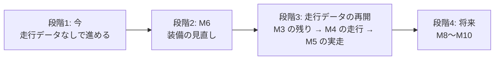

# PiCar-X 開発ロードマップ

本書はプロジェクト全体の計画と順番を一元管理する。ここには「何を、どの順で、どうなったら完了か」と、判断に効いた結果だけを置く。現行の仕様は各仕様書に、作業の経過は git の履歴にある（2026-11-17 に整理）。

> [!NOTE]
> - 走行と MLOps の現行仕様、実機の確認手順 → [E2E_SPECIFICATION.md](E2E_SPECIFICATION.md)
> - アプリと会話 Agent の仕様 → [APPLICATION_SPECIFICATION.md](APPLICATION_SPECIFICATION.md)
> - 全体構成の方針 → [agentic_ai_architecture_policy.md](agentic_ai_architecture_policy.md)
> - 未修正の課題一覧 → [REVIEW_FINDINGS.md](REVIEW_FINDINGS.md)

---

## 1. 最終目標

**PiCar-X が人と話しながら家の構造を把握し、家の中を自由に走る。**

そのために、走行判断とは別の会話 Agent が次の情報を総合して会話できるようにする。

- 自分の状況: 今いる場所、電池、すべてのセンサーと走行状態
- 走行の学習状況: 使用中のモデル、介入の頻度、上達の度合い
- 会話: いま言われたこと、過去の会話、人物に関する事実

### 制約

- マシンと計算リソースは大きく増強できない。GPU は前提にしない
- 費用は最小限にする。購入や装備の追加は、**走行データを集め直す前に M6 で必要なものだけ** 行う（2026-11-17 に変更。それまでは「最後に行う」だった）
- 個人情報（室内画像、音声、会話、記憶 DB、API キー）は git に追加しない

### 設計原則

1. **体（Body）と脳（Brain）を分ける。** Pi は単独で安全を保ち、脳が止まっても安全に停止する
2. **安全機能は Pi が持つ。** Wi-Fi 越しの判断を安全の根拠にしない
3. **LLM は意図だけを出す。** モーターを直接動かさず、実行可否は Body が決める
4. **完了は実機の測定で判断する。** コードの存在を完了としない
5. **クラウドへ送るデータを限定する。** Gemini のテキスト利用は継続する。新しい種類のデータを送る機能は追加前に確認する
6. **取り返しのつかない危険を最優先で防ぐ。** 落下などは、どの判断や指示よりも先に Pi が止める（2026-11-17 追加）
7. **「できた」は測って確かめる。** Agent の報告も、新しいモデルの採用も、自己申告ではなく検証の結果で決める（2026-11-17 追加）

---

## 2. 決定事項

| ID | 日付 | 項目 | 決定 |
|---|---|---|---|
| D-1 | 11-03 | Pi の機種 | Raspberry Pi 5、メモリ 8GB。ビルド基準は `MODEL=5` |
| D-2 | 11-03 | PC の稼働 | PicarX を使う時だけ PC も起動する。PC がなければ Body は安全に止まって待つ |
| D-3 | 11-03 | クラウド | Gemini を既定、PC のローカル LLM を代替にする。画像や音声などをクラウドへ送る機能は追加前に確認する |
| D-4 | 11-03 | 装備 | PC にマイクあり。車載マイクは所有、未装着。ジャイロはなし |
| D-5 | 11-07 | 認識の場所 | 音声認識（Whisper `small`）と画像認識（VLM `qwen3.5:4b`）は PC のローカルで行う |
| D-6 | 11-12 | 走行モデルの役割 | 「障害物を避けて進む」技能。どこへ行くかは上の層が意図（`any` / `left` / `right`）で渡す |
| D-7 | 11-14 | 走行ループの場所 | Pi で動かす（推論、避ける判断、引っかかりの検出、記録）。PC がなくても走れる |
| D-8 | 11-17 | 走行データの収集 | **M6 の後に回す。** 今の装備では使える走行データが集まらない（下記） |

D-8 の理由: 舵0でも毎秒約14°左へ曲がり（前輪は左を向いておらず、手で回した回り方も左右同じ）、細い家具の脚と布は超音波に映らず、黒いマットと段差を床センサーで区別できない。この状態で集めた介入の修正操作は、前が空いていても平均 +20〜+30° 右へ切っていて、障害物を避けた操作より左寄りの打ち消しが多かった。

**未決定**: M6 で何を買うか（§5 の M6）。

PC: Core i7-1255U、メモリ 16GB、GPU なし。D ドライブは C とは別の物理ディスク（2TB の HDD）で、バックアップ先に使う。

---

## 3. 現在地（2026-11-17）

| 項目 | 状態 |
|---|---|
| 走行ループ | Pi 上で約15Hz（カメラが上限）、推論の中央値 8.1ms |
| 危険の検知から停止 | 最大 20.0ms（障害物 16.9ms、段差 20.0ms）。PC が途切れると TTL の期限から 11.4ms |
| 走行モデル | v006。自動収集8セッション（学習に使えるフレーム約1万）。交差検証 ±5.56°（常に0°と答えると ±9.19°） |
| 実走 | 床で9回（2026-11-15〜16）。超音波に映らない脚や布団で詰まり、多くを人が引き継いだ。10分あたりの介入回数の比較はまだ |
| 直進 | 舵0で毎秒約14°左へ曲がる（`MOTOR_BALANCE=10` で測定、2026-11-16）。補正は0へ戻すと決め、M6 で直す |
| 自己位置 | 未着手 |
| 音声対話 | 返事の流れ始めの中央値 5.5秒（音声入力）。見る質問 8.2秒 |
| Agent の自己認識 | 電池、センサー、走行状態、最近の安全停止に答える。位置と学習状況は未対応 |

---

## 4. 進める順番

マイルストーンの番号は内容の区分で、順番ではない。各項目の **［今］** は段階1、**［M6 後］** は段階3で行う。

段階1（今。車は止めたまま、または手で持って使う）は次の順に進める。

1. 保守: Pi の SSH を鍵認証だけにする、ファイアウォール、CI の脆弱性検査
2. M3: 新しいモデルの回帰テスト（門番）と、合格しないモデルを Pi へ送らない仕組み
3. M4 の机上の部分: 地図のバグ修正、場所グラフと保存、場所の名前を教える会話、カメラを振って見回す、場所の認識の試作
4. M5 の会話の部分: 意図 API、到着や完了の検証、学習状況の報告、電池が減った時の行動
5. M7 の一部: Pi の余力の計測、自己診断、PC がない時の音声での通知、走行の記録装置

段階2の M6 は、段階1と並行して部品を選び、装着と測り直しが済んだら段階3へ進む。

---

## 5. マイルストーン

完了条件の数値は提案値で、実機の測定をもとに調整する。

### M0: 止血 ✅ 完了（2026-11-04）

公開情報の削除と停止系の修正。API キーと室内写真の削除、緊急停止の保持、走行時間と速度のサーバー側の検証、API のトークン認証、黙ってモックで起動しない、など（[REVIEW_FINDINGS.md](REVIEW_FINDINGS.md) の解決済み）。

**完了条件**: 緊急停止後の `move` が明示的な解除まで拒否される。トークンなしの要求が拒否される。LLM 応答待ち中も緊急停止できる。

### M1: 体の再構築 ✅ 完了（2026-11-09）

速いカメラと Pi 内の安全系。カメラの常時配信（15.0fps）、Rust の反射ループ（約40Hz。障害物、段差、期限切れ、不明なセンサー値、緊急停止）、TTL 付きの走行コマンド、時刻付きのセンサー値、`/api/status` と `/api/events`。確認手順と結果は [E2E_SPECIFICATION.md §9](E2E_SPECIFICATION.md)。

**完了条件**: カメラ 10fps 以上。危険検知から停止まで 100ms 以下。PC を切断すると TTL 以内に停止。段差試験を落下防止措置つきで実施し、停止を確認。

残った課題（行き先）:

- 細い家具の脚、布、低い物は超音波に映らない → M6（距離センサー、接触の検知）、M3（カメラ）
- 黒いマットを段差と判定する。床では段差検知を切って走らせている（`PICARX_DISABLE_CLIFF_GUARD=1`） → M6、M4（場所ごとの床の基準）
- 舵0でも左へ寄る、左前輪の回りが悪い → M6
- 前輪が段差の縁へセンサーより先に届く。後ろを見るセンサーがないので、記録した軌跡の範囲だけ下がる

### M2: 対話 v0 ✅ 完了（2026-11-07）

停止中に、自分の状況と過去の会話を踏まえて答える。Gemini Flash-Lite を既定とし、使えなければローカル LLM（`qwen3.5:4b`）で答える。PC のマイクで押して話す（Whisper）、状態の毎ターン注入、SQLite + FTS5 の記憶、PC のローカル VLM による見る質問、発話の一本化と割り込み停止。詳細は [APPLICATION_SPECIFICATION.md](APPLICATION_SPECIFICATION.md)。

| 種類 | 目標 | 結果 |
|---|---|---|
| 見る質問の「見てみます。」、停止 | 0.5秒以内 | 0.2秒 |
| 文字入力の会話 | 返事の流れ始めの中央値 5秒以内 | 4.7秒 |
| 音声入力の会話 | 中央値6秒以内、遅くても8秒 | 5.5秒、最大6.9秒 |
| 見る質問 | 8秒以内 | 8.2秒 |

普通の会話の相づちは試して取りやめた（利用者の判断）。

### M3: 走行の作り直し 🟡 基盤は完了、走行データの部分は M6 の後

データと評価を実走の指標に基づくものへ作り直し、走行を Pi で動かす。

済んだこと:

- [x] 車輪が回る最低の速度（40。前進の減速の下限）と、指令と実際の動きの食い違いの検出（`no_motion`、`turn_mismatch`、`uncommanded_motion`）
- [x] データの管理: セッションは追記のみ、マニフェスト、D ドライブへのバックアップ、再現できる学習、セッション単位の交差検証、採用の判定（`compare_cv`）、学習の記録（`metadata.json`）
- [x] 意図付きのモデル（意図ごとに出力の頭を分ける）、超音波を見て決まったルールで走る自動収集、曲がりの区間の意図の付け直し
- [x] Pi 上の走行ループ（`tract` で推論、避ける判断、引っかかり、後退、記録）、モデルの配置（ハッシュの確認、版の切り替えと戻し）
- [x] 介入の記録（走行ごとの `run.json`、`interventions.jsonl`、`cycles.jsonl`）、10分あたりの介入回数の集計、パッドでの引き継ぎと修正操作の記録、抜け出せない時に止まって人を呼ぶ形
- [x] データビューア: 怪しいフレームの印、範囲を選んでタグや除外、分布と統計。手作業のラベルは `data/annotations` に置き、学習が使う
- [x] データとモデルの来歴（2026-11-19）: セッション → ラベル → モデル → 交差検証 → 走行のつながり、モデルの採否（候補・有効・却下・廃止、`models/registry.json`）、配置の記録、最新と有効なモデルの表示。Control Center（`src.gui.web`、ブラウザの画面）で見て操作し、ツールの実行をジョブとして残す。操作マニュアルも Control Center に置く

判断の記録（交差検証は自動収集の8セッション）:

| 判断 | 結果 |
|---|---|
| 曲がりの区間に曲がった向きを意図として付け直す（採用） | ±11.24° → ±5.56°。常に0°（±9.19°）、意図ごとの平均（±6.77°）より良くなり、画像を使うようになった |
| 左右反転で補強する（不採用） | ±5.59°で変わらず、学習の時間が倍 |
| 「前方が塞がっているか」を学習する（重み0のまま） | 再現率 0.62。見落としが4割近くあり安全の判断に使えない。自律走行は超音波だけで避ける |
| 2026-11-15〜16 の介入の修正操作（学習に使わない） | 左寄りの打ち消しが大半（D-8）。消さずに残す |

［今］:

- [ ] 回帰テスト（門番）: データビューアのタグで、過去にぶつかった、詰まった、避け損ねた場面と、普通にまっすぐ走れた場面を「門番」に選び、新しいモデルがどう振る舞うかを1フレームずつ採点する（避ける側へ切るか、まっすぐの所で曲がらないか）。`deploy.pi push` は合格しないモデルを送らない（理由を表示し、人が明示すれば送れる）。記録した画像の再生なので、モデルの判断で次の画像が変わる閉じたループは試せない。走行全体の再生は M7 の記録装置で画像が残るようになってから
- [ ] PC の `avoidance.py` に、Pi と同じ「避けている間は少なくとも20°切る」を入れる
- [ ] Pi の走行サーバーに、モデルのフォルダの読み取り権限だけを与える（systemd）

［M6 後］:

- [ ] 直進を確かめてから、決まり（基本はまっすぐ、塞がれたら空いている側へ、分かれ道は意図の向き）で集め直す
- [ ] 脚や布団の場面の走行データと、データビューアでの手作業のラベルで、「前方が塞がっているか」を見直す
- [ ] 実走で10分あたりの介入回数を測り、モデルを比べる。走行中の緊急停止を確かめる

**完了条件**: 同じ環境で介入回数の改善を複数モデル間で比較できる。Pi 単体で 10Hz 以上で走行する。空転と引っかかりを検出し、学習から外せる。別のフォルダへ clone して同じ指標を再現できる。バックアップから復元できる。ハッシュが合わないモデルを Pi が読み込まない。1回の操作で前のモデルへ戻せる。門番の試験に合格しないモデルを Pi へ送らない。

### M4: 家の理解 ⚪ 未着手

家全体の精密な地図は目指さず、**場所とそのつながり** を把握する。

［今］:

- [ ] 地図のバグ修正（MAP-1〜5）
- [ ] 場所グラフとその保存
- [ ] 文字または声で場所の名前を教える（「ここはキッチンだよ」）
- [ ] カメラのパンの API と、車輪を動かさずに見回す動作
- [ ] カメラ画像の特徴による場所の認識の試作。画像は止まって見回すか、車を手で持って運んで集め、教えた部屋の正答率の測り方を決める
- [ ] 立ち入らない場所の印（浴室、玄関など）を場所グラフに持つ。M5 の行き先と見回りから外す
- [ ] 床の種類の記録: 場所ごとの床センサーの基準を持つ設計。絶対的な下限は緩めない（M6 の段差の確認と合わせる）

［M6 後］:

- [ ] 速度とステアリングの校正（床に印を付けて計測）と、走りながらの自動校正（記録から舵の中心と左右の差を推定し、まず提案、確かめてから自動で反映）
- [ ] 画像の変化による向きの補正（視覚オドメトリ）と、通った場所の記録（M5 の見回りで同じ所を何度も走らないため）
- [ ] 起動時の場所の確認: 毎回「場所が分からない」から始め、聞かずに使える手がかり（前回の場所、Wi-Fi の強さ）、止まったままの見回し、前向きの小さな旋回の順に確かめ、決まらない時だけ「リビングで合っていますか？」と聞く。分かるまで自律行動をしない
- [ ] 持ち上げの検知（床センサーが床を見失ったら止まり、置かれた後に場所を当て直す）、階の区別（見た目、教えてもらう、Wi-Fi の強さ。足りなければ M6 の気圧センサー）
- [ ] 占有格子は近傍の回避と可視化に限定する

**完了条件**: 3分走行後の向き誤差を記録する。教えた部屋の正答率を計測する（目標 90%。未達なら M6 のタグで補う）。再起動後も場所を覚えている。別の部屋へ運んだ後の起動で場所を正しく把握してから自律行動を始め、人に聞いた割合を記録する。

### M5: 統合 ⚪ 未着手

会話と走行をつなげ、最終目標の中核を実現する。

［今］:

- [ ] 意図 API（`go_to`、`explore`、`return`、`look`、`stop`）。LLM は意図だけを出し、速度と時間を指定しない。Pi は拒否でき、理由を Agent に返す
- [ ] 到着と完了の検証: 「着いた」「できた」は、場所の認識、動きの推定、Pi の状態で確かめた結果だけで決める。Agent は検証の結果だけを話し、確かめられない時は「キッチンへ向かいましたが、廊下の途中で止まっています」のように伝える
- [ ] 学習状況の報告（使用中のモデル、10分あたりの介入回数、上達の度合い）
- [ ] 電池が減った時の行動（止まる、充電を頼む）と、行動管理（会話、走行、安全イベントの調停）
- [ ] 夜間の記憶の要約（PC が起動している時）

［M6 後］（M4 の場所グラフが前提）:

- [ ] 行き先への移動（`go_to`）: 場所グラフで道筋を決め、分かれ道ごとの意図を走行モデルへ渡す。進めない時は止まって理由を伝え、危険を押して進まない
- [ ] 道筋の再利用: 一度着けた道筋（通る場所の順と、分かれ道の意図）を保存し、同じ頼みでは LLM を呼ばずに使う。舵角と速度の列の再生はしない（§6 の①）
- [ ] 見回り（`explore`）: 通った場所の記録から、分かれ道でまだ通っていない側を選んで意図として渡す

**完了条件**: 「キッチンに行って」で移動を試み、到着または失敗を検証の結果どおりに報告する。見回りで同じ場所を走った割合が、意図を与えない場合より低い。「最近走行は上達した？」に実データで答える。

### M6: 装備の見直し ⚪ 未着手（段階2）

**走行データを集め直す前提を整える。** 購入は、利用者が下の候補から決める。導入の前後で同じ確認を測って比べる。

| 優先 | 装備 | 費用 | 解決すること | 確かめ方 |
|---|---|---|---|---|
| 1 | 前輪の点検と修理 | なし〜交換部品 | 左前輪の回りが悪い。軸への髪の毛やほこり、ねじの締めすぎ、軸受けのこすれを点検し、直らなければ車輪か軸受けを交換 | `m3_check run --scenario forward` と左右の旋回 |
| 1 | ジャイロ（I2C の IMU） | 要購入（安価） | 舵0での左寄り。向きを測って保てば、ずれが変わっても直進できる。視覚オドメトリと衝突の検知にも使う | 直進3秒で ±3°以内 |
| 2 | 前方の距離センサーの追加（ToF など）、または接触の検知 | 要購入 | 超音波に映らない細い脚、布、低い物 | 脚の手前で止まるか避ける |
| 2 | 下向きの距離センサー | 要購入 | 黒いマットと本当の段差の区別（明るさではなく距離で見る） | マットで止まらず、机の縁で止まる |
| 3 | 後方センサー（後回し。HC-SR04P に決めたが、後ろの板に付く大きさがない。2026-11-17） | 要購入 | 後退時の障害物と段差 | 付け方が決まった時か、実走で後退が問題になった時 |
| 3 | 車輪の回転センサー（エンコーダー） | 要購入、モーターの交換を伴う | 進んだ距離 | ジャイロと視覚オドメトリで足りない時 |
| - | USB マイク | なし（所有） | 車載の音声入力 | 車体で話しかける機能を使う時 |
| - | 印刷した AprilTag | 紙のみ | 部屋ごとの位置の補正 | 場所の正答率が目標に届かない時 |
| - | 気圧センサー | 要購入（安価） | 運ばれた時の階の変化 | 他の方法で階を区別できない時 |
| - | 外付けディスク | 要購入 | PC の外へのバックアップ | 走行データが増え、失うと集め直しが大変になった時 |

**完了条件**: 補正の手作業なしで直進が3秒で ±3°以内。超音波に映らない脚の手前で止まるか避ける。黒いマットで止まらず、段差では止まる。実施した装備について、導入前後の改善を計測する。

### 保守（随時）

購入なし、走行データなし。

- [ ] CI で依存関係の脆弱性を調べる（Python は `pip-audit`、Rust は `cargo-audit`）。Dependabot を有効にする
- [ ] Pi の SSH を鍵認証だけにし、パスワードでのログインを止める
- [ ] Pi のファイアウォール（`ufw`）で、SSH と走行 API を家の LAN からだけに限る
- [ ] ルーターで Pi の IP アドレスを固定する（利用者が行う）

**完了条件**: CI が脆弱性のある依存関係を知らせる。Pi にパスワードでログインできない。家の LAN の外から Pi の API に接続できない。

---

### 将来の拡張（M7〜M10）

最終目標の後に取り組む挑戦的な項目。各マイルストーンの最初に、実現できるかを小さく試してから進め方を決める。M7 のうち PC がなくても役立つ部分は段階1で先に行う。

### M7: Pi の機能追加 ⚪ 未着手

Pi 5 の余力で、PC が止まっていても役立つ機能を足す。

- [ ] ［今］余力の計測: 走行ループを動かした状態で CPU、メモリ、温度、SD カードの空きを測る
- [ ] ［今］自己診断: CPU 温度、性能の制限、電源電圧、Wi-Fi の強さ、SD カードの空き。過熱や低電圧の時は走行を止める
- [ ] ［今］PC がない時の動作: 電池が少なくなったら止まって知らせる。PC とつながっていない時は「PC とつながっていません」と話して待つ
- [ ] ［今］走行の記録装置: 直前の数十秒の画像とセンサー値をメモリに持ち、安全停止、介入、衝突らしき出来事の前後だけを SD カードへ残す。上限を設けて古いものから消す。M3 の回帰テストで走行全体を再生する材料にもする
- [ ] ［M6 後］車載マイクの話しかけの始まりの検出（VAD）を Pi で行い、声がある区間だけを PC へ送る

**完了条件**: 追加した機能を動かしたまま、走行ループが 10Hz 以上を保つ。記録装置が安全停止の前後の画像とセンサー値を残す。PC を切った状態で、電池の低下と接続切れを音声で知らせる。

### M8: 自律学習 ⚪ 未着手

学習が足りない場所や状況を自分で見つけ、データ集めから学習、終了の判断までを人の指示なしで行う。

- [ ] 不足の検知（自信の低さ、介入や安全停止の多さ、場所の認識の失敗が集中する場所と状況）
- [ ] データ集め（不足している場所でゆっくり走る。人の操作が必要なら会話で頼む）
- [ ] 学習と評価（M3 の交差検証と門番の試験で前のモデルと比べ、悪くなれば採用しない）
- [ ] 終了の判断と、どこまで覚えたかの報告
- [ ] 保留: わざと少し揺らして走り、分からない場面を探す案（2026-11-17 の提案）

**完了条件**: 学習が足りない場所を1つ以上自動で見つけ、データ集めから終了の判断までを人の指示なしで行い、その場所の介入回数が減ったことを計測で示す。

### M9: 難しい指示 ⚪ 未着手

- [ ] 「こっちを見て」（カメラのパンと人の検出。声の方向は複数のマイクが要るので最後）
- [ ] 「ついてきて」「そこで待ってて」など、人の位置や時間の条件を含む指示
- [ ] あいまいな指示の聞き返し、実行前の危険の判断（VLM の答えだけを根拠にしない）
- [ ] 指示の評価セットで成功率を計測する
- [ ] 保留: 人のそばで速度を落とすなどの配慮（2026-11-17 の提案）

**完了条件**: 「こっちを見て」で、カメラに映る範囲の利用者の方を向く。評価セットの成功率を記録する。危険な指示では止まって理由を伝える。

### M10: 機体の抽象化 ⚪ 未着手

機体ごとの構成表（センサー、カメラ、移動の方式、モーターの出力の範囲）から、使える機能と安全の設定を組み立てる。部品の自動検出、機体によらない機能の窓口、構成表からの安全の層、校正の手順、学習の引き継ぎ。車輪から足への変更は最後に扱う。

**完了条件**: PiCar-X の構成表から今と同じ機能が組み立てられる。構成表を変えた時に、使える機能と安全の設定が正しく変わることを試験で示す。

---

## 6. 外部の提案の評価（2026-11-17）

5つの提案（経験のコード化、不可逆操作のガード、回帰テスト、完了の検証、遅延の補正）を、今の構成と実測値に照らして判断した。

| 提案 | 判断 | 取り込み先 | 理由 |
|---|---|---|---|
| ① 成功した走行をコードとして残し、次から LLM や推論なしで再生する | 一部採用 | M5 の道筋の再利用 | 道筋（通る場所の順と分かれ道の意図）を残して LLM の呼び出しを減らすのは有効。舵角と速度の列の再生は採らない。回転センサーがなく、舵0でも毎秒約14°曲がる今の車では、同じ指令でも同じ道を走らず、出発の位置と向きも毎回違う。障害物を避けるのは毎回走行モデルと Pi が行う |
| ② 取り返しのつかない操作（落下、水回り、抜け出せない隙間）を最優先で防ぐ | 採用（形を変える） | 設計原則6、M4、M5、M6 | 落下は Pi の段差検知が最大 20ms で止めており、LLM は意図しか出せないので、「どの指示よりも優先」は今の構成と同じ。足りないのは、黒いマットで誤って止まるため床では段差検知を切っている点で、M6 の下向きの距離センサーと M4 の場所ごとの床の基準で直す。浴室や玄関は場所が分かって初めて判断できるので、Pi 単独では守れない。M4 で立ち入らない印を付け、M5 で行き先と見回りから外す（物理的な柵も併用）。後ろの見えない隙間は M6 の後方センサーで判断する（後回し。それまでは記録した軌跡の範囲だけ下がり、IMU で衝撃を検知したら止める） |
| ③ 過去の失敗場面で新しいモデルを自動で試し、合格するまで配らない | 採用（今すぐ） | M3 の回帰テスト（門番） | データビューアのタグと既存の配置の仕組みで作れる。負例を学習に混ぜるより試験に使う、という整理にも同意。ただし記録の再生は1フレームずつの採点で、走行全体の閉じたループは試せない |
| ④ Agent の「着きました」を信用せず、独立に確かめる | 採用 | 設計原則7、M5 | 設計原則4（完了は測定で判断）を Agent の報告にも広げる。確かめる手段は場所の認識、動きの推定、Pi の状態。Wi-Fi の強さは大まかな手がかりにとどめる |
| ⑤ 推論の遅れの分だけ先の位置を予測して舵を切る | 後回し | §7 | 今の速度（壁への接近で毎秒約11cm）では、100ms の遅れの間に進むのは約1cm。ふらつきの原因が遅れだという根拠がまだない。まず Pi で撮影から指令までの遅れを測り、遅れが効いていると分かってから検討する |

提案のうち、失敗例を学習させる案は③に、わざと揺らして走る案は M8 に、人への配慮は M9 に入れた（後の2つは保留）。

---

## 7. 後回しにするもの、やらないもの

### 後回し

- Pi 上のローカル LLM、ベクトル DB（まず FTS5 で検索品質を確かめる）
- 統合 GUI の残り（Control Center は来歴・採否・比較・配置・ジョブまで。カメラ・注釈・会話の画面は Qt のまま。設定の連携は後回し）、Python GUI の音声設定、速度も予測する E2E モデル
- MLflow と DVC: `metadata.json`、マニフェスト、`compare_cv`、来歴とステージ（`registry/lineage.py`、`registry/stages.py`）と Control Center で足りている。M8 で実験の数が増えたら再検討
- 固定のテストセット: セッションが10程度になるまで交差検証を使う。門番の試験は別に作る（M3）
- 走行モデルの A/B 比較とドリフトの検知（M8）、モデルの署名（PC 以外から配るようになったら）
- 遅延の先回り補正（§6 の⑤）: Pi で遅れを測り、効いていると分かってから

### やらないもの

- 前方超音波1本と推測航法のみによる家全体の精密地図
- GPU を必要とするモデルや 3D シミュレーター
- 到達できないノードを含むマルチエージェント構成
- 常駐する MLOps の基盤（MinIO、PostgreSQL、Prometheus、Grafana、Kubernetes）
- 外部のラベル付けツール（Label Studio など）: 修正操作の記録とデータビューアで足りる
- 舵角と速度の列をそのまま再生して走る方式（§6 の①）
- リポジトリの D ドライブへの移動（D は HDD で遅い。バックアップ先に使う）
