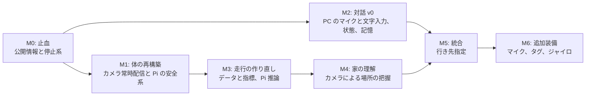

# PiCar-X 開発ロードマップ

本書はプロジェクト全体の計画を一元管理する。

> [!NOTE]
> - 走行と MLOps の現行仕様 → [E2E_SPECIFICATION.md](E2E_SPECIFICATION.md)
> - アプリと会話 Agent の仕様 → [APPLICATION_SPECIFICATION.md](APPLICATION_SPECIFICATION.md)
> - 全体構成の方針 → [agentic_ai_architecture_policy.md](agentic_ai_architecture_policy.md)
> - 未修正の課題一覧 → [REVIEW_FINDINGS.md](REVIEW_FINDINGS.md)

---

## 1. 最終目標

**PiCar-X が人と話しながら家の構造を把握し、家の中を自由に走る。**

そのために、走行判断とは別の会話 Agent が次の情報を総合して会話できるようにする。

- 自分の状況: 今いる場所、電池、すべてのセンサーと走行状態
- 走行の学習状況: 使用中のモデル、介入の頻度、上達の度合い
- 会話: いま言われたこと、過去の会話、人物に関する事実

### 制約

- マシンと計算リソースは大きく増強できない
- 費用は最小限にする。**購入や追加の装備が必要な作業は最後に行う（M6）**
- GPU は前提にしない
- 個人情報（室内画像、音声、会話、記憶 DB、API キー）は git に追加しない

### 設計原則

1. **体（Body）と脳（Brain）を分ける。** Pi は単独で安全を保ち、脳が止まっても安全に停止する
2. **安全機能は Pi が持つ。** Wi-Fi 越しの判断を安全の根拠にしない
3. **LLM は意図だけを出す。** モーターを直接動かさず、実行可否は Body が決める
4. **完了は実機の測定で判断する。** コードの存在を完了としない
5. **クラウドへ送るデータを限定する。** Gemini のテキスト利用は継続する。新しい種類のデータを送る機能は追加前に確認する

---

## 2. 決定事項（2026-11-03）

| ID | 項目 | 決定 | 計画への影響 |
|---|---|---|---|
| D-1 | **Pi の機種** | Raspberry Pi 5 Model B、メモリ 8GB | ビルド基準は `MODEL=5`。走行推論と音声認識を Pi 上で動かせる可能性を実測する |
| D-2 | **PC の稼働** | PicarX を使う時は PC も利用可能 | Brain は PC に置く。PC の常時起動は不要。PC がなければ Body は安全に停止して待機する |
| D-3 | **クラウド** | 現行の Gemini 利用は意図したもので問題なし。LLM は Gemini を既定とし、PC のローカル LLM を代替にする | Gemini API キーは `.env` で管理する。画像や音声など、新しい種類のデータをクラウドへ送る機能は、追加前に確認する |
| D-4 | **追加装備** | PC にマイクあり。車載用マイクは所有、未装着。ジャイロはなし（必要なら購入を検討） | M2 の音声入力は PC のマイクで開発する。車載の装備が必要な作業はすべて M6 へ移動。ジャイロなしで進める |

### PC の性能（確認値）

Intel Core i7-1255U、メモリ 16GB、NVIDIA GPU は検出されず。ローカル LLM は CPU で動作する前提で、モデルは実測で選ぶ（M2）。

### 未決定

- 音声認識と画像認識を Gemini で行うか、ローカルで行うか（M2 の評価後に確認する）

---

## 3. 現在地（2026-11-06 時点）

| 指標 | 目標 | 現状 |
|---|---|---|
| 走行ループ周期 | 10Hz以上（M1） | **15.0Hz**（p50、2026-11-04 実機） |
| 危険検知から停止まで | 100ms以下（M1） | **最大 16.9ms**（障害物5回、速度20。段差は未確認） |
| 学習データ | 実走の改善が確認できる量（M3） | 150フレーム、左に偏り |
| 介入回数 | 10分あたりの回数を記録（M3） | 未計測 |
| 自己位置 | カメラのみの精度を計測（M4） | 未計測。地図の左右反転などのバグあり |
| 音声対話 | 音声入力から応答まで（M2） | 音声入力なし（`listen` はスタブ）。発話は文ごとの送信と割り込み停止に対応 |
| Agent の自己認識 | 電池、位置、学習状況に答える（M2、M5） | 電池、センサー、走行状態、最近の安全停止に答える。位置と学習状況は未対応 |

---

## 4. 全体の流れ

M1 と M2 は並行して進められる。M2 は停止中の会話から始めるので、走行の完成を待たない。M0〜M5 は追加の購入や装着なしで進める。

---

## 5. マイルストーン

完了条件の数値は提案値で、実機の測定をもとに調整する。

### M0: 止血 ✅ 完了（2026-11-04）

公開情報と停止系の問題を解消する。

- [x] API キーと室内写真の削除、`.gitignore` の追加
- [x] 仕様書とロードマップの矛盾を修正
- [x] 緊急停止の保持（SAF-1）
- [x] `duration_ms` と速度をサーバー側で検証（SAF-3）
- [x] GUI の緊急停止を常に押せるようにする（SAF-9）
- [x] API のトークン認証と CORS の制限（SAF-10）
- [x] ハード初期化失敗時に黙ってモック起動しない（SAF-11）
- [x] 個人データを追加しにくくする `.gitignore` の強化
- [x] ユーザー名とプライベート IP を履歴から除去、`articles/` を追跡から除外
- [x] 実機で完了条件を確認する（緊急停止、トークン、LLM 応答待ち中の停止）
- [x] `v001` を追跡から除外し、ONNX 出力時にローカルのパスを除去（OPS-9）

**完了条件**: 緊急停止後の `move` が明示的な解除まで拒否される。トークンなしの要求が拒否される。LLM 応答待ち中も緊急停止できる。

### M1: 体の再構築 🟡 実機確認は Wi-Fi 切断を残すのみ

全機能の前提となる、速いカメラと Pi 内の安全系を作る。

- [x] カメラの常時配信（`rpicam-vid` の MJPEG 出力）。要求がない時はカメラを止める
- [x] 周期の内訳を計測（撮影、通信、推論、指令）。走行終了時に表示し、`data/cycle_profiles/` へ数値を保存
- [x] Rust の反射ループ（目標 40Hz）: 障害物、段差、期限切れ、不明なセンサー値、緊急停止
- [x] TTL 付き走行コマンドへ変更（`ttl_ms` は 50〜1000）
- [x] 全センサー値に時刻を付け、「不明」を表現する
- [x] `/api/status` と `/api/events`（電池、モード、センサー、安全イベント）
- [x] Python の安全系のうち、反射ループへ移す範囲を移植（段差、障害物停止、通信断）
- [x] Python CI の追加、Rust CI のビルド対象を Pi 5 へ変更
- [ ] 実機で完了条件を確認する（下記。手順4の Wi-Fi 切断が未実施）

**完了条件**: カメラ 10fps 以上。危険検知から停止まで 100ms 以下。PC を切断すると TTL 以内に停止。段差試験を **落下防止措置つきで** 実施し、停止を確認。

**範囲（2026-11-04 に確認）**: 障害物の停止は、壁や大きな家具など **超音波で見える物** を対象とする。細い脚、音を吸う物、低い物は検知できないことがあり、M3 のカメラで補う。

#### 実機での確認手順

Pi へ新しいバイナリを配置してから、PC の `python/` で実行する。

| 順 | 確認 | 手順 | 合格基準 |
|---|---|---|---|
| 1 | 状態と反射ループ | `uv run python -m src.e2e.m1_check status` | 20Hz 以上。電池とセンサーが実測値 |
| 2 | カメラ | `uv run python -m src.e2e.m1_check camera` | 10fps 以上 |
| 3 | 切断時の停止 | 広い床で `uv run python -m src.e2e.m1_check ttl --i-understand-the-car-will-move` | 理由 `ttl_expired`、TTL + 100ms 以内 |
| 4 | Wi-Fi 切断 | 走行中に PC の Wi-Fi を切る | TTL（400ms）以内に停止 |
| 5 | 障害物の停止 | 低速で壁へ向けて走行し、`uv run python -m src.e2e.m1_check events` | `obstacle` で停止、100ms 以下 |
| 6 | 段差の停止 | **落下防止措置つき** で段差へ低速で近づけ、同じく `events` を確認 | `cliff` で停止し、車輪が段差の手前に残る |
| 7 | 床の種類 | よく使う部屋の明るい床を低速で走らせる（`--disable_stuck`） | 段差でない場所で止まらない。想定外の床で止まった時は安全に待機し、再校正で再開できる |
| 8 | 周期の内訳 | `autonomous_driver` を走らせ、終了時の表を確認 | 走行ループが 10Hz 以上 |

実機の結果（2026-11-04 時点）:

| 順 | 結果 | 実測 |
|---|---|---|
| 1 | 合格 | 反射ループ 39.9Hz、走行後の最大間隔 28.1ms。電池 8.14V（83%）。床の値は停止中 1146〜1222、走行中 989〜1344 で連番の異常値なし。起動時の校正で記録した連番の値（`0x0A0B` など）は捨てる修正で解消（確認は再起動1回、原因は未特定） |
| 2 | 合格 | 15.0fps。間隔の中央値 66.7ms、最大 170.8ms |
| 3 | 合格 | 336ms 後に `ttl_expired` で停止（TTL 300ms） |
| 4 | 保留 | 後日実施 |
| 5 | 合格 | 壁で確認。速度20は `obstacle` で5回停止、最大 16.9ms、停止時 14.58〜14.97cm。速度50の連続走行は 14.3cm で検知、16.9ms で停止指令、惰性で約1.7cm 進み 12.6cm で停止。細い脚などは範囲外 |
| 6 | 合格 | 閾値300、速度50の連続走行で `cliff` により自力で停止（停止指令まで 20.0ms、惰性は約2.3cm）。前輪は縁に近いが手前に残った（距離は未測定）。速度20で前輪が縁にかかる位置まで進んだ斜めの進入は、利用者の判断で許容。余裕は小さいので、段差の近くでは車のそばで走らせる |
| 7 | 合格 | 走行して問題なしと利用者が判断（速度50、`--disable_stuck`）。手で動かした測定では床 1038〜1465。暗い床は未確認。床への適応は M4 |
| 8 | 合格 | 15.0Hz（p50）、p95 は 88.1ms。内訳の中央値はフレーム待ち 52.0ms、状態取得 9.7ms、推論 1.2ms、指令 19.7ms |

実走で見つかった課題:

- **速度50の連続走行で家具の脚に正面から衝突した（Pi は停止せず、破損なし）。** 脚の15〜20cm 手前に置いても距離は100前後で、超音波では脚が見えない。M1 では防げないので M3 のカメラで補う（利用者の判断）。それまでは車のそばで走らせる
- 舵0でも左へ寄る。左前輪の抵抗か舵の中心のズレの可能性がある（未確認）
- 前が広く空くと超音波の反射が戻らず、前進を拒否していた。反射が戻らないだけの時は「遠い」として走行を許可し、速度を60までに抑えた（利用者の判断）。広い場所で `far=True`、前進の拒否なしを実機で確認。クッションや布をかざした確認では `343.0` のままで、検知できない恐れがある。カメラによる前方の判断（M3）で補う
- 左前輪の回りが悪く、走行に影響している可能性がある（ハードの課題。未対応）
- モーターの PWM が 50Hz、出力が公式より低い（速度20で公式60%に対し20%）。PWM は公式と同じ約1.76kHz に変更した。実機の感触では速度50前後で進む（定規での測定はなし）。出力の計算は未変更
- 舵を切っても車体が曲がらなかった。左右の後輪が同じ速さだったので、内側を遅くする処理を追加した。速度50、舵 +30 と -30 で左右とも曲がることを実機で確認
- 走行に必要な速度が50前後になりそう。手順5と6は速度20でしか確認していないので、決めた速度で再試験が必要
- 斜めの進入では、前輪がセンサーより先に縁へ届く。後退でしか戻れないので、走行プログラムは軌跡の記録が尽きると待機する
- 床センサーの左右がコードと逆だった（進行方向に向かって右のセンサーを覆うと1番目の値が下がった）。読み取りの順序を修正し、実機で左右とも確認した
- スタック検知が約5秒ごとに発動した。誤検知の疑いがあり、未解決（閾値が旧周期の前提のまま）

**段差の判定値は記録データからの推定** で、実機では未確認。特に手順 6 と 7 の結果で調整する（`rust/src/safety/mod.rs` の校正定数）。

### M2: 対話 v0 🔵 作業中

停止中に、自分の状況と過去の会話を踏まえて答えられるようにする。音声は PC のマイクで開発する。

- [x] Gemini とローカル LLM の切り替え。Gemini が使えない時は Flash-Lite、それも使えなければローカルで応答。実際の上限超過（429）と混雑（503）で確認（2026-11-06）
- [x] ローカル LLM の選定と計測（CPU 実行）。`qwen3.5:4b` を採用し、JSON で行動を決める専用経路を追加（`python/src/agents/local_agent.py`）
- [x] PC のマイクを使う音声入力: 押して話す方式とローカルの Whisper（`small`）。GUI の会話で確認（2026-11-06）
- [x] 状態ストアと、毎ターンの状態注入（Gemini）。ローカルは状態の質問をコードで回答
- [x] 記憶の一本化（SQLite + FTS5）: 会話、人物の事実、車体の出来事（安全停止、緊急停止、床の校正）を PC に保存。Rust 側の記憶は下の廃止計画で削除する
- [x] カメラ画像の認識方式の評価: PC のローカル VLM で「何が見える？」に答える。実際の室内で利用者が確認し、問題なし（2026-11-06）。Gemini への画像送信は許可済みだが、必要になるまで使わない
- [x] 単一 Agent への整理、発話経路の一本化、割り込み停止。実機で確認（2026-11-06）
- [ ] 応答時間の計測と目標の決定（完了条件の残り）
- [x] Rust 側の LLM、記憶、旧 GUI の廃止計画（下記）

#### Gemini が応答しない問題（2026-11-06）

原因は2つ。どちらも API キーとコードの誤りではない。

- **無料枠の上限**: `gemini-3.8-flash` は1日20回まで（`GenerateRequestsPerDayPerProjectPerModel-FreeTier`）。ツールを使う会話は1ターンで2〜3回呼ぶので、数ターンで尽きる。上限はモデルごとで、`gemini-3.5-flash-lite` は同じ時に使えた
- **混雑**: `gemini-3.8-flash` は短い質問にも 90秒以上応答しないか、503（高い需要）を返した。ライブラリが内部で5回やり直すので、503 が返るまで 51秒かかり、Flash-Lite で答えるまで最悪約2分だった

対策:

- Gemini への1回の要求は 20秒で打ち切り、ライブラリ内ではやり直さない
- 混雑、応答なし、上限超過の時は、同じモデルでやり直さずに Flash-Lite へ切り替え、それも使えなければローカル LLM で答える
- Flash が上限の時、実際の経路で Flash-Lite が 1.3秒で答えた

既定のモデルは Flash-Lite に変更した（利用者の判断）。Flash は GUI で選べば使える。

GUI の確認（2026-11-06、ローカル LLM）: 利用者が試し、問題なしとの報告。

#### 発話と割り込み（2026-11-06）

- Gemini の Agent は、使われていなかった走行、視覚、発話のサブエージェントを削除し、LLM とツールを往復する1つの Agent にした
- 発話は PC の `Speaker`（`python/src/voice/speaker.py`）に一本化した。LLM には発話ツールを渡さない。返事は文ごとに Pi へ送り、Pi は1文目の再生中に2文目を生成する
- 新しい発言と緊急停止で読み上げを止める。Pi に `POST /api/audio/stop` を追加し、生成中だった文も再生しない。`/api/status` の `audio.speaking` で発話中かが分かる
- 撮影ツールは画像を LLM に渡していなかったので外した。後にローカル VLM の `look` ツールに置き換えた（下記）

実機の結果（2026-11-06、Pi 5）:

- 発話 API: 合格。長い文の音声の生成と送信に 0.6秒。再生中は `audio.speaking` が True、`/api/audio/stop` の後は False になり、声も途中で止まった
- GUI（Flash-Lite）: 次の項目を利用者が確認し、すべて問題なし。新しい発言、押して話す、緊急停止で読み上げが止まる。緊急停止の後に「さっき何があった？」に答え、GUI を開き直しても答える。カメラの前の物を答える。黒い棒を見せると反応した（生成した画像の細い棒は見落としていた）。走行の安全の判断に使わない方針は変えない

#### 音声入力（2026-11-06）

車体にはマイクがないので、PC の内蔵マイクで話す。返事は車体のスピーカーから聞こえる。車載マイクは M6。

- GUI の「🎤 押して話す」を押している間だけ録音し、離すと PC のローカルの Whisper（`faster-whisper`、CPU、int8）で文字にする。文字入力と同じ経路で送るので、「止まって」の即時停止も効く
- 話し始めに読み上げ中の返事を止める。Pi の声を録音しにくくなる
- 音声はメモリ上だけで扱い、保存もクラウドへの送信もしない
- 内蔵マイクの音が小さい（最初の録音でピーク 0.026、最大 -41 dBFS）ので、ピークを揃えてから渡す。増幅は30倍まで
- 短すぎる録音と小さすぎる音は Whisper に渡さない。雑音だけの6秒は `small`、`large-v3-turbo` とも文を作らなかった
- 最初の録音（`small`）: 6秒に 2.4秒で「こんにちは、できますか?こんにちは」
- モデルの比較は `uv run python -m src.voice.mic_check --models small large-v3-turbo`。同じ6秒の録音（最大 -30 dBFS）で次の結果だったので、既定は `small` にした。環境変数 `PICARX_WHISPER_MODEL` で変えられる

| モデル | 文字にする時間 | 結果（話した内容は「こんにちは、聞こえますか、もしもし」） |
|---|---|---|
| `small` | 2.4秒 | こんにちは。聞こえますか?もしもし。 |
| `large-v3-turbo` | 9.4秒 | こんにちは、聞こえますか?もしもーし |

- 最初の録音は声が小さく（最大 -41 dBFS）、`small` が「聞こえますか」を「できますか」と聞き違えた。小さい声では誤りやすい
- 必要なライブラリは `uv sync --extra voice`。入っていない時はボタンが無効になる

#### カメラ画像の認識（2026-11-06）

PC のローカル VLM（`qwen3.5:4b`、画像処理部あり）を、生成した 320×240 の画像で測った。室内の画像は使っていない。

| 項目 | 結果 |
|---|---|
| 1枚あたりの応答 | 8.6〜11.0秒（画像の処理 3.5〜4.9秒、生成 2.9〜3.9秒）。初回はモデルの読み込みで +6秒程度 |
| 内容 | 箱とドアは答えられた。床に置いた細い棒（家具の脚の代わり）は4回とも答えず、「進路はふさがっていない」と答えた |

- 「何が見える？」への会話の返事には使える速さだが、走行の安全判断には使えない。細い脚の検知は M3 のカメラ学習で行う

実装（`python/src/vision/local_vlm.py`）:

- Pi のカメラから1枚だけ取り、PC の VLM に見せる。画像は PC の外へ送らない
- Gemini の Agent には `look` ツールを渡す。Gemini に届くのは VLM の説明の文章だけ
- ローカル LLM の Agent は、「何が見える？」「周りの様子どう？」などを LLM を通さずに VLM へ渡す
- 認識に時間がかかるので、GUI は先に「見てみます。」と返す
- 実際の経路を生成した画像で試すと、初回 15.0〜15.6秒（モデルの読み込みを含む）、2回目 8.5〜8.7秒
- VLM を読み込むと、Ollama が会話用のテキスト専用モデルをメモリから外した（計測時の PC の空きメモリは 1.2GB / 15.7GB）。ローカル LLM で会話している時は、見た直後の返事でテキストモデルを読み込み直す時間がかかる。Gemini で会話している時は影響しない。VLM は2分使わなければ解放する
- Gemini に画像を送る方式は許可済み（2026-11-06）。ローカルを試した後に、聞かれた時の1枚だけを送る形で比べる
- 実際の室内画像での正答は未確認

#### Rust 側の旧機能の廃止計画

**理由**: 旧 GUI（`--gui`）とその LLM（`rust/src/llm_agent/`）は、反射ループを通さずに `px.forward()` でモーターを動かす。段差や障害物の停止、TTL、緊急停止の保持が効かない。記憶（`rust/src/memory/`）は PC 側と二重になっている。

| 対象 | 置き換え先 | 削除の前に必要なこと |
|---|---|---|
| `llm_agent/`（Gemini、Ollama、コマンド実行） | PC の Agent | なし |
| `memory/`（会話、要約、長期記憶） | PC の記憶 DB | Pi に残る `picarx_memory.db` を PC へ移すか削除するかを利用者が決める。要約は M5 の夜間要約で作り直す |
| `sample/picarx_sample.rs`（旧 GUI）、`sample/rc_controller/` | Python GUI | カメラのパンとチルトの API を追加する（M4 の見回しにも必要）。ブザーは使わないなら削除 |
| `audio_input.rs`（Pi での録音） | PC のマイク（M2）、車載マイク（M6） | なし。M6 で方式を決め直す |
| TTS エンジンの選択（Piper Plus） | `/api/audio/speak` の引数 | Python から選べるようにするか、既定を変えるかを決める |
| 依存の `eframe`、`ureq`、`rusqlite`、`uuid` | — | 上の削除後に外す。`dotenvy` は API サーバーでも使うので残す |

手順:

1. 旧 GUI にしかない機能（カメラのパンとチルト、TTS エンジンの選択）を API へ移す
2. Pi の `picarx_memory.db` の扱いを決める
3. `--gui`、`llm_agent/`、`memory/`、`sample/`、`audio_input.rs` を削除し、依存を外す
4. 仕様書の §13 を削除し、Pi 5 のビルド時間と実行ファイルの大きさの変化を記録する

それまでは `--gui` を使わない。

**完了条件**: 「電池どう？」に実測値で答える。再起動後も前回の話題を答えられる。Gemini が使えない時もローカル LLM で応答する。応答時間を計測し、0.5秒以内の相づちと、本回答の開始までの目標を決める。

#### ローカル LLM の計測（2026-11-05、i7-1255U、偽の走行ツールと固定の状態）

`uv run python -m src.llm_eval` で測定。実機と GUI では未確認。

| 項目 | 従来（ツール定義） | 新方式（JSON） |
|---|---|---|
| 調整に使っていない32問の正答 | 25/32（距離と段差のセンサー呼び出しを正解とすると 27/32） | 30/32 |
| 頼んでいない走行（同じ32問） | 0回 | 0回 |
| 状態の質問 | 16〜23秒 | ほぼ0秒 |
| 連続した会話での走行と舵 | 35〜41秒（LLM 2回） | 1.3〜2.9秒 |
| 会話の最初の応答 | 17〜23秒 | 10〜16秒 |

画像処理部を外したテキスト専用モデル（`uv run python -m src.llm_setup` で作成）で、メモリのピークは 4.28GB から 3.08GB に減った。履歴の上限を増やすと 16 ターン後で 3.38GB。10スレッドで最初の応答は 8.7〜9.3 秒（6スレッドは 9.5〜10.8 秒）。テキスト専用かつ `presence_penalty` 0 で、調整に使っていない32問は 31/32。

応答時間の 93〜98% はプロンプトの処理だった。`qwen3.5` は途中まで巻き戻せないので、固定の指示を先頭に置き、履歴を追記だけにしている。

### M3: 走行の作り直し ⚪ 未着手

データと評価を実走の指標に基づくものへ作り直す。

- [ ] 10fps 以上で再収集し、距離、実速度、床センサーの値を保存
- [ ] セッション単位の分割、シード固定、左右反転
- [ ] 「前方が塞がっているか」の補助出力（超音波を自動ラベルに使う）。**優先**: 細い家具の脚と音を吸う物は超音波で見えず、衝突を確認済み。超音波が見えない物はラベルが付かないので、手動のラベルも検討する
- [ ] 介入時に人の修正操作を記録（現在の承認機能を置き換える）
- [ ] 主指標を「10分あたりの介入回数」に変更し、モデル間で比較
- [ ] 推論を Pi 5 へ移行（`ort` または `tract`）

**完了条件**: 同じ環境で介入回数の改善を複数モデル間で比較できる。Pi 単体で 10Hz 以上で走行する。

### M4: 家の理解 ⚪ 未着手

家全体の精密な地図は目指さず、**場所とそのつながり** を把握する。この段階では装備を追加せず、カメラのみで行う。

- [ ] 地図のバグ修正（MAP-1〜4）※先行して実施可
- [ ] 速度とステアリングの校正（床に印を付けて計測）
- [ ] 画像の変化量による向きの補正（視覚オドメトリ）
- [ ] カメラ画像の特徴による場所の認識
- [ ] カメラのパンを使った見回し
- [ ] 場所グラフとその保存
- [ ] 文字または声で場所の名前を教える（「ここはキッチンだよ」）
- [ ] 占有格子は近傍の回避と可視化に限定
- [ ] 床の種類への適応: 記録した床の値をもとに、走行中の基準値の更新と、場所ごとの基準値の保存を設計する。絶対的な下限は緩めない

**完了条件**: 3分走行後の向き誤差を計測し記録する。教えた部屋の正答率を計測する（目標 90%。未達なら M6 のタグで補う）。再起動後も場所を覚えている。

### M5: 統合 ⚪ 未着手

会話と走行をつなげ、最終目標の中核を実現する。

- [ ] 意図 API: `go_to`、`explore`、`return`、`look`、`stop`
- [ ] 行動管理（会話、走行、安全イベントの調停）
- [ ] 学習状況の報告
- [ ] 電池低下時の行動（充電を頼む、停止する）
- [ ] 夜間の記憶要約と再学習（PC が起動している時に実行）

**完了条件**: 「キッチンに行って」で移動を試み、到着または失敗を正しく報告する。「最近走行は上達した？」に実データで答えられる。

### M6: 追加装備 ⚪ 未着手

**最後に行う。** M0〜M5 の計測結果を見て、必要なものだけを実施する。

| 装備 | 費用 | 内容 | 判断基準 |
|---|---|---|---|
| USB マイク | なし（所有） | 車載の音声入力、走行中の会話（モーター音と自声への対策） | 音声で話しかける機能を車体で使う時に実施 |
| 印刷した AprilTag | 紙と印刷のみ | 部屋ごとの絶対位置の補正 | 場所の正答率が目標に届かない時 |
| I2C ジャイロ | 要購入 | 向きの補正、衝突とスタックの検知 | 向きの誤差が移動に支障をきたす時 |
| 後方センサー | 要購入 | 後退時の障害物検知 | 実走で後退が問題になった時 |

**完了条件**: 車体のマイクに話しかけて応答する。走行中に話しかけても安全に応答する。実施した装備について、導入前後の改善を計測する。

---

## 6. 既存機能の状態

凡例: 🟢 完了条件を実機で確認済み / 🟡 動作するが課題あり / ⚪ 未実装

実機の完了条件を定めていなかったため、現時点で 🟢 はない。「Phase」はコードやコメントで使われている機能 ID で、計画の番号としては使わない。

| 機能 ID | 内容 | 状態 | 課題 |
|---|---|---|---|
| Step 1 | データ収集 GUI | 🟡 | 約1fps。距離と速度を保存しない |
| Step 2 | 学習と ONNX 出力 | 🟡 | 動作する。データ量と再現性に課題 |
| Step 3 | オフライン評価 | 🟡 | 走行性能の指標にならない |
| Step 4 | 遠隔自律走行 | 🟡 | 約1Hz |
| Phase 1 | MLOps レジストリ | 🟡 | 実走の指標がない |
| Phase 2.1 | Disengagement Logger | 🟡 | 約30秒分を記録。ラベルはモデル出力 |
| Phase 2.2 | データセット統合 | 🟡 | 動作する |
| Phase 2.3 | 残差クリーナー | 🟡 | 改善の判断には使えない |
| Phase 2.4 | 再学習パイプライン | 🟡 | 実行はできるが、データは150フレーム |
| Phase 3.1 | 段差検知 | 🟡 | Pi へ移管し校正つきに変更。実機の段差試験は未実施 |
| Phase 3.2 | 速度リミッター | 🟡 | PC 側に残す。停止は Pi の反射ループが行う |
| Phase 3.3 | ウォッチドッグ | 🟡 | 停止は Pi の TTL へ移管。PC 側は通信状態の記録のみ |
| Phase 3.4 | 直前軌跡と安全後退 | 🟡 | 記録のない範囲へは後退しない。実機未確認 |
| Phase 3.5 | 占有格子 | 🟡 | 左右反転などのバグ。保存不可 |
| Phase 3.6 | スタック検知 | 🟡 | 10fps なら検知まで約2秒の計算。実機未確認 |
| — | サーボ校正の自動読込 | 🟡 | 実装あり。今回のレビューでは実機未確認 |
| — | チャット（Gemini / Ollama） | 🟡 | テキストのみ。LLM は画像を見ていない |
| — | TTS | 🟡 | API 経由は Default エンジン固定 |
| — | 会話メモリと長期記憶 | 🟡 | Python GUI で会話、事実、車体の出来事を保存。旧 Rust GUI の記憶は廃止予定 |
| — | 音声入力 | ⚪ | Rust 旧 GUI の録音のみ。API はスタブ |

---

## 7. 旧計画との対応

| 旧項目 | 移行先 | 変更点 |
|---|---|---|
| Phase 4.1〜4.3（Pi 推論、低遅延、PC の役割分離） | M3 | PC 離れそのものではなく、応答速度と安全のために実施 |
| Phase 5.1（Pi のローカル LLM） | 後回し（§8） | PC を利用できるので不要。Gemini と PC のローカル LLM を使う |
| Phase 5.2（LLM の性能向上） | M2 | 状態注入と FTS5 による記憶検索を優先 |
| Phase 5.3（GUI と Agent × E2E 統合） | M5 | 統合 GUI は後回し。意図 API を優先 |
| Phase 6.1（動画ストリーミング） | M1 | **最後から最優先へ** |
| Phase 6.2（STT） | M2（PC のマイク）、M6（車載） | **PC で前倒し** |
| Phase 6.3（Python GUI の音声設定） | 後回し（§8） | |
| Phase 6.4（データ拡張、速度予測） | M3（拡張のみ） | 速度予測は後回し |
| Phase 6.5（後方センサー） | M6 | 実走で後退が問題になってから |

---

## 8. 後回しにするもの、やらないもの

### 後回し

- Pi 上のローカル LLM
- ベクトル DB（まず FTS5 で検索品質を確かめる）
- 統合 GUI の作り込み、Python GUI の音声設定
- 速度も予測する E2E モデル

### やらないもの

- 前方超音波1本と推測航法のみによる家全体の精密地図
- GPU を必要とするモデルや 3D シミュレーター
- 到達できないノードを含むマルチエージェント構成の維持
