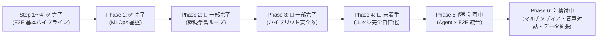

# PiCar-X 開発ロードマップ

本書は PiCar-X プロジェクト全体の開発ロードマップを一元管理する。
詳細な実装仕様は各仕様書を参照。

> [!NOTE]
> - E2E 自律走行 & MLOps の詳細仕様 → [E2E_SPECIFICATION.md](E2E_SPECIFICATION.md)
> - Agentic AI Controller の詳細仕様 → [APPLICATION_SPECIFICATION.md](APPLICATION_SPECIFICATION.md)

---

## 全体フロー

---

## 進捗サマリー

### E2E 自律走行 & MLOps

| 項目 | ステータス | 備考 |
|------|:----------:|------|
| **Step 1**: データ収集 GUI | ✅ 完了 | `gui_collector.py` |
| **Step 2**: モデル学習 & ONNX エクスポート | ✅ 完了 | `train.py`、複数セッション統合対応 |
| **Step 3**: オフライン評価 | ✅ 完了 | `evaluate.py` |
| **Step 4**: 遠隔自律走行 | ✅ 完了 | `autonomous_driver.py` |
| **Phase 1**: MLOps レジストリ | ✅ 完了 | Dataset / Model / Compare CLI |
| **Phase 2.1**: Disengagement Logger | ✅ 完了 | 緊急停止・急ブレーキ直前データの自動タグ付け & 管理CLI |
| **Phase 2.2**: データセット統合 | ✅ 完了 | `DrivingDataset` が親ディレクトリ/リスト入力対応 |
| **Phase 2.3**: 残差データクリーナー | ✅ 完了 | `cleaner.py` (Data-Centric AI) |
| **Phase 2.4**: 再学習パイプライン | ✅ 完了 | v001→v004 学習済、clean_v1/v2 生成済 |
| **Phase 3.1**: 多重センサー防護 (グレースケール) | ✅ 完了 | 床面センサーによる段差・階段落下防止 & 自動後退退避 |
| **Phase 3.2**: ダイナミック・スピードリミッター | ✅ 完了 | 急旋回時・障害物接近時の自動動的減速 |
| **Phase 3.3**: ウォッチドッグ (通信タイムアウト) | ✅ 完了 | 通信断・ハートビート途絶時の即時自動停止 |
| **Phase 4.1**: Rust ONNX Runtime 組み込み | ❌ 未着手 | Pi 単体での推論 |
| **Phase 4.2**: 超低遅延化 | ❌ 未着手 | Wi-Fi オーバーヘッド排除 |
| **Phase 4.3**: PC 側役割の分離 | ❌ 未着手 | PC は学習・配信のみ担当 |
| **Bonus**: サーボ校正自動補正 | ✅ 完了 | `core.rs` が `picar-x.conf` を自動読込 |

### Agentic AI Controller & システム統合

| 項目 | ステータス | 備考 |
|------|:----------:|------|
| **自然言語チャット (Gemini/Ollama)** | ✅ 完了 | LangGraph ベース、LLM 切替対応 |
| **TTS (音声合成)** | ✅ 完了 | Default (Open JTalk/eSpeak) & Piper Plus 対応 |
| **会話メモリ & 長期記憶** | ✅ 完了 | SQLite、要約・キーバリュー記憶、Gemini のみ |
| **Phase 5.1**: ローカルLLM on Pi 配置 | 🗺️ 計画中 | Gemini API はオプション維持 |
| **Phase 5.2**: ローカルLLM 性能向上策 | 🗺️ 計画中 | プロンプト最適化・量子化検討等 |
| **Phase 5.3**: GUI Agent × E2E 統合 | 🗺️ 計画中 | 統合 GUI + ONNX と LLM の協調走行 |

### 次世代UX・マルチメディア & 高度制御 (Phase 6)

| 項目 | ステータス | 備考 |
|------|:----------:|------|
| **Phase 6.1**: 低遅延動画ストリーミング | 💡 検討中 | MJPEG / H.264 による真の動画配信（1秒更新制約の解消） |
| **Phase 6.2**: 実機完結型 音声認識 (STT) | 💡 検討中 | Pi側マイク入力による完全音声対話ループ (Voice-to-Voice) |
| **Phase 6.3**: Python GUI 音声・車載設定統合 | 💡 検討中 | Piper Plus切替・音量・カメラ画質などのGUI設定化 |
| **Phase 6.4**: データ拡張 & 速度予測E2E化 | 💡 検討中 | 左右反転Augmentationと「舵角＋車速」の複合自律制御 |

---

## 各フェーズの概要

### ✅ Step 1〜4: E2E 基本パイプライン (完了)
データ収集 GUI → PyTorch 学習 → ONNX エクスポート → オフライン評価 → 遠隔自律走行の一連フローが完成。

### ✅ Phase 1: MLOps 基盤 (完了)
データセット・モデルのバージョン管理と定量比較 CLI を整備。計算負荷ゼロ（メタデータ管理のみ）。

### 🔧 Phase 2: データフライホイール & 継続学習 (一部完了)
失敗した走行データから効率的にリカバリーを学習させる仕組み。
Disengagement Logger、データクリーナー、複数セッション再学習がすべて実装完了。

### ✅ Phase 3: ハイブリッド安全系 (完了)
家庭内走行時、AI 推論の誤判定が起きても家具・壁への衝突や段差・階段からの落下を防ぐ多重 Fail-Safe アーキテクチャ。計算負荷ゼロ（ルールベース）。

### ⬜ Phase 4: エッジ完全自律化・Rust 推論移植 (未着手)
Wi-Fi・PC なしで Raspberry Pi 単体が完全自律動作。Rust の `ort` crate で ONNX 推論を Pi 上に移植。

### 🗺️ Phase 5: Agent × E2E 統合 (計画中)
- **5.1** ローカルLLM の Pi 配置（Gemini API はオプション維持）
- **5.2** ローカルLLM の性能向上策（プロンプト最適化・RAG・量子化検討）
- **5.3** GUI 統合 + ONNX（E2E 操舵）× LLM（状況判断・上位計画）の協調走行

詳細は [APPLICATION_SPECIFICATION.md §14](APPLICATION_SPECIFICATION.md) を参照。

### 💡 Phase 6: 次世代UX・マルチメディア & 高度制御 (検討中)
両仕様書の「既知の制約」「今後の拡張」「アーキテクチャ方針」に記載されていた課題を体系化したフェーズ。
- **6.1 低遅延リアルタイム動画ストリーミング**:
  - 現行の1秒ごとの `rpicam-still` 単発実行から脱却し、MJPEG / H.264 / WebSocket ストリーミングAPIをPi側に導入。GUI・推論へ20〜30fpsの滑らかな映像を常時供給する。
- **6.2 実機完結型 音声対話ループ (STT / Voice-to-Voice)**:
  - Pi側マイクから軽量STT（Whisper等）で音声を文字起こしし、キーボード不要の完全ハンズフリー音声対話を実現。
- **6.3 Python GUI での音声・ハードウェア詳細設定統合**:
  - 現在Rust GUIにしかないTTSエンジン切替（Default vs Piper Plus）、音量調整、発話ミュート、カメラ解像度等の設定をPython GUIへ統合。
- **6.4 データ拡張 (Augmentation) & 速度予測E2E化**:
  - 直進過多データを補正する左右反転・明暗変更オーグメンテーションの導入、および固定スロットルから「カーブ前自動減速」等の舵角・車速複合予測モデルへの進化。
