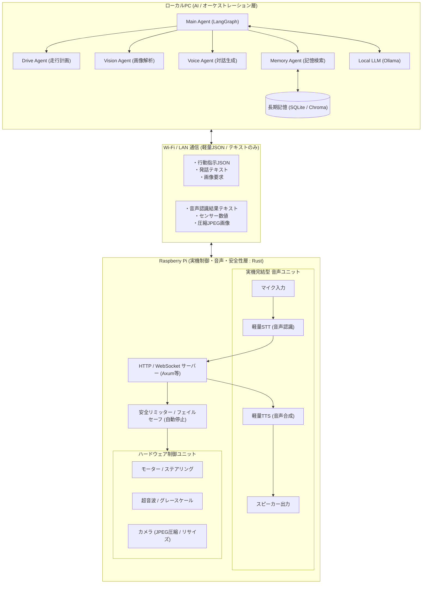

# PiCar-X Agentic AI 実装方針書 (PC-Raspberry Pi 分散構成版)

本書は、**ローカルPC（AI/Agent基盤）** と **Raspberry Pi（実機制御・ハードウェア/音声処理）** をネットワーク経由（Wi-Fi/LAN）で連携させ、低遅延かつ安定した自律走行・対話システムを構築するためのアーキテクチャ方針書です。

---

## 1. 結論（基本方針）

- **物理的な役割分担（分散配置）**:
  - **ローカルPC**: 高負荷なAI処理（LangGraph、Multi-Agent、ローカルLLM / Ollama、長期記憶 / Vector DB）を実行
  - **Raspberry Pi**: 実機制御（モーター・センサー）に加え、**重い音声データ（録音・STT・TTS）や安全ガードを実機側で完結**
- **通信負荷の最小化**:
  - ネットワーク上には**テキストデータと軽量化されたJSON/画像のみ**を流し、大容量な音声ストリームは通信に載せない
- **通信断へのフェイルセーフ**:
  - Wi-Fi切断やPC側の応答遅延が発生しても、Raspberry Pi（Rust）側の安全リミッターが自律的にモーターを安全停止

---

## 2. システム全体構成図（物理配置・通信フロー）



---

## 3. レイヤー別役割分担と通信設計

### 3.1. ローカルPC (Python / LangGraph)
- **LangGraph Multi-Agent**:
  - 各種サブエージェント（Drive, Vision, Voice, Memory）の自律的な思考・判断
- **テキストベースの対話処理**:
  - Raspberry Piから送られてきた「認識済みテキスト」を元に返答・行動を決定
- **軽量通信クライアント**:
  - Raspberry PiのREST/WebSocketエンドポイントへJSONコマンドを送信

### 3.2. Raspberry Pi (Rust / ハードウェア・ローカル音声処理)
- **音声処理の実機完結**:
  - **マイク入力 → STT（音声認識）**: 音声を文字起こしし、**テキストのみ**をPCへ通知
  - **TTS（音声合成） → スピーカー再生**: PCから受け取った**テキスト**を実機ローカルで音声合成して再生
- **画像通信の最適化**:
  - フル解像度の動画ストリームは常時送信せず、Vision Agentからの要求時のみリサイズ・圧縮したJPEGを送信
- **ハードウェア制御 & 安全リミッター**:
  - モーター、サーボ、超音波センサーの直接制御
  - 通信途絶時のタイムアウト自動停止
  - 超音波センサーによる前方障害物検知時のハードウェア強制ブレーキ

---

## 4. 通信インターフェース仕様（JSON例）

### ① 音声対話（音声データではなくテキストをやり取り）
- **ユーザー発話時 (Raspberry Pi -> PC)**:
  ```json
  {
    "event": "voice_input",
    "text": "前の障害物まで何センチあるか教えて"
  }
  ```
- **ロボット発話時 (PC -> Raspberry Pi)**:
  ```json
  POST /api/audio/speak
  {
    "text": "前方の障害物までは、およそ35センチです。"
  }
  ```

### ② 走行制御・センサー取得
- **走行コマンド (PC -> Raspberry Pi)**:
  ```json
  POST /api/drive/move
  {
    "direction": "forward",
    "speed": 30,
    "duration_ms": 1000
  }
  ```
- **センサー取得 (PC -> Raspberry Pi)**:
  ```json
  GET /api/sensor/ultrasonic
  --> Response: {"distance_cm": 35.4}
  ```

### ③ 画像取得（要求時のみ軽量化して転送）
- **画像要求 (PC -> Raspberry Pi)**:
  ```json
  POST /api/camera/snapshot?width=320&quality=70
  --> Response: {"image_base64": "..."}
  ```

---

## 5. 改訂版ロードマップ

1. **フェーズ 1: Raspberry Pi側 (Rust) のAPI & 音声完結基盤**
   - 軽量HTTP/WebSocketサーバー（`axum` 等）の実装
   - 実機内での軽量STT/TTS環境の整備（テキストのみ送受信するAPIの構築）
   - 安全リミッター（通信断タイムアウト停止・障害物自動停止）の実装
2. **フェーズ 2: PC側 (Python) のクライアント & Tool実装**
   - LAN経由でRaspberry Piの各APIを叩くLangChain Tool群の作成
3. **フェーズ 3: PC側 LangGraph Multi-Agent の構築**
   - Ollama（ローカルLLM）と連携したStateGraphの実装
   - 発話テキスト・センサー値・画像をもとにした自律動作ループの作成
4. **フェーズ 4: 長期記憶（Memory）の統合**
   - PC上のSQLite / Vector DBを用いた走行ログやユーザー会話履歴の永続化
