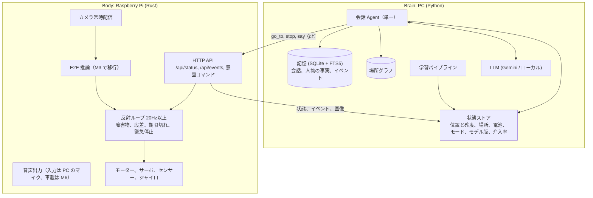

# PiCar-X アーキテクチャ方針書

本書は、Raspberry Pi 5（Body）と PC（Brain）に分けた **目標構成** と、その判断理由を定める。

> [!IMPORTANT]
> 本書は目標構成を示す。M1（Pi の安全系）と M2（対話）の部分は実装済みで、残りは未実装の目標である。現行の動作は [APPLICATION_SPECIFICATION.md](APPLICATION_SPECIFICATION.md) と [E2E_SPECIFICATION.md](E2E_SPECIFICATION.md)、計画と決定事項は [ROADMAP.md](ROADMAP.md) を参照する。

---

## 1. 基本方針

- **Body と Brain を分ける**
  - **Body（Pi / Rust）**: モーター、センサー、カメラ、音声入出力、安全機能、走行推論
  - **Brain（PC / Python）**: 会話 Agent、状態の集約、記憶、場所の理解、学習
- **安全は Body が単独で保つ**: Wi-Fi の切断や Brain の停止時も、Body が自律的に停止する
- **Brain は意図だけを送る**: LLM はモーターを直接動かさない。Body は要求を拒否できる
- **PC は使用時のみ起動する**: PicarX を使う時は PC も利用可能なので、常時起動は前提にしない（ROADMAP の D-2）。PC がなければ Body は停止して待機する
- **クラウドへ送るデータを限定する**: 現行の Gemini 利用は意図したもので問題なし。LLM は Gemini を既定とし、PC のローカル LLM を代替にする。画像や音声など、新しい種類のデータをクラウドへ送る機能は、追加前に確認する（ROADMAP の D-3）

---

## 2. 目標構成



---

## 3. 判断と理由

### 3.1 安全機能を Pi に置く

旧構成の走行ループは PC 側で約1Hzで、段差や障害物への反応が遅れていた。Wi-Fi の遅延に影響されない Pi 内のループで監視する。M1 で実装し、反射ループは約40Hz、危険検知から停止指令まで最大 16.9ms を実機で確認した（2026-11-04）。

### 3.2 単一 Agent にする

旧構成の Drive、Vision、Voice ノードはグラフ上で到達不能だった。計算資源が限られる環境ではモデル呼び出しを増やす構成の利点が小さいので、単一 Agent と少数のツールにする。M2 で実装した。

### 3.3 状態はプロンプトへ毎回注入する

小さなローカル LLM でもツール呼び出しに依存せずに状況を把握でき、呼び出し回数も減らせる。

### 3.4 記憶は SQLite + FTS5 から始める

追加サービスなしで動き、日本語検索はトリグラムで対応できる見込みである（要検証）。検索品質が不足した場合にベクトル検索を検討する。

### 3.5 LLM は Gemini を既定とし、ローカルを代替にする

Gemini は応答の品質と速度に優れる。一方で通信断やクォータ超過（429）があるので、PC のローカル LLM を代替にする。PC は GPU なしの Core i7-1255U なので、モデルは応答時間の実測で選ぶ。Pi 5 のメモリは LLM に使わず、走行、安全、音声入出力に充てる。

### 3.6 クラウドへ送るデータを限定する

どのクラウドでも安全性を 100% 担保することはできない。Gemini API の規約（2026-03-23 発効版を確認）では、無料枠の入出力は製品改善に使われ、人が閲覧する場合がある。有料枠でも、不正利用の検知のため一定期間ログが保存される。この点を理解したうえで現行の利用を継続する。室内画像や音声など新しい種類のデータを送る機能は、追加前に確認する。

### 3.7 音声処理の場所は性能で決める

旧版は「音声は重いので通信に載せない」としていたが、16kHz モノラル PCM は約256kbps であり、帯域は決定的な理由にならない。

M2 では、PC のマイクとローカルの Whisper（`small`、CPU）で文字にすると決めた。文字起こしは約2.3秒。画像の認識も PC のローカル VLM で行い、画像と音声は PC の外へ出さない。車載マイクは M6 で装着し、モーター音と自声への対策を行う。話し始めの検出は Pi で行う案がある（M7）。

### 3.8 自己位置は場所のつながりで持つ

前方超音波1本と推測航法では家全体の精密地図を作れない。まずカメラのみで場所を認識し、場所グラフとして持つ。精度が足りない場合に限り、印刷した AprilTag とジャイロを M6 で追加する。占有格子は近傍の回避と可視化に限定する。

### 3.9 Pi の余力は Pi だけで役立つ機能に使う

Pi 5 のメモリと CPU は、走行、安全、音声出力を優先する。余力は、M3 の走行推論を Pi で動かした後に測り、PC が止まっていても役立つ機能（走行の記録装置、自己診断、PC がない時の音声での通知）に使う（M7）。LLM は当面 Pi で動かさない（ROADMAP の「後回し」）。

### 3.10 機体の違いは構成表で吸収する

将来は、センサーやカメラの位置、移動の方式、モーターの出力の範囲を機体ごとの構成表に書き、ソフトウェアはこの表から使える機能と安全の設定を組み立てる（M10）。会話、計画、学習の層は、機体によらない機能の窓口（進む、止まる、距離を知る、見る）だけを使う。

---

## 4. インターフェース

### 4.1 現行 API（抜粋）

| 用途 | 要求 | 応答 |
|---|---|---|
| 走行 | `POST /api/drive/move` `{"direction":"forward","speed":30,"ttl_ms":500}` | `{"status":"ok"}` |
| 緊急停止 | `POST /api/drive/emergency_stop`、`POST /api/drive/emergency_stop/reset` | `{"status":"ok"}` |
| 距離 | `GET /api/sensor/ultrasonic` | `{"distance_cm":35.4,"age_ms":12}`。不明な時は 503 |
| 発話 | `POST /api/audio/speak` `{"text":"..."}` | `{"status":"ok"}` |
| 画像 | `GET /api/camera/snapshot` | `{"image_base64":"...","width":320,"height":240,"seq":1,"age_ms":20}` |
| 映像 | `GET /api/camera/stream` | MJPEG の常時配信 |
| 状態 | `GET /api/status` | 電池、センサー、走行モード、走れない理由 |
| 安全イベント | `GET /api/events?after=<id>` | `{"events":[...],"latest_event_id":3}` |

全要求で Bearer トークンが必須である。一覧は [APPLICATION_SPECIFICATION.md §7](APPLICATION_SPECIFICATION.md) を参照する。

### 4.2 目標 API（未実装の案）

```json
GET /api/status
{
  "time": "2026-11-03T12:00:00Z",
  "mode": "idle",
  "battery": {"voltage": 7.6, "percent": 50, "age_ms": 120},
  "ultrasonic": {"distance_cm": 35.4, "age_ms": 40, "valid": true},
  "grayscale": {"values": [800, 790, 810], "age_ms": 40, "valid": true},
  "safety": {"estop": false, "last_event": "obstacle_stop"}
}
```

```json
POST /api/drive/command
{"speed": 30, "steer": 5, "ttl_ms": 300}
```

---

## 5. 計画

実施順序と完了条件は [ROADMAP.md](ROADMAP.md) で一元管理する。
