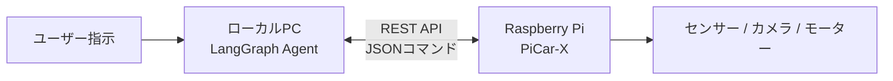
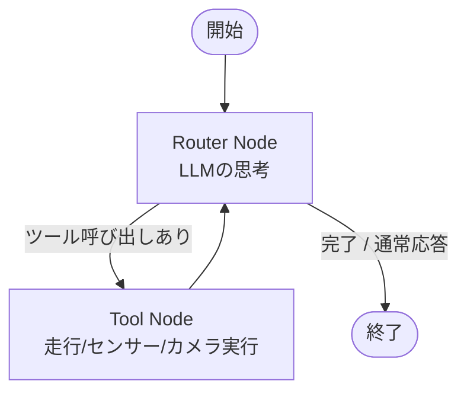
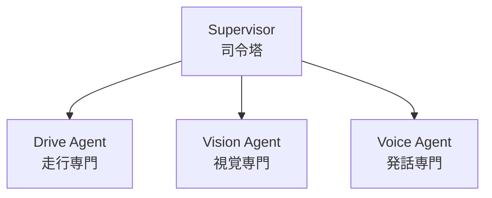

# 【LangGraph×ラズパイ】AIエージェントでロボット（PiCar-X）を自律制御してみた

## 1. はじめに（前回の振り返りと課題）

本記事は、以下の前編記事の続編です。

- **前編**: [【LLM構造化出力】ラズパイ自作ロボットを自然言語対話で制御してみた](https://qiita.com/tactac1238/items/7d0a3d14609e29f77133)

### 前回達成したこと
- Gemini APIの構造化出力（Structured Outputs）を活用
- LLMの出力をJSONスキーマで固定し、パースエラーゼロで安全にPiCar-Xを走行制御

### 感じた限界
- **一方通行の指示しかできない**: 「指示 → 1回のJSON生成 → 実行」で完結してしまう
- **環境変化に対応できない**: 移動中に障害物を見つけた場合や、カメラ画像を確認してから次の動作を決めるといった「フィードバックループ」が組めない
- **複雑なタスクの破綻**: 「障害物がないか確認し、あれば避けて元のルートに戻る」といった複数ステップの自律行動を1回の出力で定義するのは困難

この限界を突破するため、今回は **LangGraph** を用いたAIエージェント制御へ移行しました。

---

## 2. LangGraphとは？

LangGraphは、LLMを用いたアプリケーションにおいて **循環（ループ）や状態管理を持つ処理フローをグラフ構造として定義・実行するためのライブラリ** です。

通常のLLMチェーン（一方通行のパイプライン）とは異なり、以下の特徴を持ちます。

- **State（状態）の保持**:
  - 会話履歴やセンサー値、実行結果などの変数を辞書形式で一元管理し、ノード間で引き継ぎます。
- **Node（ノード / 処理単位）**:
  - LLMの呼び出し、ツールの実行、データ変換など、1つの具体的な処理を行うPython関数です。
- **Edge（エッジ / 遷移と条件分岐）**:
  - ノードから次のノードへの移動を定義します。LLMの判断結果に応じて「ツールを実行する」「処理を終了する」などの条件付き分岐（Conditional Edge）が可能です。
- **ループの実現**:
  - 「LLMがツール実行を要求 → ツールが実機を動かして結果を返す → 再度LLMが結果を見て判断」という反復処理を明示的に記述できます。

---

## 3. システムアーキテクチャ

ローカルPC側でLangGraphによる意思決定を行い、ラズパイ側でハードウェア制御・安全停止を担う構成です。



### 役割分担
- **ローカルPC (Python / LangGraph)**:
  - 会話履歴の管理
  - LLMによるツールの選定・パラメータ決定
  - ツールの実行と結果の評価
- **Raspberry Pi (Rust / ハードウェア制御)**:
  - モーター・サーボの駆動
  - センサー値（超音波・グレースケール）の取得
  - 前方障害物検知時のハードウェア強制自動停止（安全ガード）

---

## 4. LangGraphによるエージェントの設計

現在実装している最小構成のエージェントループは以下のグラフで動作します。



### 処理の流れ
1. **Router Node**: ユーザーの入力とこれまでの履歴を元に、LLMが「ツールを実行するか」または「終了して回答するか」を判定。
2. **Conditional Edge**: 
   - ツール呼び出しが必要な場合 → `tools` ノードへ遷移
   - 不要（回答完了）な場合 → `END` へ遷移
3. **Tool Node**: 指定されたツール（前進、カメラ撮影、センサー取得など）を実行し、その結果をメッセージ履歴（State）に追加して `Router` に戻る。

---

## 5. 実装コード（抜粋）

### ① 状態（AgentState）の定義
```python
from typing import Annotated, List, TypedDict
import operator
from langchain_core.messages import BaseMessage

class AgentState(TypedDict):
    # 会話履歴・ツールの入出力履歴を追記型リストで管理
    messages: Annotated[List[BaseMessage], operator.add]
    current_agent: str
    is_finished: bool
```

### ② グラフの構築と条件分岐
```python
from langgraph.graph import StateGraph, END
from langgraph.prebuilt import ToolNode
from langchain_core.messages import AIMessage

# ルーティング判定関数
def route_after_main(state: AgentState):
    last_msg = state["messages"][-1]
    # LLMがツール実行を要求した場合は tools ノードへ
    if isinstance(last_msg, AIMessage) and last_msg.tool_calls:
        return "tools"
    return END

# グラフ定義
workflow = StateGraph(AgentState)
workflow.add_node("router", router_node)
workflow.add_node("tools", ToolNode(ALL_TOOLS))

workflow.set_entry_point("router")
workflow.add_conditional_edges(
    "router",
    route_after_main,
    {
        "tools": "tools",
        END: END,
    },
)
workflow.add_edge("tools", "router")  # ツール実行後はRouterに戻る

app = workflow.compile()
```

---

## 6. 構造化出力からエージェント化して変わったこと

| 項目 | 構造化出力のみ（前編） | LangGraphエージェント（今回） |
| :--- | :--- | :--- |
| **動作方式** | 1往復の固定JSON生成 | 状況に応じた反復ループ（思考→実行→再思考） |
| **環境フィードバック** | 実行前の推測のみ | センサー値やカメラ結果を見て次の手を決定可能 |
| **エラー自己修復** | 実行失敗時はそのまま停止 | 失敗結果を見て別のアプローチを自律的に試行可能 |
| **柔軟性** | あらかじめ決めたスキーマの範囲内 | 複数のツールを組み合わせた複雑なタスクに対応 |

### 動作確認で実感したリアルな違い

以前は「前進して障害物があれば避けて」と指示すると、最初に生成した固定JSON通りに突っ込んで壁の手前で安全停止し、そのままフリーズしていました。
LangGraphにしてからは、「少し前進 → センサーで距離12cmを検知 → 自律的にハンドルを切って回避」というように、ロボット自身が環境の変化を見ながら臨機応変にリカバリーして動くようになりました。

---

## 7. まとめと次の展望（マルチエージェント化への課題）

LangGraphの導入により、センサー結果を受けた自律的な反復実行に成功しました。
実用化に向けて、現在は以下の課題に取り組んでいます。

### 現在できていない課題
- **ツールの肥大化**: 1つのLLMが全ツール（走行・カメラ・音声）を持つため、ツール選択ミスやトークン消費が増える。
- **並行動作が不可**: 処理が直列なため、「喋りながら走る」「走りながらカメラで周囲を監視する」ができない。
- **割り込み制御が不可**: 走行タスクの途中で障害物を検知しても、即座に中断してブレーキをかけられない。



### 次の展望（解決策）
- **専門エージェントへの分離**:
  - `Drive`（走行のみ）、`Vision`（カメラのみ）、`Voice`（発話のみ）にツールとプロンプトを分割し、精度向上とトークン削減を図る。
- **並行処理と割り込みの実装**:
  - 走行と画像監視を非同期で並行稼働させ、視覚エージェントが異常を検知した際に走行エージェントを即座に停止させる協調制御を実装する。
