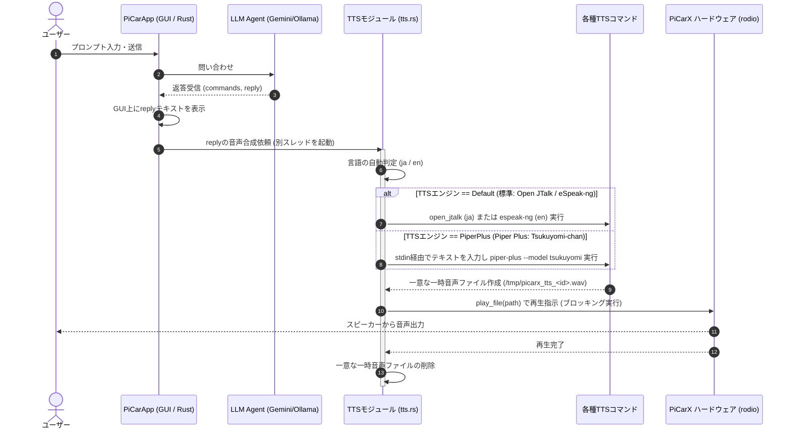

# 音声合成（Text-to-Speech）機能の追加計画

LLMからの返答テキスト（`reply`）を自動で「日本語」か「英語」に判定し、Raspberry PiのローカルTTSエンジンを呼び出して音声で再生するための実装計画です。
本計画では、標準的なエンジン（**Open JTalk / eSpeak-ng**）と、高品質な多言語対応エンジン（**Piper Plus / Tsukuyomi-chan**）をGUIで切り替えて使用できるようにします。

---

## 実装の概要

1. **エンジンの切り替え**: GUI（egui）上にTTSエンジンの切り替えUI（標準 vs Piper Plus）を追加します。
2. **言語の自動判定**: 返答テキストに日本語（ひらがな・カタカナ・漢字）が含まれているかを判定し、使用する言語を決定します。
   - ※ Tsukuyomi-chanは日本語と英語を含む6言語に対応した単一のモデルです。
3. **外部コマンドによる音声生成**: Rustの `std::process::Command` を使用し、選択されたエンジンに応じたTTSコマンドを実行して一時音声ファイルを作成します。
   - **標準エンジン**: 日本語は `open_jtalk`、英語は `espeak-ng` を使用します。
   - **Piper Plusエンジン**: `ayutaz/piper-plus` の C++版CLI (`piper-plus`) を使用します。shellを経由せず、テキストを標準入力（stdin）経由で流し込みます。モデルの解決は `--model tsukuyomi` を指定して自動で行わせます。
4. **一意な一時ファイルとクリーンアップ**:
   - 同時実行等による競合を防ぐため、タイムスタンプ等を活用した一意なファイル名 `/tmp/picarx_tts_<unique-id>.wav` を生成します。
   - 再生完了後、直ちにこの一時ファイルを削除します。
5. **音声の非同期再生（別スレッド）**:
   - 既存の `Picarx::play_file` は再生完了までスレッドが停止するブロッキング処理です。
   - GUIの描画やカメラ映像の更新をブロックしないよう、**「音声生成 → 再生 → 一時ファイル削除」の一連の処理は別スレッド（`std::thread::spawn`）**で非同期に実行します。

### システムアーキテクチャ（データフロー）



---

## 変更が必要なファイルと詳細

### 1. [NEW] `rust/src/tts.rs`

音声合成処理を担当する独立モジュールを新規作成します。

- **`pub enum TtsEngine`**:
  ```rust
  #[derive(Debug, Clone, Copy, PartialEq, Eq)]
  pub enum TtsEngine {
      Default,    // Open JTalk (日本語) / eSpeak-ng (英語)
      PiperPlus,  // Piper Plus (Tsukuyomi-chan 6言語高品質モデル)
  }
  ```
- **`pub fn detect_language(text: &str) -> &'static str`**:
  - テキストに日本語の文字が含まれる場合は `"ja"`、それ以外は `"en"` を返します。
- **`pub fn generate_tts_file(text: &str, lang: &str, engine: TtsEngine) -> Result<std::path::PathBuf, Box<dyn std::error::Error + Send + Sync>>`**:
  - ナノ秒単位のタイムスタンプを含めた一意なパス `/tmp/picarx_tts_<nanoseconds>.wav` を作成します。
  - **`TtsEngine::Default`**:
    - `"ja"` のとき: `open_jtalk` コマンドを実行します。
    - `"en"` のとき: `espeak-ng` コマンドを実行し、引数でテキストを渡します。
  - **`TtsEngine::PiperPlus`**:
    - 実機上に展開した `/usr/local/share/piper-plus/bin/piper-plus` コマンドを `Stdio::piped()` で実行します。
    - 引数として `--model tsukuyomi`、`--noise-scale 0.5`（WavLM discriminatorで学習された高品質モデル向けの公式推奨設定）、および `--output_file <一時パス>` を指定します。
    - プロセスの `stdin` にテキスト（`text`）を書き込みます。

---

### 2. [MODIFY] `rust/src/main.rs`

新規作成した `tts` モジュールを登録します。

```rust
mod llm_agent;
mod picarx;
mod rpi_camera;
mod sample;
mod sensor_monitor;
pub mod tts; // 追加
```

---

### 3. [MODIFY] `rust/src/sample/picarx_sample.rs`

GUI上にTTSエンジン選択肢を追加し、LLM応答受信時に非同期で再生と一時ファイルクリーンアップを行います。

- **`PiCarApp` 構造体**:

  - 選択中のTTSエンジンを保持する `selected_tts: crate::tts::TtsEngine` フィールドを追加します。
- **GUIの更新 (`update` 内)**:

  - LLM選択ラジオボタンの隣に、TTSエンジン選択ラジオボタンを追加します。

  ```rust
  ui.horizontal(|ui| {
      ui.label("TTSエンジン:");
      ui.radio_value(&mut self.selected_tts, crate::tts::TtsEngine::Default, "標準 (JTalk/eSpeak)");
      ui.radio_value(&mut self.selected_tts, crate::tts::TtsEngine::PiperPlus, "高品質 (Piper Plus)");
  });
  ```
- **応答受信時の処理 (`AppMode::WaitingForLlm` 内)**:

  - 別スレッドを起動し、音声ファイルの生成、ブロッキング再生、および再生後のファイル削除を実行します。

  ```rust
  let reply_clone = reply.clone();
  let px_clone = Arc::clone(&self.px);
  let tts_engine = self.selected_tts;
  std::thread::spawn(move || {
      let lang = crate::tts::detect_language(&reply_clone);
      match crate::tts::generate_tts_file(&reply_clone, lang, tts_engine) {
          Ok(path) => {
              // play_file は再生終了までスレッドをブロックする
              {
                  let mut px = px_clone.lock().unwrap();
                  if let Err(e) = px.play_file(&path, 1.0) {
                      eprintln!("⚠ 音声ファイルの再生に失敗: {}", e);
                  }
              }
              // 再生終了後に一時ファイルを削除
              if let Err(e) = std::fs::remove_file(&path) {
                  eprintln!("⚠ 一時音声ファイルの削除に失敗: {}", e);
              }
          }
          Err(e) => eprintln!("⚠ 音声合成に失敗: {}", e),
      }
  });
  ```

---

## Raspberry Pi実機への必要なパッケージとモデルのインストール

### 1. デフォルトエンジン用パッケージ

```bash
sudo apt-get update
sudo apt-get install -y \
  espeak-ng \
  open-jtalk \
  open-jtalk-mecab-naist-jdic \
  hts-voice-nitech-jp-atr503-m001
```

### 2. Piper Plus（`ayutaz/piper-plus`）の配置とモデル取得

Piper Plusの実行バイナリを展開し、内蔵の自動ダウンロード機能を用いてつくよみちゃん音声モデル（`tsukuyomi-chan-6lang-fp16.onnx` と `config.json`）を取得します。

> [!NOTE]
> `tsukuyomi` は日本語・英語を含む6言語対応の多言語モデルです。そのため、本手順だけで日本語と英語の両方の音声合成に対応できます（各言語ごとの個別モデルを手動でダウンロードする必要はありません）。

```bash
# 展開ディレクトリの作成
sudo mkdir -p /usr/local/share/piper-plus
cd /usr/local/share/piper-plus

# Piper Plus C++ CLI (ARM64版) のダウンロードと展開
sudo curl -L   -o piper.tar.gz   https://github.com/ayutaz/piper-plus/releases/latest/download/piper-linux-arm64.tar.gz
sudo tar xzf piper.tar.gz

# つくよみちゃん音声モデルを自動ダウンロード (日本語・英語の多言語対応)
sudo mkdir -p /usr/local/share/piper-plus/models
cd /usr/local/share/piper-plus/models
sudo curl -L   -o tsukuyomi.onnx   https://huggingface.co/ayousanz/piper-plus-tsukuyomi-chan/resolve/main/tsukuyomi-chan-6lang-fp16.onnx
sudo curl -L   -o config.json   https://huggingface.co/ayousanz/piper-plus-tsukuyomi-chan/resolve/main/config.json
```

※ もし実機のオフライン環境などで手動配置する場合は、Hugging Faceの[Tsukuyomi-chanモデル](https://huggingface.co/ayousanz/piper-plus-tsukuyomi-chan)リポジトリより、`tsukuyomi-chan-6lang-fp16.onnx` および `config.json` を取得して適切なディレクトリへ配置してください。

---

## 検証プラン

### 手動検証

1. **環境構築の確認**: Raspberry Pi上で `/usr/local/share/piper-plus/bin/piper-plus --download-model tsukuyomi` がエラーなく完了し、つくよみちゃんモデルファイル（ONNXおよび `config.json`）がダウンロードされていることを確認します。
2. **標準TTS動作テスト**:
   - GUIで「標準 (JTalk/eSpeak)」を選択します。
   - 日本語のプロンプトを送信し、Open JTalkによる音声が再生されることを確認します。
   - 英語のプロンプトを送信し、eSpeak-ngによる音声が再生されることを確認します。
3. **Piper Plus / Tsukuyomi-chan動作テスト**:
   - GUIで「高品質 (Piper Plus)」を選択します。
   - 日本語のプロンプトを送信し、Piper Plus（つくよみちゃんモデル）から日本語で音声が再生されることを確認します。
   - 英語のプロンプトを送信し、同じつくよみちゃんモデルから英語で音声が再生されることを確認します。
4. **一時ファイルの自動削除確認**:
   - 再生完了後に `/tmp/` ディレクトリを確認し、一時ファイルが自動で削除されていることを確認します。
